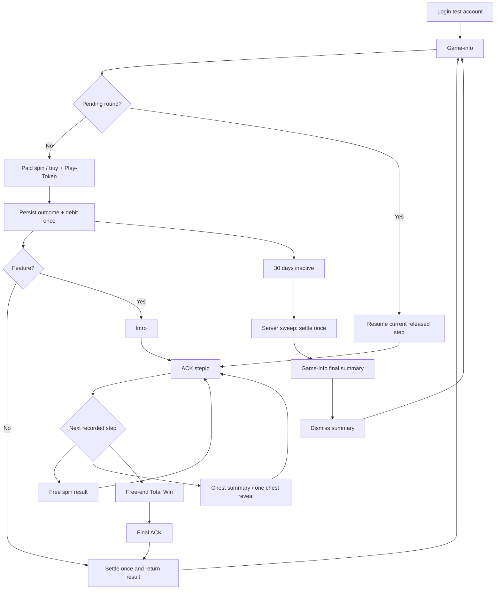

# Localhost backend theo FE–BE proposal

Implementation cho [FE-BE-Proposal](FE-BE-Proposal.md), revision `v1-review-6`. Đây là backend synthetic để review contract với Team A, chưa phải math/wallet production. Những ví dụ cũ dùng `spinWinMinor` không thay thế tên mới `totalwin_amt` và `winLines[].win_amt` trong proposal.

Update: mọi POST từ FE dùng URL sạch và gửi `gameCode` trong JSON, bao gồm login, spin, buy-feature và các ACK. Ví dụ `POST /api/v1/spin` với `{"gameCode":"tavern-drop","isFreespin":0,"betMinor":1000,"chanceMode":"normal"}`. Game-info/status cũng dùng POST với body JSON; URL của toàn bộ API v1 không có query parameters. Xem [framework/resource extension](framework-gen3-review.md).

## Chạy

Node >=22.18, chạy tại repository root:

```powershell
npm ci
npm start
```

API: `http://localhost:4000/api/v1`. `npm run dev` cũng mở backend này và Vite ở port 5173, proxy `/api` về 4000. Muốn chạy BE riêng song song với backend cũ:

```powershell
$env:PORT = '4350'
$env:MOCK_API_DATA_FILE = '.runtime/backend-local-v1.json'
npm start
```

Không cần database ngoài. Round, kết quả, ACK receipts, session và ví test nằm trong JSON ở `.runtime/backend-v1.json` (hoặc `MOCK_API_DATA_FILE`). File được flush và atomic rename trước khi trả thành công. Restart cùng file sẽ giữ tiến độ. Chỉ chạy **một process trên mỗi data file**, local store chưa hỗ trợ nhiều worker/instance. Muốn reset hãy dừng process trước rồi đổi đường dẫn data file. `.runtime` không được commit.

## Đăng nhập và gọi API

```powershell
$base = 'http://localhost:4350/api/v1'
$login = Invoke-RestMethod "$base/login" -Method Post -ContentType 'application/json' -Body '{"gameCode":"tavern-drop","userId":"client-review"}'
$headers = @{ 'Session-Id' = $login.sessionId; Authorization = "Bearer $($login.token)" }
$info = Invoke-RestMethod "$base/game-info" -Method Post -ContentType 'application/json' -Body '{"gameCode":"tavern-drop"}' -Headers $headers
$headers['Play-Token'] = $info.playToken
$result = Invoke-RestMethod "$base/buy-feature" -Headers $headers -Method Post -ContentType 'application/json' -Body '{"gameCode":"tavern-drop","betMinor":1000,"featureMode":"drop"}'
$result | ConvertTo-Json -Depth 15
# Sau khi FE trình diễn xong intro, ACK để nhận kết quả free spin đầu tiên:
$ack = @{ gameCode = 'tavern-drop'; isFreespin = 1; curStep = $result.freegame.curStep; stepId = $result.stepId } | ConvertTo-Json
$result = Invoke-RestMethod "$base/spin" -Headers $headers -Method Post -ContentType 'application/json' -Body $ack
# Mở lại game-info để kiểm tra resume đúng kết quả vừa phát.
Invoke-RestMethod "$base/game-info" -Method Post -ContentType 'application/json' -Body '{"gameCode":"tavern-drop"}' -Headers $headers | ConvertTo-Json -Depth 15
```

Login `{"gameCode":"tavern-drop"}` chọn ngẫu nhiên một trong 5 tài khoản demo; lưu `userId` để đăng nhập lại đúng tài khoản. Local mock chấp nhận test ID trực tiếp; production phải thay bằng launch-token validation của A. Không đưa mock identity vào môi trường có tiền thật.

| Endpoint | Body / hành vi |
| --- | --- |
| POST `/login` | `{ "gameCode": "tavern-drop", "userId": "client-review" }`; bỏ userId để chọn tài khoản demo |
| POST `/game-info` | `{ "gameCode": "tavern-drop" }`: Settings, lastReels, ví đã xác nhận, entitlement, resume |
| POST `/spin` | Paid: `{ "isFreespin": 0, "betMinor": 1000, "chanceMode": "normal" }` + Play-Token |
| POST `/buy-feature` | `{ "betMinor": 1000, "featureMode": "tavern" }` + Play-Token; cũng hỗ trợ `drop` |
| POST `/spin` | ACK: `{ "isFreespin": 1, "curStep": "freespin", "stepId": "BE-issued UUID" }`; optional `kind: "shown_as_result"` |
| POST `/rounds/status` | `{ "gameCode": "tavern-drop" }`: Ví, settlement, released/presented cursors; không phát thêm bước |
| POST `/spin` | Dismiss expired summary: `{ "isFreespin": 0, "curStep": "final-summary", "summaryId": "BE-issued UUID" }` |

Các request sau login gửi `Session-Id` + `Authorization: Bearer <token>`. `gameCode` bắt buộc nằm trong JSON body của mỗi request; `reuse` là config 3×3. API trả 400 khi URL chứa query hoặc body thiếu gameCode, và 405 khi gọi GET. Header transport là lựa chọn cho local review, chờ A xác nhận. Paid Spin và Buy Feature dùng chung entitlement Play-Token. Retry giữ nguyên token/body; thay payload trên token đã dùng trả 409 `REQUEST_CONFLICT`. ACK không mang `betMinor` và không cần Play-Token. Sau final ACK, lấy token mới từ response hoặc game-info.

## Money và presentation

- KRW, exponent 0: `1000` là ₩1,000. Allowed bets hiện tại: 100, 500, 1000, 2000, 5000, 10000. Ví synthetic ban đầu ₩10,000,000. `settings.chancePrices`/`buyPrices` là **hệ số giá**, `chargedMinor` là số tiền xác nhận.
- `reels` là numeric ID row-major; vị trí ô và lineId bắt đầu từ 1. Scatter ID 11; Wild ID 1. Mock hiện chỉ có Scatter trigger, không trả tiền Scatter riêng nên không tạo entry `S` giả.
- Snapshot và settings của round được lưu; `configId` chứa hash config. `winLines`, `totalwin_amt` mô tả khoản thắng của spin; `freegame.totalWinMinor` là tổng đang trình diễn, có base win và feature. `wallet.confirmedBalanceMinor` chỉ là tiền đã ghi nhận.
- Một debit và một settlement mỗi paid round. Normal không trigger được settle ngay. Feature trả pending cho tới ACK `free-end` hoặc auto-close. Cap 10,000 × base bet, kể cả bonus buy; không dùng giá mua làm cơ sở cap.
- BE tạo và lưu toàn bộ kết quả trước response đầu, nhưng chỉ phát một bước tại mỗi ACK. Giữ nguyên outcome khi restart/retry/turbo. Chest mới chỉ lộ multiplier khi đến bước của rương đó.
- Cursors là ordinal bắt đầu từ 1, `stepId` là UUID opaque. Base spin được cấp cùng intro (nếu có feature), intro cần ACK. Không gửi API theo frame. Một ACK sau intro, mỗi free spin, chest summary, mỗi chest reveal, total win.
- Resume `freespin`: `show_stored_result`, board/win/keys/count đều sau lượt vừa phát. Resume chest: snapshot ở bước đã ACK, chỉ replay rương đang phát. ACK khi animation và số tiền đã hoàn tất, kể cả skip/turbo; không tính lại kết quả ở FE.
- Inactivity 30 ngày tính từ wager hoặc ACK mới hợp lệ. Request poll/status và duplicate không gia hạn. Sweeper mỗi phút và lúc startup quyết toán độc lập trình duyệt; khi process dừng, xử lý quá hạn ở lần startup kế. Sau auto-close, phải dismiss final summary trước cược mới.
- Receipt retry trả response đã lưu của request đó; có thể cũ hơn trạng thái hiện tại. FE dùng roundId/cursors để bỏ response đến trễ và gọi game-info nếu cần đối chiếu.



## Phạm vi tích hợp

Tavern và config 3×3 đã dùng `routing.contract: "proposal-v1"` trong JSON. Adapter dùng chung tại `src/framework/transport/proposal.ts`; game chỉ custom trình diễn. Bỏ field contract trong config để dùng legacy `HttpTransport` cho module chưa chuyển đổi.

FE login bằng test identity UUID lưu trong localStorage, áp settings/bets/currency từ BE trước khi dựng controls. Paid request giữ token cùng requestId trước khi gửi. ACK chỉ gửi khi trình diễn xong; response chứa free spin tiếp được giữ đến lịch auto spin, còn bước chest/total win được trình diễn nối tiếp. Reload dùng game-info để restore đúng bước. Khi mất ACK response, recovery đọc bước BE đang phát thay vì diễn lại lượt đã hoàn tất. Final ACK xong mới cập nhật ví theo số BE xác nhận.

`formatMoney` dùng currency code/exponent/locale, hiện KRW có ₩, dấu phân cách hàng nghìn và không có phần thập phân. UI không tự tính payout. Đổi/quên test identity (clear localStorage) tạo tài khoản khác; production sẽ dùng launch identity từ operator.

Chạy local mặc định: `npm run dev`, mở `http://localhost:5173/?game=tarvern` hoặc `?game=default`. Khi chạy BE riêng ở 4350, đặt `$env:LOCAL_API_ORIGIN='http://127.0.0.1:4350'` trước khi mở Vite.

Production còn cần A chốt auth, bet steps/rounding, math, wallet integration, database transactions/concurrency, session expiry, retention, job runner và ledger reconciliation. Sweep local không thay thế scheduler luôn hoạt động của production.

Kiểm tra: `npm test` (durable retry, resume, chest, single settlement, inactivity), `npm run build`. Các ví dụ và số tiền đều synthetic.
