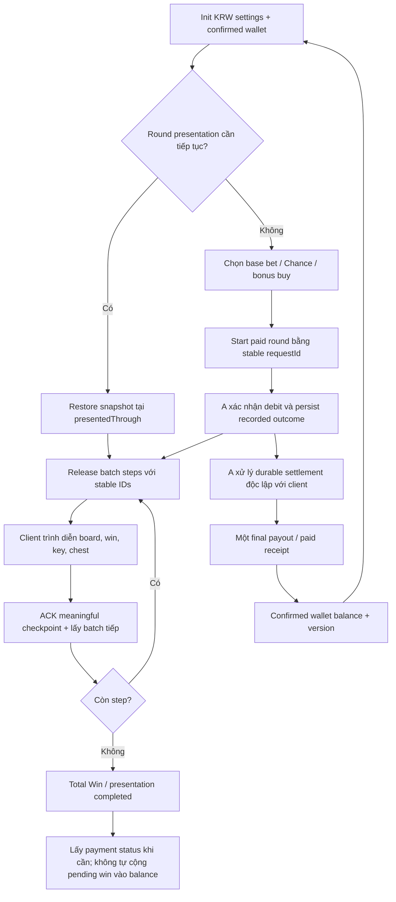
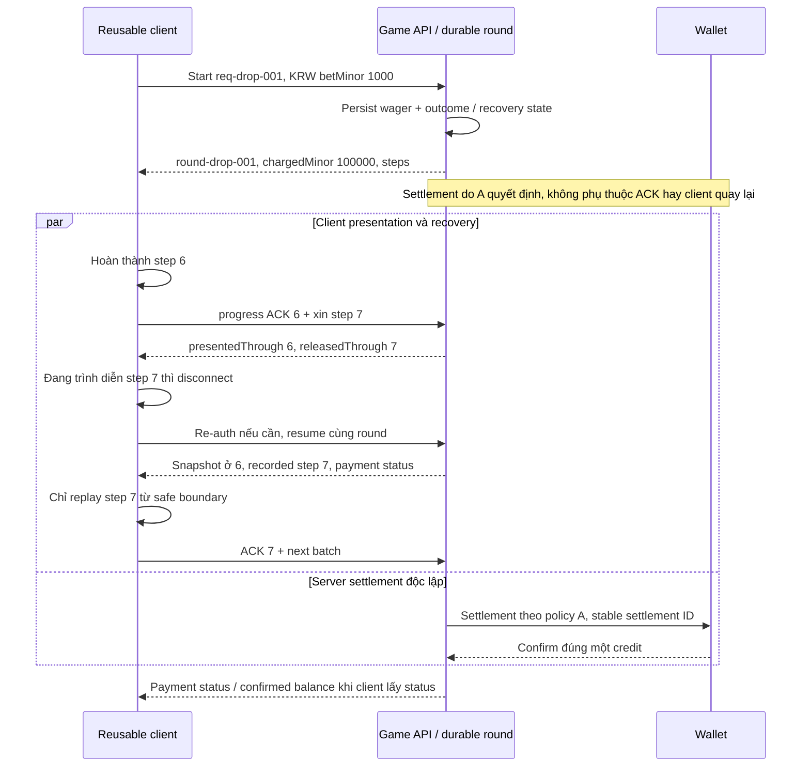
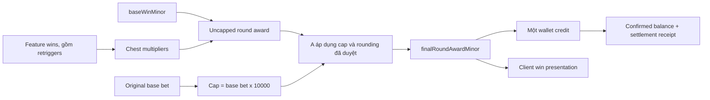

# BE requirements and proposed API — KRW, mid-round resume, single settlement

**Bản tham khảo trước khi khách chốt.** Dùng [bản BE/FE hiện tại](game-and-api-flow-krw.md) cho lần review tiếp theo. Bản mới phát riêng kết quả từng rương, thanh toán sau khi presentation hoàn tất và tự đóng round sau 30 ngày không hoạt động thật.

**Cập nhật format symbol/line.** Draft review mới dùng `reels` phẳng theo hàng và `winLines` với vị trí ô từ 1. Các ví dụ board hai chiều bên dưới thuộc bản trước. [Quy ước BE–FE hiện tại](game-and-api-flow-krw.md#format-reels-và-winlines)

**Luồng đề nghị dùng cho buổi review hiện tại** nằm trong [Game flow và API](game-and-api-flow-krw.md). Bản đó dùng login → gameInfo, gộp snapshot resume vào gameInfo và xác định checkpoint cho từng rương. Các ví dụ dưới đây lưu lại phương án trước để đối chiếu field và yêu cầu.

Ngày cập nhật 18/11/2026. Đối tượng review là team A, client developer và math specialist.

**Yêu cầu khách hàng được phân tích dưới đây là đầu vào scope. Endpoint, tên field, enum, checkpoint và lịch settlement trong phần đề xuất cần team A review để thống nhất một contract version. Các JSON đều là synthetic development examples, chưa phải final Kai math hoặc API đã triển khai.**

**Ví dụ mock gốc đã chú thích để gửi review:** [backend-mock-examples-client-review.md](backend-mock-examples-client-review.md). Các ví dụ gốc và draft KRW mới có mục đích khác nhau: mock thể hiện code đang chạy, còn draft là đề xuất chưa tích hợp.

### Rà soát yêu cầu: đã chốt và còn cần thống nhất

**Đã chốt bởi khách hàng:** resume đúng round/free-spin/chest progress; một final payout cho paid round gồm base + feature; cap 10.000 × base bet gốc kể cả bonus buy; outcome bất biến qua reconnect/skip/turbo/duplicate/lost response; progress không tạo bet hay payout; server bảo toàn winnings và settlement không phụ thuộc duy nhất vào client quay lại hoặc animation-complete; pending win tách khỏi confirmed balance; KRW exponent 0 và UI ₩ có dấu phân tách, không thập phân, kiểm tra cả số dài trên mobile; formatter currency cấu hình được. Team A owns outcome/wallet/server recovery, phía client owns presentation/checkpoint. Customer yêu cầu gửi các **mock example hiện có có chú thích missing fields**, kèm cách phân biệt release với presentation và tần suất request dự kiến.

**Đề xuất, chưa được khách hàng/A chốt:** tên endpoint và fields bên dưới; `requestId`, step ID và hai cursor cụ thể; checkpoint theo một spin; cơ chế ACK/batching/lookup, quote, walletVersion, idempotency key và enum status; thời điểm định sẵn toàn bộ outcome, mức độ release dữ liệu và retention. Việc backend xác nhận checkpoint là một thiết kế cần review, không phải một giao thức đã được khách hàng phê duyệt. `chest: [1, 1, 1, 1, 1]` trên từng spin và multiplier cuối trong spin cuối là yêu cầu thiết kế của TPT trong cuộc trao đổi này, cần A xác nhận khi thống nhất contract. `keyRowsByReel` là đề xuất để resume chính xác vị trí key, không phải mảng multiplier thứ hai.

**Cần chốt, không tự suy diễn:** thời điểm credit wallet và khi UI refresh balance; trường hợp zero-win/thất bại; rounding, bet steps, charge Chance/buy và xử lý cap; mapping symbol/line; cơ chế bảo toàn payout nếu người chơi không quay lại; multi-device và thời gian lưu receipt. Đặc biệt, khách hàng yêu cầu free spin **đã hoàn tất không restart**. Nếu mất kết nối đúng giữa completion và xác nhận checkpoint, cần cùng A chốt ranh giới completion và cách đảm bảo yêu cầu đó; không tự coi việc replay một spin đã hoàn tất là đã được khách hàng chấp thuận.

## 1. Tài liệu và implementation đã đối chiếu

- [M1 mock API](milestone-1-api.md) và [JSON mock hiện có](milestone-1-api-examples.json) mô tả format đang chạy.
- [Compact API draft](proposed-compact-api.md) và [JSON draft](proposed-compact-api-examples.json) là đề xuất cũ, có USD/scale 2 và giả định credit base win riêng.
- [Resumable client proposal](resumable-round-client-proposal.md) đã đề xuất release cursor, presentation checkpoint và một payout toàn round. Tài liệu này bổ sung KRW/exponent 0 và các ví dụ cụ thể cho yêu cầu mới.
- [HAR reference](tavern-reference-har-analysis.md) ghi nhận một round game gốc. HAR đó chưa chứng minh được cơ chế resume, bảo toàn payout hoặc rounding cần dùng cho dự án.
- Source đã đọc gồm [contracts](../src/framework/domain/contracts.ts), [controller](../src/framework/controller.ts), [transport](../src/framework/transport/http.ts), [mock](../server/mock-game.ts), [HTTP server](../server.js) và [game config](../src/games/tavern/game.config.json).

Khi có khác biệt, dùng yêu cầu khách hàng mới về KRW, cap 10.000× và single final settlement để review contract tiếp theo. Các example cũ giữ giá trị tham khảo cho việc mapping implementation.

| Nội dung | Client/mock hiện có | Khoảng thiếu so với yêu cầu |
| --- | --- | --- |
| Init và spin | GET /api/session, POST /api/command, cookie HttpOnly | Chưa có envelope version, currency/exponent, charged amount và payment status rõ ràng |
| Retry | Giữ exact request trong local storage, retry requestId; mock giữ receipt trong RAM | Chưa có durable request lookup sau restart/session change |
| State | Board, remaining/played, accumulated, key rows, chest multiplier | Chưa có snapshot tại presentation checkpoint hoặc release cursor |
| Resume | Load snapshot mới nhất; giữ request chưa rõ kết quả | Nhận response xong là xóa pending request, chưa lưu bước animation đã hoàn thành lên BE |
| Wallet | Base win có thể credit riêng; feature credit lúc kết thúc | Cần đúng một settlement cho base + linked feature/retrigger/chest |
| Currency và cap | UI chia 100, có ký hiệu $, config capMultiplier = 5000 | Chưa triển khai KRW/exponent 0 hoặc cap 10.000× trong runtime |

**Deliverable này là tài liệu yêu cầu và format đề xuất. Việc đổi wallet, currency formatter và resume adapter trong runtime là phần implementation tiếp theo.** Team A đã có groundwork synthetic theo trao đổi của khách hàng; tài liệu này không xác nhận code hoặc database nội bộ của A.

## 2. Phân tích yêu cầu và trách nhiệm

| ID | Yêu cầu và hành vi cần đạt | Trách nhiệm |
| --- | --- | --- |
| BE-01 | Reload/reconnect khôi phục cùng paid round, remaining spins, accumulated win, board, key/chest và bonus phase | A lưu durable state/outcome; client restore đúng checkpoint |
| BE-02 | Free spin đã hoàn tất không chạy lại; chỉ presentation chưa hoàn tất có thể replay từ safe boundary được thống nhất | Client đánh dấu hoàn thành; A và client cùng chốt boundary, persistence và xử lý mất ACK |
| BE-03 | Một paid round gồm base game, toàn bộ linked free spins, retriggers và chest. Credit final payout đúng một lần | A và wallet |
| BE-04 | Cap toàn round = 10.000 × original base bet, kể cả buy bonus | A và math specialist |
| BE-05 | Reconnect, skip/turbo, duplicate/lost response giữ nguyên recorded outcome; request progress không tạo wager/payout | A đảm bảo idempotency và recovery; client dùng lại exact request |
| BE-06 | Đóng browser không làm mất winnings; settlement không phụ thuộc duy nhất vào animation-complete hoặc việc người chơi quay lại | A xác định server settlement/round-close và xử lý interruption |
| BE-07 | Feature accumulation, round award, confirmed credit và confirmed wallet balance có ngữ nghĩa riêng | A trả authoritative fields; client hiển thị đúng |
| BE-08 | First game dùng KRW, currencyExponent = 0, hiển thị ₩1,000 và không có số lẻ | Currency/formatting ở reusable client; A xác nhận currency/amount |
| BE-09 | Giữ examples trong API thread hiện có, gửi format hiện có kèm missing fields, thống nhất một version | Client chuẩn bị mapping/examples; A review |

Hướng resumable client phù hợp scope đã trao đổi trong [proposal trước](resumable-round-client-proposal.md). Cơ chế settlement durable thuộc BE. Các lựa chọn protocol mới dưới đây cần được hai bên duyệt trước khi tích hợp.

## 3. Tiền, KRW và multiplier

- Mọi field kết thúc bằng Minor là số nguyên trong đơn vị nhỏ nhất của currency. Với KRW và exponent 0, betMinor = 1000 nghĩa là ₩1,000, không chia cho 100.
- Init trả currency, currencyExponent, allowedBetMinor và các mức giá server xác nhận. Client chỉ gửi mức base bet/mode yêu cầu; response xác nhận baseBetMinor, chargedMinor, payout và balance.
- Chance charge và bonus buy price là tiền. Ví dụ hệ số giá mua 100× tại base ₩1,000 cho chargedMinor = 100000. Hệ số giá mua phải tách biệt với payout multiplier.
- roundCapMinor = originalBaseBetMinor × roundCapMultiplier. Ví dụ base ₩1,000, mua giá ₩100,000, cap vẫn ₩10,000,000.
- `chest` và `roundCapMultiplier` là hệ số không có currency. Hiển thị multiplier là 5× thay vì ₩5. payoutMultiplier, nếu BE trả, cũng là hệ số và không thay cho finalRoundAwardMinor.
- Client không tự làm tròn tiền để quyết định payout. A và math specialist chốt bet steps, rounding stage/mode và quy tắc cap trước integration. Các field tiền dưới đây có giá trị nguyên an toàn trong JavaScript; nếu BE cần vượt Number.MAX_SAFE_INTEGER, phải đổi schema tiền sang decimal string thống nhất.

Formatter dùng currency/exponent do init xác nhận. Với KRW có thể cấu hình Intl.NumberFormat theo locale ko-KR, currency KRW, minimumFractionDigits = maximumFractionDigits = 0. Nghiệm thu ký hiệu ₩ và grouping trên thiết bị đích.

UI cần áp dụng cùng formatter cho Balance, Bet, Chance charge, bonus-buy price, mỗi spin win, feature accumulation, chest result, Big Win series, Total Win và history. Mobile cần thử ₩1,000, ₩100,000, ₩10,000,000, ₩999,999,999 ở portrait/landscape, gồm các ô HUD và popup. Dùng căn phải/tabular digits, fit chữ hoặc nới ô có kiểm soát để giữ đầy đủ amount.

**Kết quả rà runtime sau pull:** `tavern/app.ts` và Basic skin hiện vẫn format scale 2; shop/share còn có `$` cố định, và màn kết thúc có đoạn nội suy lại balance dựa trên `paidAward` của mock. Phần này chưa đáp ứng KRW hay cơ chế confirmed balance/payment status mới. Các bitmap font `td_gold`, `td_green`, `td_red` có dấu phẩy nhưng không khai báo glyph `₩` (U+20A9); cần thiết kế cách hiển thị ký hiệu hoặc fallback font phù hợp cho các số gắn Spine, sau đó kiểm tra kích thước dài trên mobile. Không chỉ đổi nhãn `$` hoặc bỏ `/100`, vì data scale, quote, rounding và quyền sở hữu số tiền phải đồng bộ với contract A.

## 4. Ba trạng thái độc lập

| Nhóm | Field đề xuất | Ý nghĩa |
| --- | --- | --- |
| Recorded/released outcome | releasedThrough, steps[].stepId | Server đã persist và release bước kết quả nào |
| Presentation | presentedThrough, snapshotAtPresented, nextStepId | Checkpoint cuối đã được server xác nhận; bước nào client cần tiếp tục |
| Money | result, settlement.status, wallet.confirmedBalanceMinor | Kết quả cuối, trạng thái credit và balance thật do BE xác nhận |

Luôn có 0 ≤ presentedThrough ≤ releasedThrough. Step IDs trong một round giữ nguyên qua retry/reconnect. Client không suy ra presentedThrough từ việc nhận response, reel đã dừng riêng lẻ hoặc từ wallet đã paid.

Một server có thể đã release tất cả steps và settle trong khi client mới trình diễn vài free spins. Khi resume, snapshot phải tương ứng presentedThrough, không lấy state cuối để bỏ qua các presentation chưa được ACK.

Nếu animation đã hoàn tất nhưng ACK chưa tới server, client retry exact checkpoint request. Nếu request đã commit, server trả cursor mới. Nếu chưa commit và client mất local receipt, snapshot phía server có thể chưa phản ánh presentation đã hoàn tất. Đây là khoảng hở cần A/client thống nhất thiết kế checkpoint và xử lý crash để đáp ứng yêu cầu không restart free spin đã hoàn tất; **không xem replay một spin đã hoàn tất là đã được khách hàng chấp thuận**. Hệ thống cũng không thể chứng minh người chơi đã nhìn thấy từng frame.

### Checkpoint đề xuất

| Step type | Ranh giới hoàn thành | State cần giữ |
| --- | --- | --- |
| base_spin | Reel, line/scatter win hoàn tất | Board, baseWinMinor, original bet, trigger outcome |
| bonus_enter | Đã Continue và transition vào free game hoàn tất | Mode, total/played/remaining, accumulated win, chest state |
| free_spin | Reel, win, key/chest activation và retrigger của spin đó hoàn tất | Board sau spin, spinWinMinor, remaining, accumulated win, key rows, retrigger |
| chest_result | Đã mở các chest đủ điều kiện, áp dụng multiplier theo kết quả BE và trình diễn tổng cuối | State sau spin cuối, multiplier từng reel, raw/capped award |
| total_win | Đã Continue, outro và quay về normal hoàn tất | Final result, presentation done, payment status gần nhất |

Free spin là đơn vị checkpoint mặc định. Nếu có retrigger popup +5 thì nó thuộc cùng step free_spin, tránh ACK spin trước khi cập nhật số lượt. Checkpoint riêng chest_result giúp ngắt giữa mở rương chỉ replay chest, giữ nguyên spin cuối đã hoàn tất.

## 5. Protocol tối thiểu đề xuất

Tên path là draft, dùng contractVersion = krw-resume-draft-1 trên mọi envelope. Xác thực dựa trên cơ chế A cung cấp; các ví dụ không chứa token thật.

| Request | Vai trò | Có thể tạo giao dịch tiền? |
| --- | --- | --- |
| GET /api/v1/session | Init/refresh; settings, confirmed wallet, round cần resume và pending start requests | Không |
| POST /api/v1/rounds | Chấp nhận một paid action mới với requestId duy nhất | Có, server xác nhận wager một lần |
| POST /api/v1/rounds/{roundId}/progress | ACK bước hoàn thành và đồng thời xin batch kế tiếp | Không |
| GET /api/v1/rounds/{roundId}/resume | Restore snapshot tại checkpoint, lấy steps chưa trình diễn, wallet/payment status | Không |
| GET /api/v1/requests/{requestId} | Resolve start/progress response bị mất theo phạm vi account/game | Không |
| GET /api/v1/rounds/{roundId}/status | Payment receipt, outcome và presentation status khi cần refresh | Không |

Ưu tiên BE persist full outcome rồi release batch phù hợp. Nếu A release từng bước, A cần xác định cách hoàn tất outcome và settlement khi client rời đi. Phần release không được chặn xử lý tiền do client chưa ACK.

Progress ACK phải monotonic, không vượt releasedThrough, không nhảy qua step chưa hoàn thành. Dùng expectedPresentedThrough để phát hiện hai thiết bị/tab cùng tiến cursor. Một request checkpoint có thể ACK nhiều steps liên tiếp nếu policy được thống nhất, đổi lại sẽ replay cả batch chưa ACK khi interruption.

### Tần suất dự kiến

- Một init mỗi lần mở hoặc reconnect. Một start cho mỗi paid round.
- Phương án tham khảo, chưa tối ưu/chốt: một progress request sau mỗi meaningful step, gộp ACK và next batch. Một bonus 10 spins có base + bonus_enter + 10 free_spin + chest_result nếu có + total_win, tức 13–14 progress requests, cộng start. Retrigger thêm số free_spin thực tế. Đây là phép đếm cho phương án đó, không phải tần suất bắt buộc hay số round trip tối thiểu đã được xác nhận.
- Tìm cách giảm round trips bằng batch events và piggyback ACK. Không batching ACK nhiều free spins theo cách có thể replay các spin đã hoàn tất nếu chưa chứng minh phù hợp yêu cầu khách hàng và được A/customer duyệt.
- Không request cho frame, line win, key riêng lẻ, từng multiplier bay hoặc thao tác turbo. Skip hoàn tất presentation cùng outcome rồi ACK tại ranh giới tương ứng.
- Payment status lấy cùng init/progress/resume khi đủ mới. Nếu cần polling, A xác nhận interval/backoff/timeout; client tôn trọng retryAfterMs và không polling khi tab offline.

## 6. Proposed envelope và mapping

| Field | Owner | Ý nghĩa |
| --- | --- | --- |
| requestId | Client tạo, A persist/dedupe | Stable ID cho một logical write, giữ qua timeout/retry |
| roundId | A | Một paid round duy nhất, giữ xuyên feature/retrigger/chest |
| outcomeId, outcomeVersion | A | Nhận diện recorded outcome bất biến; không đổi khi skip/turbo |
| originalBaseBetMinor | A xác nhận | Mốc cap và bet khóa trong feature |
| chargedMinor | A | Tổng wager thực trừ cho paid action; progress không charge |
| releasedThrough / presentedThrough | A xác nhận | Release cursor / presentation ACK cursor |
| steps[].board, featureAfter | A | Board và feature state sau đúng step đó, dùng restore và validate presentation |
| lineWins[].amountMinor, spinWinMinor | A | Payout line / toàn spin; không có nghĩa đã credit |
| keyRowsByReel | A hoặc mapping được A duyệt | Vị trí key theo từng row/reel, cần cho resume và xác định chest đủ điều kiện |
| steps[].chest | A | Một mảng 5 multiplier theo reel cho mỗi kết quả spin; mặc định `[1, 1, 1, 1, 1]`, spin cuối thực tế trả multiplier cuối |
| featureWinBeforeMultipliersMinor, featureAwardMinor | A | Tổng feature trước multiplier / phần feature đã tính cap |
| finalRoundAwardMinor | A | Final payout cả paid round sau cap, gồm base + feature |
| settlement.status, creditedMinor, settlementId | A/wallet | Pending/paid/zero-win và receipt, theo enum A duyệt |
| wallet.confirmedBalanceMinor, walletVersion | A/wallet | Số dư xác nhận và version đơn điệu chống response cũ |

Mapping mock hiện tại: bet → originalBaseBetMinor, wins[].amount → amountMinor, spinWin → spinWinMinor, feature.accumulated → featureWinBeforeMultipliersMinor, chests[].rows → keyRowsByReel, completion.roundAward → finalRoundAwardMinor. Các field mock là scale 2; khi chuyển runtime sang KRW cần mapping currency rõ ràng, không chỉ đổi ký hiệu $ thành ₩.

Chưa có field tương ứng cho chargedMinor, payment status/receipt, durable outcome ID, checkpoint, snapshotAtPresented và walletVersion. Chúng là đề xuất BE mới. State.version hiện có phục vụ concurrency command, không tự tương đương presentation cursor.

Board dùng board[reel][row], reel/row từ 0, trái sang phải và trên xuống dưới. Đề xuất giữ symbol IDs dạng chuỗi của config hiện có, ví dụ A, K, Q, J, 10, wild, bonus. bonus là Scatter. Payline ID là index từ 0 của line mapping version do init xác nhận. Không mặc định áp dụng bảng numeric symbol hoặc 40 lines từ compact draft cũ. Current Tavern config có 5 reels × 5 rows và 15 lines.

Theo lựa chọn client đã nêu, `chest` chỉ là **một mảng multiplier**, không gửi thêm `finalMultipliers` hay `chestUnlocked` trùng lặp. Mỗi `base_spin`/`free_spin` trả mảng này: trước spin kết thúc là `[1, 1, 1, 1, 1]`; spin cuối thực tế, kể cả kết thúc sớm vì cap, trả giá trị cuối như `[5, 1, 1, 1, 1]`. `snapshotAtPresented` cũng giữ mảng tương ứng với checkpoint, nhất là sau spin cuối nhưng trước chest reveal. `1` là multiplier identity, không phản ánh key đã thu; `keyRowsByReel` là dữ liệu key riêng để resume và xác định rương đủ điều kiện. Trường hợp rương unlock có thể nhận ×1 hay không cần A/math xác nhận, không suy ra unlock chỉ từ giá trị multiplier. Không chest đủ điều kiện thì giữ mảng 1 và bỏ animation mở rương. Đảm bảo multiplier cuối do BE lưu ổn định trước mọi retry/reconnect, nhưng chỉ release ở thời điểm được thống nhất.

## 7. Concrete synthetic examples

Mọi amount là integer KRW, currencyExponent = 0. Ví dụ giá Chance/buy, line payouts và chest multiplier chỉ để kiểm tra mapping. Không mô tả certified math. JSON dùng cùng board mapping, snapshot có đủ board và key rows; step ví dụ độc lập được ghi rõ khi rút gọn các steps trước đó.

### 7.1 Session/init

GET /api/v1/session

```json
{
  "code": 0,
  "contractVersion": "krw-resume-draft-1",
  "synthetic": true,
  "sessionId": "session-demo",
  "settings": {
    "gameCode": "tavern-drop",
    "currency": "KRW",
    "currencyExponent": 0,
    "locale": "ko-KR",
    "allowedBetMinor": [100, 500, 1000, 5000],
    "defaultBetMinor": 1000,
    "roundCapMultiplier": 10000,
    "quoteId": "quote-001",
    "quotes": [
      {"baseBetMinor": 1000, "mode": "base", "chance": "standard", "chargedMinor": 1000},
      {"baseBetMinor": 1000, "mode": "base", "chance": "extra", "chargedMinor": 2000},
      {"baseBetMinor": 1000, "mode": "base", "chance": "super", "chargedMinor": 5000},
      {"baseBetMinor": 1000, "mode": "buy_tavern", "chance": "standard", "chargedMinor": 50000},
      {"baseBetMinor": 1000, "mode": "buy_drop", "chance": "standard", "chargedMinor": 100000}
    ],
    "boardMappingVersion": "tavern-symbols-draft-1",
    "paylineMappingVersion": "tavern-15-lines-draft-1",
    "reels": 5,
    "rows": 5
  },
  "wallet": {"confirmedBalanceMinor": 1000000, "walletVersion": 40},
  "resumableRound": null,
  "pendingRequests": []
}
```

Quotes là option đề xuất để UI hiển thị charge server-confirmed. A quyết định TTL và scope. Quote hết hiệu lực cần refresh trước khi người chơi xác nhận lại; không âm thầm charge mức cao hơn. Nếu chưa có quote field, đây là khoảng cần bổ sung khi chốt contract.

### 7.2 Normal spin có win

POST /api/v1/rounds — request chỉ yêu cầu wager/mode, không gửi kết quả hoặc số dư.

```json
{
  "contractVersion": "krw-resume-draft-1",
  "requestId": "req-normal-001",
  "gameCode": "tavern-drop",
  "quoteId": "quote-001",
  "mode": "base",
  "chance": "standard",
  "betMinor": 1000
}
```

```json
{
  "code": 0,
  "contractVersion": "krw-resume-draft-1",
  "synthetic": true,
  "requestId": "req-normal-001",
  "roundId": "round-normal-001",
  "outcomeId": "outcome-normal-001",
  "outcomeVersion": 1,
  "currency": "KRW",
  "currencyExponent": 0,
  "originalBaseBetMinor": 1000,
  "chargedMinor": 1000,
  "roundCapMinor": 10000000,
  "outcomeStatus": "final",
  "presentationStatus": "pending",
  "releasedThrough": 1,
  "presentedThrough": 0,
  "steps": [{
    "stepId": 1,
    "type": "base_spin",
    "board": [
      ["A", "K", "K", "K", "K"],
      ["A", "Q", "Q", "Q", "Q"],
      ["A", "J", "J", "J", "J"],
      ["K", "K", "K", "K", "K"],
      ["Q", "Q", "Q", "Q", "Q"]
    ],
    "lineWins": [{
      "paylineId": 0,
      "symbolId": "A",
      "positions": [{"reel": 0, "row": 0}, {"reel": 1, "row": 0}, {"reel": 2, "row": 0}],
      "amountMinor": 2500
    }],
    "spinWinMinor": 2500,
    "baseWinMinor": 2500,
    "chest": [1, 1, 1, 1, 1],
    "featureAfter": null
  }],
  "result": {"finalRoundAwardMinor": 2500, "capped": false},
  "settlement": {"status": "pending", "creditedMinor": 0, "settlementId": null},
  "wallet": {"confirmedBalanceMinor": 999000, "walletVersion": 41}
}
```

paylineId 0 và payout là fixture synthetic có chủ đích để minh họa highlight; payout không lấy từ paytable mock hiện tại và không khẳng định là payout của final math. Tại đây BE đã trừ ₩1,000, win ₩2,500 vẫn pending.

### 7.3 Buy Drop và bonus progression

Start request dùng req-drop-001, mode buy_drop, betMinor 1000, chance standard. Server xác nhận roundId round-drop-001, chargedMinor 100000, originalBaseBetMinor 1000, roundCapMinor 10000000, balance sau charge 900000. Đây là round độc lập với normal example.

POST /api/v1/rounds

```json
{
  "contractVersion": "krw-resume-draft-1",
  "requestId": "req-drop-001",
  "gameCode": "tavern-drop",
  "quoteId": "quote-001",
  "mode": "buy_drop",
  "chance": "standard",
  "betMinor": 1000
}
```

Start response dùng envelope mục 7.2 với các giá trị buy đã nêu, outcomeId = outcome-drop-001. Step 1 chứa board trigger được server ghi nhận và `chest: [1, 1, 1, 1, 1]`; step 2 có type bonus_enter và featureAfter ban đầu với mode drop, totalSpins 10, playedSpins 0, remainingSpins 10, featureWinBeforeMultipliersMinor 0 và năm key-row arrays rỗng. Phần trigger board còn thiếu trong draft này; fixture cụ thể sẽ lấy từ recorded buy response của A.

Chuỗi step minh họa gồm 1 base_spin, 2 bonus_enter, 3–12 free_spin, 13 chest_result, 14 total_win. Ten spins không retrigger trong fixture này. Khi có retrigger, step IDs tiếp tục tăng và chest/total sẽ nằm sau free spin cuối thực tế.

Client đã hoàn thành bốn free spins, tương ứng step 6. Request progress sau đây ACK step 6 và xin step 7. Đây là ACK presentation, không phải spin/wager mới.

```json
{
  "contractVersion": "krw-resume-draft-1",
  "requestId": "req-drop-progress-006",
  "expectedPresentedThrough": 5,
  "presentedThrough": 6,
  "maxSteps": 1
}
```

POST /api/v1/rounds/round-drop-001/progress — response

```json
{
  "code": 0,
  "contractVersion": "krw-resume-draft-1",
  "synthetic": true,
  "requestId": "req-drop-progress-006",
  "roundId": "round-drop-001",
  "outcomeId": "outcome-drop-001",
  "outcomeVersion": 1,
  "currency": "KRW",
  "currencyExponent": 0,
  "releasedThrough": 7,
  "presentedThrough": 6,
  "steps": [{
    "stepId": 7,
    "type": "free_spin",
    "spinIndex": 5,
    "spinWinMinor": 2400,
    "chest": [1, 1, 1, 1, 1],
    "board": [
      ["A", "K", "K", "K", "K"],
      ["A", "Q", "Q", "Q", "Q"],
      ["A", "J", "J", "J", "J"],
      ["K", "K", "K", "K", "K"],
      ["Q", "Q", "Q", "Q", "Q"]
    ],
    "lineWins": [{
      "paylineId": 0,
      "symbolId": "A",
      "positions": [{"reel": 0, "row": 0}, {"reel": 1, "row": 0}, {"reel": 2, "row": 0}],
      "amountMinor": 2400
    }],
    "retriggerAdded": 0,
    "newKeyPositions": [{"reel": 2, "row": 0}],
    "featureAfter": {
      "mode": "drop",
      "totalSpins": 10,
      "playedSpins": 5,
      "remainingSpins": 5,
      "featureWinBeforeMultipliersMinor": 10240,
      "keyRowsByReel": [[0, 1, 2, 3, 4], [0, 1], [0], [], []]
    }
  }],
  "settlement": {"status": "pending", "creditedMinor": 0, "settlementId": null},
  "wallet": {"confirmedBalanceMinor": 900000, "walletVersion": 41}
}
```

Client hiển thị Win ₩2,400, Total Win ₩10,240 khi step 7 hoàn tất. Trước khi nhận ACK step 7, durable presentation cursor vẫn là 6. Ví dụ row 0 trên reel 0/1 đã có từ trước nên chỉ reel 2 là newKeyPositions.

### 7.4 Mid-round resume đúng ranh giới

Ngắt mạng trong animation của step 7. GET /api/v1/rounds/round-drop-001/resume trả

```json
{
  "code": 0,
  "contractVersion": "krw-resume-draft-1",
  "synthetic": true,
  "roundId": "round-drop-001",
  "outcomeId": "outcome-drop-001",
  "outcomeVersion": 1,
  "currency": "KRW",
  "currencyExponent": 0,
  "originalBaseBetMinor": 1000,
  "chargedMinor": 100000,
  "roundCapMinor": 10000000,
  "releasedThrough": 7,
  "presentedThrough": 6,
  "presentationStatus": "pending",
  "nextStepId": 7,
  "snapshotAtPresented": {
    "stepId": 6,
    "phase": "free_spins",
    "board": [
      [
        "K",
        "Q",
        "J",
        "10",
        "A"
      ],
      [
        "Q",
        "J",
        "10",
        "A",
        "K"
      ],
      [
        "J",
        "10",
        "A",
        "K",
        "Q"
      ],
      [
        "10",
        "A",
        "K",
        "Q",
        "J"
      ],
      [
        "A",
        "K",
        "Q",
        "J",
        "10"
      ]
    ],
    "lastSpinWinMinor": 1600,
    "baseWinMinor": 400,
    "chest": [
      1,
      1,
      1,
      1,
      1
    ],
    "feature": {
      "mode": "drop",
      "totalSpins": 10,
      "playedSpins": 4,
      "remainingSpins": 6,
      "featureWinBeforeMultipliersMinor": 7840,
      "keyRowsByReel": [
        [
          0,
          1,
          2,
          3,
          4
        ],
        [
          0,
          1
        ],
        [],
        [],
        []
      ]
    }
  },
  "settlement": {
    "status": "pending",
    "creditedMinor": 0,
    "settlementId": null
  },
  "wallet": {
    "confirmedBalanceMinor": 900000,
    "walletVersion": 41
  },
  "steps": [
    {
      "stepId": 7,
      "type": "free_spin",
      "spinIndex": 5,
      "spinWinMinor": 2400,
      "chest": [
        1,
        1,
        1,
        1,
        1
      ],
      "board": [
        [
          "A",
          "K",
          "K",
          "K",
          "K"
        ],
        [
          "A",
          "Q",
          "Q",
          "Q",
          "Q"
        ],
        [
          "A",
          "J",
          "J",
          "J",
          "J"
        ],
        [
          "K",
          "K",
          "K",
          "K",
          "K"
        ],
        [
          "Q",
          "Q",
          "Q",
          "Q",
          "Q"
        ]
      ],
      "lineWins": [
        {
          "paylineId": 0,
          "symbolId": "A",
          "positions": [
            {
              "reel": 0,
              "row": 0
            },
            {
              "reel": 1,
              "row": 0
            },
            {
              "reel": 2,
              "row": 0
            }
          ],
          "amountMinor": 2400
        }
      ],
      "retriggerAdded": 0,
      "newKeyPositions": [
        {
          "reel": 2,
          "row": 0
        }
      ],
      "featureAfter": {
        "mode": "drop",
        "totalSpins": 10,
        "playedSpins": 5,
        "remainingSpins": 5,
        "featureWinBeforeMultipliersMinor": 10240,
        "keyRowsByReel": [
          [
            0,
            1,
            2,
            3,
            4
          ],
          [
            0,
            1
          ],
          [
            0
          ],
          [],
          []
        ]
      }
    }
  ]
}
```

Response inline lại step 7 đã ghi như mục 7.3, tránh thêm một round trip khi resume. Nếu A chọn phân trang hoặc URL riêng, response phải giữ cùng outcomeId/version và không tạo outcome mới chỉ vì retry.

Restore step 6 trước, không restore featureAfter của step 7. Chỉ replay step 7 bằng recorded payload, không chạy scatter trigger hay bốn free spins trước. Snapshot cùng cursor là dữ liệu BE phải cung cấp; không tái dựng bằng RNG hoặc dựa duy nhất trên local storage.

### 7.5 Chest/final result

Fixture độc lập tiếp tục round-drop-001 tới step 11 đã ACK. Free spin cuối là step 12; tổng feature trước nhân là ₩12,000, base win ₩400 và chest đầu tiên mở 5×. Ví dụ sau release spin cuối và cả dữ liệu cho hai phase trình diễn tiếp theo. Team A cần xác nhận việc release batch và quyền xem kết quả cuối sớm; nếu không được phép, chia response theo policy của A.

```json
{
  "code": 0,
  "contractVersion": "krw-resume-draft-1",
  "synthetic": true,
  "roundId": "round-drop-001",
  "currency": "KRW",
  "currencyExponent": 0,
  "releasedThrough": 14,
  "presentedThrough": 11,
  "steps": [
    {
      "stepId": 12,
      "type": "free_spin",
      "spinIndex": 10,
      "spinWinMinor": 0,
      "board": [
        ["A", "A", "A", "A", "A"],
        ["K", "K", "K", "K", "K"],
        ["Q", "Q", "Q", "Q", "Q"],
        ["J", "J", "J", "J", "J"],
        ["10", "10", "10", "10", "10"]
      ],
      "lineWins": [],
      "chest": [5, 1, 1, 1, 1],
      "featureAfter": {
        "mode": "drop", "totalSpins": 10, "playedSpins": 10, "remainingSpins": 0,
        "featureWinBeforeMultipliersMinor": 12000,
        "keyRowsByReel": [[0, 1, 2, 3, 4], [0, 1], [0], [], []]
      }
    },
    {
      "stepId": 13,
      "type": "chest_result",
      "chestSourceStepId": 12,
      "featureWinBeforeMultipliersMinor": 12000,
      "featureAwardMinor": 60000
    },
    {"stepId": 14, "type": "total_win", "finalRoundAwardMinor": 60400}
  ],
  "result": {
    "baseWinMinor": 400,
    "featureWinBeforeMultipliersMinor": 12000,
    "rawFeatureAwardMinor": 60000,
    "featureAwardMinor": 60000,
    "uncappedRoundAwardMinor": 60400,
    "finalRoundAwardMinor": 60400,
    "roundCapMinor": 10000000,
    "capped": false
  },
  "settlement": {"status": "pending", "creditedMinor": 0, "settlementId": null},
  "wallet": {"confirmedBalanceMinor": 900000, "walletVersion": 41}
}
```

Step 12 là spin cuối, nên `chest` đã đổi thành `[5, 1, 1, 1, 1]`. Client trình diễn step 12, checkpoint, rồi đến step 13 dùng **cùng mảng chest đã nhận**, không gửi một mảng multiplier thứ hai. `chestSourceStepId` chỉ là tham chiếu đề xuất; snapshot tại checkpoint sau spin cuối phải lưu `chest` này nếu người chơi ngắt kết nối trước hoặc trong chest reveal. Client có thể trình diễn giá trị trung gian, nhưng `featureAwardMinor` và `finalRoundAwardMinor` là số cuối server xác nhận; không dùng animation để quyết định credit. Khi cap xảy ra, A/math cần chốt quy tắc hiển thị trung gian và phân bổ cap cho base/feature. Nếu không chest nào đủ điều kiện thì spin cuối vẫn trả `[1, 1, 1, 1, 1]`; bỏ step chest_result hoặc mô tả skip theo contract đã thống nhất.

### 7.6 Presentation complete và payment status

POST /api/v1/rounds/round-drop-001/progress

```json
{
  "contractVersion": "krw-resume-draft-1",
  "requestId": "req-drop-progress-014",
  "expectedPresentedThrough": 12,
  "presentedThrough": 14,
  "maxSteps": 0
}
```

Ví dụ này batch ACK hai bước chest_result và total_win sau khi cả hai đã hoàn tất. Nếu ACK 13 riêng, request ACK 14 phải có expectedPresentedThrough = 13.

```json
{
  "code": 0,
  "contractVersion": "krw-resume-draft-1",
  "synthetic": true,
  "roundId": "round-drop-001",
  "presentationStatus": "completed",
  "presentedThrough": 14,
  "releasedThrough": 14,
  "outcomeStatus": "final",
  "result": {"finalRoundAwardMinor": 60400, "capped": false},
  "settlement": {"status": "pending", "creditedMinor": 0, "settlementId": null},
  "wallet": {"confirmedBalanceMinor": 900000, "walletVersion": 41},
  "retryAfterMs": 2000
}
```

UI đã hoàn thành có thể vẫn pending tiền. Sau đó GET /api/v1/rounds/round-drop-001/status trả

```json
{
  "code": 0,
  "contractVersion": "krw-resume-draft-1",
  "synthetic": true,
  "roundId": "round-drop-001",
  "currency": "KRW",
  "currencyExponent": 0,
  "outcomeStatus": "final",
  "presentationStatus": "completed",
  "result": {"finalRoundAwardMinor": 60400, "capped": false},
  "settlement": {
    "status": "paid",
    "creditedMinor": 60400,
    "settlementId": "settlement-drop-001",
    "settledAt": "2026-11-18T09:00:00Z"
  },
  "wallet": {"confirmedBalanceMinor": 960400, "walletVersion": 42}
}
```

Balance = ₩1,000,000 − ₩100,000 + ₩60,400 = ₩960,400. Response status lặp lại vẫn có creditedMinor 60400 và cùng settlementId; đó là receipt cumulative cho round, không phải delta cần cộng mỗi lần fetch.

Ví dụ minh họa thanh toán sau presentation, không quy định trigger settlement. A có thể settle trước ACK 14 hoặc khi browser đã đóng. Paid receipt và recorded outcome vẫn cần truy cập được để resume phần presentation còn lại.

Zero win nên có status riêng như no_payout, creditedMinor 0 và finality rõ ràng. Trạng thái processing/retrying/failed, retry ownership và settlementId cho zero win do A chốt. Client không tự biến failed/unknown thành no_payout.

### 7.7 Duplicate, lost response và lỗi

| Trường hợp | Hành vi contract đề xuất |
| --- | --- |
| Mất start response | Giữ requestId + body; lookup hoặc retry cùng request, nhận cùng round/outcome/charge |
| Duplicate requestId cùng payload | Trả receipt đã ghi, không gọi lại RNG/wager/credit |
| Duplicate requestId khác payload | HTTP 409 REQUEST_CONFLICT, reconcile bằng lookup |
| Mất checkpoint ACK | Retry cùng progress request; A trả ACK đã persist hoặc commit đúng một lần |
| ACK cũ hoặc nhiều tab | Trả canonical cursor/snapshot; không tự hạ cursor hoặc gửi round mới |
| Chưa có bước release kế | Không tự spin mới; A trả status/retryAfterMs theo policy |
| Token hết hạn | Re-auth rồi lookup cùng account/game/round; retention và quyền truy cập do A định nghĩa |
| Round đã paid nhưng UI chưa xong | Resume presentation còn lại với payment paid; không settle lần hai |

```json
{
  "code": 1001,
  "contractVersion": "krw-resume-draft-1",
  "requestId": "req-drop-progress-006",
  "error": {
    "code": "PRESENTATION_CONFLICT",
    "roundId": "round-drop-001",
    "canonicalPresentedThrough": 7,
    "action": "resume"
  }
}
```

Mã `1001` chỉ là ví dụ; A quyết định error catalog và numeric code thực tế. Request lookup cần phân biệt accepted, pending/processing, rejected và unknown theo A. Unknown/timeout không cho phép suy ra chưa charge. walletVersion giúp client bỏ qua balance cũ nếu response đến sai thứ tự.

Để giữ operator correctness, đề xuất A dùng settlement identity duy nhất theo paid round, persist trạng thái trước khi gọi wallet và reconcile theo receipt của wallet khi response bị mất. Unique constraint/idempotency phía wallet cùng transaction hoặc durable outbox ở BE cần được A xác định. Chỉ dedupe ở client hoặc một cờ paid trong RAM không bảo đảm single credit khi server crash. Khi reconnect, auth/session mới vẫn phải lookup được round theo account/game và request ID trong retention đã duyệt.

## 8. Flow charts







## 9. Nghiệm thu integration và câu hỏi cần chốt

| Scenario | Kết quả bắt buộc |
| --- | --- |
| Reload ở free spin 5 sau ACK 4 | Khôi phục cùng round, 4 spins completed; replay spin 5 và các keys tương ứng |
| Reload giữa chest reveal | Không replay free spins đã ACK; replay chest từ boundary đã duyệt |
| Mất ACK sau animation hoàn tất | Dedupe/reconcile; cần A và client thống nhất cơ chế xử lý để đáp ứng yêu cầu không restart free spin đã hoàn thành |
| Đóng browser ngay sau debit | BE xử lý round/winnings và eventual settlement theo policy của A |
| Skip/turbo | Cùng outcome, amounts và final payment; chỉ đổi duration/checkpoint timing |
| Duplicate start/progress/status | Một debit, một final credit, cùng round/outcome và receipt |
| Bonus buy cap | Base ₩1,000 thì cap ₩10,000,000 dù giá mua lớn hơn base bet |
| Paid trước khi UI xem hết | Resume phần còn lại, confirmed wallet không bị hạ về balance giả lập |
| KRW trên mobile | Amount nguyên, có ₩/grouping, đủ chỗ cho Balance/Bet/Chance/buy/win/chest/Total Win |
| Non-KRW reusable config | Currency và exponent từ settings; formatter không hard-code chia 100 |

Cần A xác nhận outcome persistence/release policy, settlement trigger và trạng thái cuối, walletVersion, retention/re-auth, multi-tab ownership, safe checkpoints, batching và error catalog. Cần A/math chốt giá Chance/bonus, bet steps, cap allocation và rounding. Cần client triển khai versioned adapter, checkpoint ACK/replay và currency formatter sau khi contract được duyệt.

Gửi link tài liệu này cùng [JSON mock hiện có](milestone-1-api-examples.json) vào **API thread hiện có** để A review. Đây là nội dung bàn giao để người dùng đăng, chưa có tin nhắn được gửi ra ngoài từ tác vụ này. Các field mới/missing đã được liệt kê ở mục 1 và 6; chưa có ngày implementation được hai bên thống nhất.
