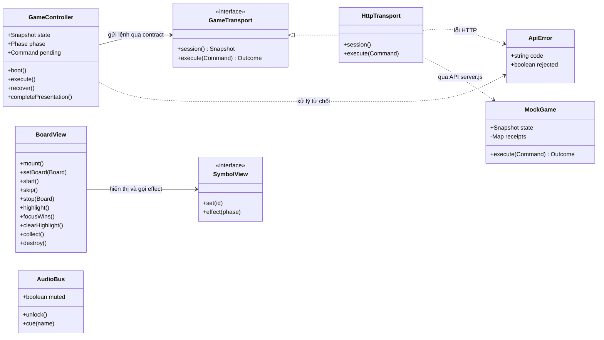
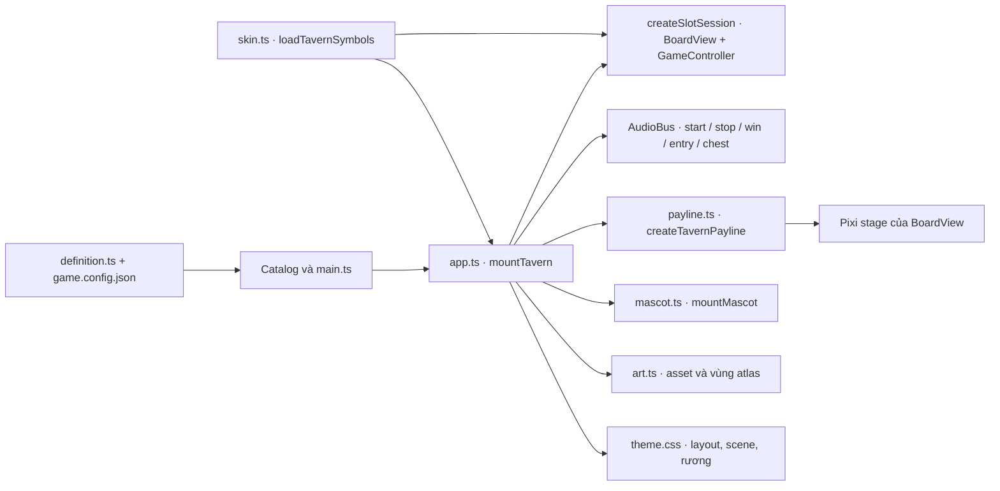
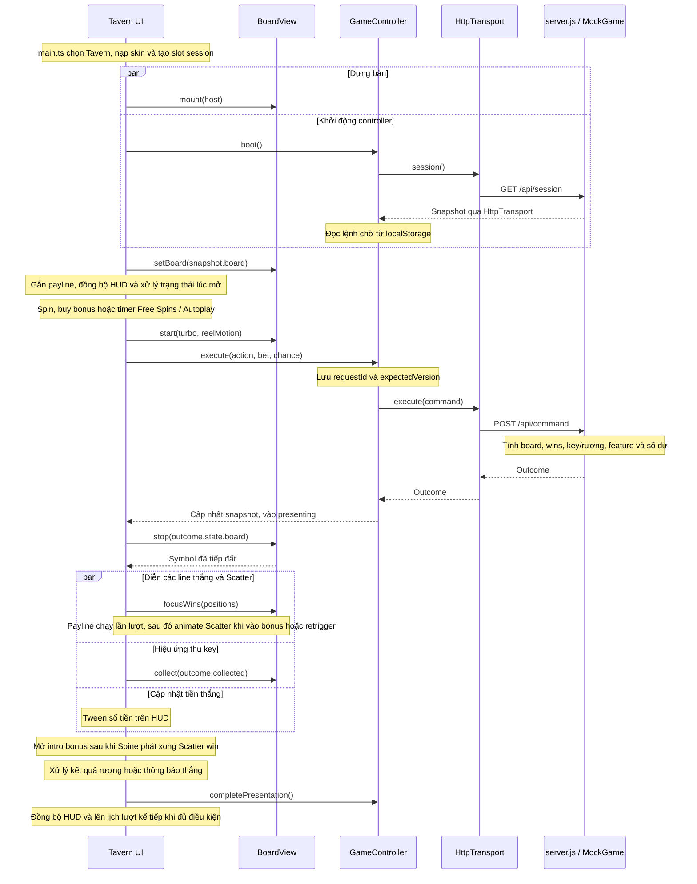
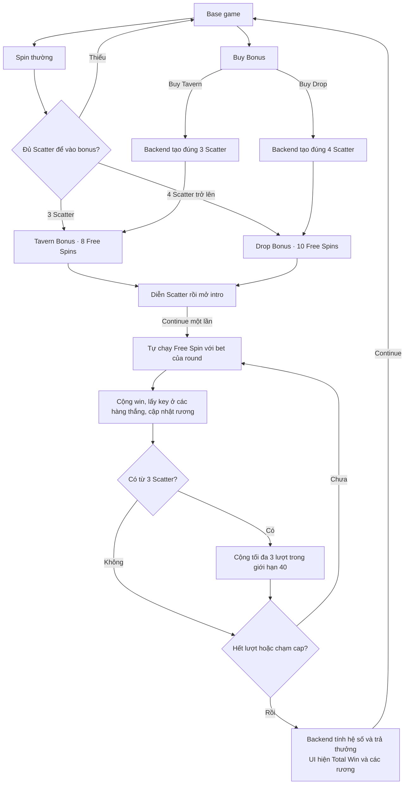
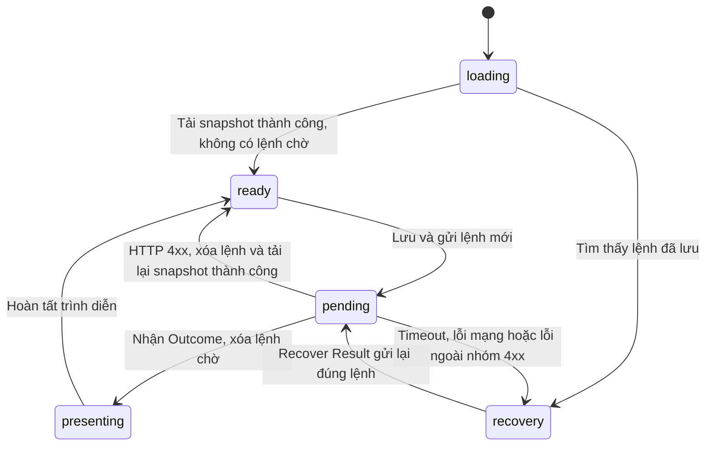

# Sơ đồ class và runtime Tavern Drop

- [Class của framework và mock backend](#class-cua-framework)
- [Module của game Tavern](#module-cua-tavern)
- [Khởi động và vòng đời một lượt](#khoi-dong-va-vong-doi)
- [Tavern Bonus, Drop Bonus và rương](#bonus-va-ruong)
- [Trạng thái và khôi phục](#trang-thai-va-khoi-phuc)

## Class của framework và mock backend

| Class | Trách nhiệm |
| --- | --- |
| [`GameController`](../src/framework/controller.ts) | Lấy snapshot, kiểm soát phase, lưu lệnh có `requestId` và `expectedVersion`, nhận kết quả hoặc gửi lại lệnh đang chờ. |
| [`HttpTransport`](../src/framework/transport/http.ts) | Hiện thực `GameTransport` qua HTTP. Dùng API base từ config, gửi kèm cookie cùng origin và áp timeout cho request. |
| [`ApiError`](../src/framework/transport/http.ts) | Giữ mã lỗi và đánh dấu HTTP 4xx là lệnh bị từ chối để controller tải lại snapshot. |
| [`BoardView`](../src/framework/presentation/board.ts) | Dựng lưới Pixi từ config, điều khiển Normal/Drop, cập nhật symbol, highlight và vẽ hiệu ứng thu key. |
| [`AudioBus`](../src/framework/presentation/audio.ts) | Mở khóa Web Audio, quản lý mute và tải, cache, phát âm thanh theo cue. Skin gọi class này theo nhịp trình diễn. |
| [`MockGame`](../server/mock-game.ts) | Sở hữu snapshot và receipt của một phiên demo. Xác thực lệnh, tính chi phí và kết quả, cập nhật tiến độ rương, trả thưởng và ghi kết quả theo `requestId`. |

Các điểm ghép để tái sử dụng framework:

| Module | Vai trò |
| --- | --- |
| [`game-config.ts`](../src/framework/game-config.ts), [schema JSON](../src/framework/game-config.schema.json), [`catalog.ts`](../src/games/catalog.ts) | Kiểm tra config và đăng ký cùng một `GameDefinition` cho client và server. |
| [`contracts.ts`](../src/framework/domain/contracts.ts) | Định nghĩa dữ liệu trao đổi, gồm `Command`, `Snapshot`, `Outcome`, `GameDefinition` và `GameTransport`. |
| [`createSlotSession`](../src/framework/session.ts) | Ghép controller, transport, storage và BoardView. Khởi động controller song song với Pixi rồi đưa bàn từ snapshot lên màn hình. |
| [`SymbolFactory` và `SymbolView`](../src/framework/presentation/board.ts) | Factory dựng từng ô từ kích thước do BoardView cung cấp. View đổi symbol, nhận phase animation và có thể báo khi hiệu ứng kết thúc qua Promise. |
| [`rules.ts`](../src/framework/domain/rules.ts) | Hàm dùng trong backend để chấm payline, thu key theo ô thắng và áp hệ số rương cùng giới hạn trả thưởng. |
| [`server.js`](../server.js) | Phục vụ bản build và định tuyến `/session`, `/command` theo catalog. Cookie gắn trình duyệt với một instance MockGame. |
| [`mountBasicGame`](../src/framework/presentation/basic-game.ts), [`assets.ts`](../src/framework/presentation/assets.ts) | Skin dùng chung cho demo 3×3 và các hàm chung để dựng URL asset, tải texture. |

## Module của game Tavern

Tavern triển khai giao diện bằng module và các hàm. Các khối dưới đây tương ứng với các điểm vào trong mã.

| Module | Trách nhiệm |
| --- | --- |
| [`definition.ts`](../src/games/tavern/definition.ts) và [`game.config.json`](../src/games/tavern/game.config.json) | Cấu hình bàn 5×5, symbol, payline, bet, timing Normal/Drop và tham số bonus. Motion mặc định là Drop. |
| [`app.ts`](../src/games/tavern/app.ts) | `mountTavern()` gắn HUD và nút. `run()` gửi lệnh và bắt đầu chuyển động, `present()` diễn kết quả, `sync()` cập nhật HUD và scene, `syncBonusArt()` cập nhật key/rương, `scheduleNextSpin()` hẹn lượt tự động. `openShop()` và `confirmFeature()` xử lý lựa chọn trong shop. |
| [`skin.ts`](../src/games/tavern/skin.ts) | Nạp Spine và WebP dự phòng, tạo `SymbolView` cho BoardView, cung cấp icon paytable. Ánh xạ phase `idle`, `spin`, `land`, `win` sang animation của symbol. |
| [`payline.ts`](../src/games/tavern/payline.ts) | Dựng lớp Pixi vẽ đường thắng từ tọa độ các ô và hiện số tiền từng line. |
| [`mascot.ts`](../src/games/tavern/mascot.ts) | Dựng nhân vật desktop trên canvas riêng, chạy idle và phát win khi được gọi. |
| [`art.ts`](../src/games/tavern/art.ts) và [`theme.css`](../src/games/tavern/theme.css) | Lấy ảnh và vùng atlas, bố trí bàn, HUD, key/rương, background và chuyển cảnh. |

## Khởi động và vòng đời một lượt

Với **Drop**, bàn cũ rơi ra, chờ kết quả rồi thả bàn mới theo timing lượt vào. Symbol giữ pose idle khi rơi, gọi `land` khi tiếp đất và `win` cho ô được highlight. Với **Normal**, ticker cuộn reel với phase `spin` rồi dừng theo bàn server trả về. Khi mở game, snapshot có feature đang chạy sẽ được xếp lịch tự động sau khi bàn sẵn sàng. Nếu có lệnh chờ, UI mở hộp thoại khôi phục.

## Tavern Bonus, Drop Bonus và rương

Trong Free Spins, mỗi reel có một rương. Một hàng thắng trên reel đó cho một key, mỗi hàng chỉ tính một lần. Đủ tất cả các hàng sẽ mở khóa rương. Khi chốt thưởng, rương đã mở lấy hệ số theo mode **Tavern ×2/×3/×5**, **Drop ×5/×10/×25/×50/×100**. Rương chưa mở tính ×1. Backend nhân tổng thắng trong feature với tích các hệ số, sau đó áp giới hạn thưởng của cả round.

`presentation.spinType` chọn chuyển động reel. `feature.mode` chọn số Free Spins khởi đầu và bảng hệ số rương. Vì vậy, Tavern Bonus cũng sử dụng chuyển động Drop theo config hiện tại.

Tavern chờ toàn bộ Scatter phát xong animation `win` trước khi mở intro trong cả spin thường và Buy Bonus, kể cả khi dùng Turbo hoặc Skip lượt.

## Trạng thái và khôi phục

Khi gián đoạn, Tavern dừng lượt tự động, khôi phục bàn từ snapshot đang giữ và hiện **Recover Result**. Nếu server đã xử lý lệnh, gửi lại đúng lệnh với cùng `requestId` sẽ lấy Outcome đã lưu mà không trừ bet lần nữa. Phiên và receipt nằm trong bộ nhớ của mock server, nên khôi phục phụ thuộc vào việc phiên còn tồn tại.
