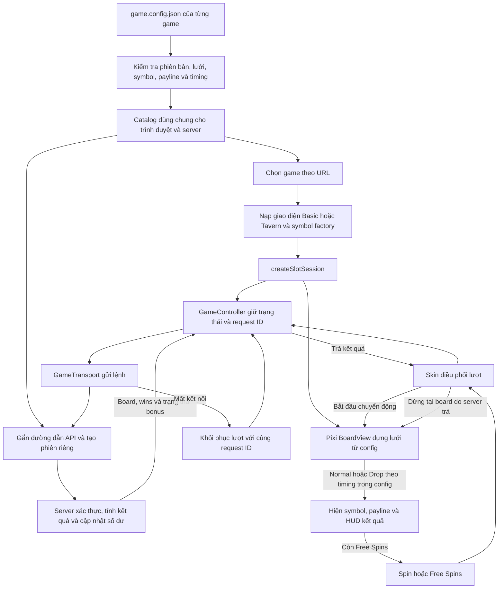

# Slot Framework v1

## Chuẩn cấu hình

Hai game mẫu đều dùng [schema v1](../src/framework/game-config.schema.json). [Tavern](../src/games/tavern/game.config.json) dùng Drop và giao diện Spine. [Demo 3×3](../src/games/reuse/game.config.json) dùng Normal, kích thước ô và khoảng cách riêng, cùng giao diện Basic.

| Nhóm | Trường và đơn vị |
| --- | --- |
| Nhận diện | `schemaVersion`, `id`, `title`. ID giữ namespace khôi phục lượt. |
| Định tuyến | `routing.query` chọn game tại `/?game=...`. `routing.apiBase` chọn đường dẫn API. `routing.skin` chọn `basic` hoặc `tavern`. |
| Lưới | `reels` là số cột, `rows` là số ô mỗi cột, `initialBoard[reel][row]` chứa ID symbol. Chỉ số bắt đầu từ 0. |
| Symbol và payline | Số loại symbol là độ dài mảng `symbols`. `pays` ánh xạ số symbol khớp sang hệ số tính theo phần trăm bet. Mỗi phần tử của `lines` chứa một chỉ số hàng cho từng reel, từ trái sang phải. |
| Bet | `bets` và `defaultBet` dùng đơn vị tiền nhỏ nhất. Bet mặc định phải thuộc danh sách. |
| Bố cục reel | `presentation.cellSizePx` và `gapPx` dùng pixel logic của Pixi. |
| Normal | `presentation.spinType: "normal"`. Cấu hình tốc độ thường và turbo bằng px/giây, khoảng chờ dừng giữa reel bằng ms, thời gian và độ nảy khi dừng. |
| Drop | `presentation.spinType: "drop"`. Hai pha `exit` và `enter` có thời gian rơi, độ lệch theo reel và hàng, thời gian giữ pha. Có thể chỉnh hệ số turbo và độ nảy. |
| Mock backend | `demo` chứa số dư đầu, cap, tỷ lệ Scatter, giá và số lượt bonus, hệ số rương và ngưỡng win. Số free spins bằng 0 tắt mode bonus tương ứng. |

## Thêm game

1. Sao chép config [demo 3×3](../src/games/reuse/game.config.json). Đặt ID, URL và API riêng. Cập nhật số reel, số hàng, symbol, bàn khởi tạo, payline và timing.
2. Import JSON và thêm kết quả `loadGameConfig(config)` vào danh sách [catalog](../src/games/catalog.ts). Skin Basic dựng bàn và controls từ config. Server đăng ký API từ cùng catalog.
3. Với giao diện riêng, cung cấp một skin và `SymbolFactory`. Factory nhận kích thước ô từ framework. Giao diện Tavern dùng art khung 5×5, atlas symbol và trình bày rương riêng.
4. Với luật thưởng khác, triển khai `GameTransport` phù hợp và xử lý payout phía server. Mock backend hiện hỗ trợ payline và feature kiểu Tavern/Drop. Skin Basic trình bày lượt spin và payline.

JSON được import khi build. Thay config cần build lại client và khởi động lại mock server để hai phía đọc cùng phiên bản.
