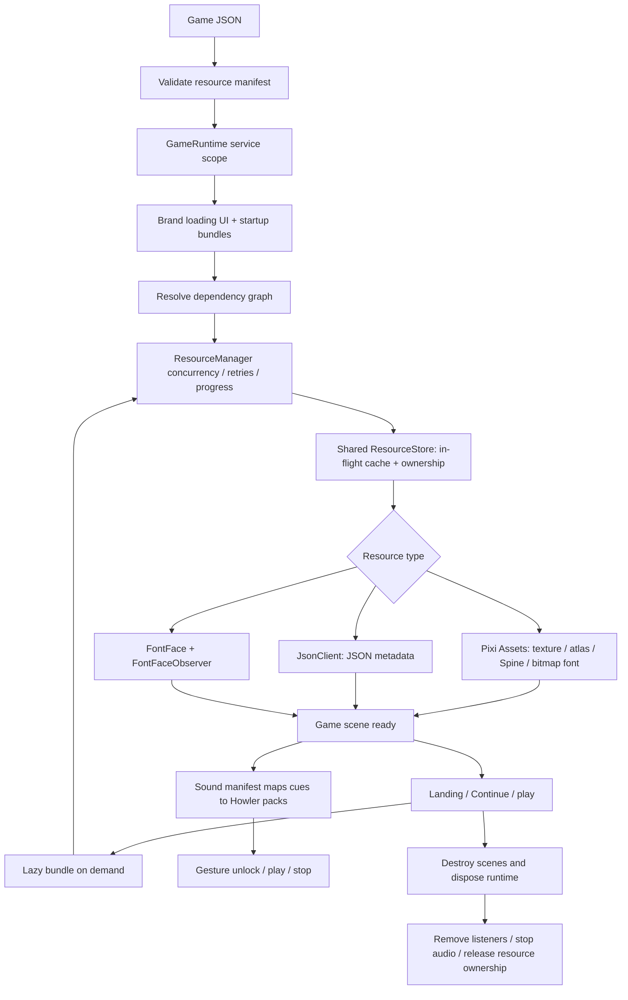
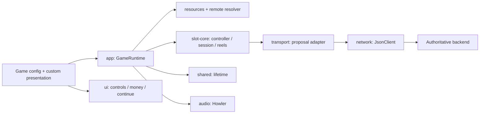

# Framework extension: Gen3 review and resource pipeline

## Implemented in this revision

POST requests use clean endpoint URLs. For example:

```http
POST /api/v1/spin
Content-Type: application/json
Session-Id: <BE session>
Authorization: Bearer <BE token>
Play-Token: <BE entitlement>

{"gameCode":"tavern-drop","isFreespin":0,"betMinor":1000,"chanceMode":"normal"}
```

Login, buy-feature, progress ACK and final-summary ACK also carry `gameCode` in JSON. Game-info and round status also use POST: `/api/v1/game-info` and `/api/v1/rounds/status`, each with `{"gameCode":"tavern-drop"}` in its JSON body. Every v1 endpoint rejects query parameters (400) and GET requests (405). Routing is resolved before payload validation and the receipt fingerprint is scoped to the selected account/game.

The development backend now uses Node watch mode. A previous localhost process was still running the old login validator, causing `INVALID_FIELDS` after the FE body changed. It has been restarted with the matching contract. Refresh tests must cover the actual HTTP endpoint, not only in-memory mocks.

## Gen3 source reviewed

Reference checkout: `D:/Blackwolf/gen3-framework`. Files reviewed include:

| Gen3 module | Relevant source/design | Current framework implementation |
| --- | --- | --- |
| gen3-remote | `config/central-config.json`, remote asset/branding folders | `remote/asset-resolver.ts`: data-only resource paths, HTTP(S), CDN base, `{brand}`, `{locale}`, `{version}` |
| gen3-shared | Shared fonts, localization, overlays and common assets | `shared/disposables.ts`; shared resource ownership and existing shared controls/money helpers |
| gen3-slot-core | Shared reel/game execution separated from game assets | `slot-core/index.ts`: public core entry, controller/session/domain contracts; existing normal/drop BoardView remains shared |
| gen3-ui | Common controls, loading popup and game UI wrappers | `ui/index.ts`: controls, money and bitmap amounts; Tavern keeps its specific art/layout/animations |
| gen3-app | MainApp, scene lifecycle, ResourceManager, ResourceAsyncLoader, ResourceUtils, SoundLoader | `app/game-runtime.ts`, `resources/*`, `audio/howler-bus.ts`: per-game service scope, manifest/bundles, typed driver, preload, lazy load and disposal |
| gen3-network | HTTPClient and socket request/response mapping | `network/json-client.ts`: HTTP/timeout/error handling; `transport/proposal.ts`: versioned protocol, auth, entitlements, checkpoints and wire mapping |

This is an adaptation of the architecture, not an installation of the Gen3 packages. The inspected Gen3 app pins Pixi 6.3.2 and Spine loader 3.8; this project uses Pixi 8 and Spine 4.2. Importing those packages wholesale would introduce incompatible rendering objects and duplicate engine versions. Production hosts/operators from the reference remote config are not used here.

The open-source libraries actually adopted are **Howler 2.2.4** for sound packs/sprites, fallback codecs and browser audio lifecycle, and **FontFaceObserver 2.1.0** for webfont readiness. Both are also used by Gen3. Pixi 8 `Assets` remains the texture/atlas/Spine/bitmap-font backend instead of porting Pixi 6 `Loader`.

## Resource standard

Each game owns an optional `resources` section in its game JSON. Its schema is `src/framework/resources/resource-manifest.schema.json`. The existing game config validator also verifies aliases, dependencies, cycles, concurrency and retry settings at startup/build time.

```json
{
  "resources": {
    "base": "games/my-game/",
    "concurrency": 4,
    "retries": 1,
    "assets": {
      "atlas": { "src": "master.atlas" },
      "symbols": { "src": "symbols.skel" },
      "font.ui": { "src": "ui.woff2", "type": "font", "family": "Game UI", "weight": "700" },
      "audio.manifest": { "src": "sounds.json", "type": "json", "optional": true }
    },
    "bundles": {
      "boot": { "assets": ["atlas", "font.ui"] },
      "symbols": { "dependsOn": ["boot"], "assets": ["symbols"] },
      "bonus": { "assets": ["audio.manifest"] }
    },
    "startup": ["symbols"]
  }
}
```

`startup` selects eager bundles. Bundles can load concurrently within the configured limit, but dependencies finish before their dependents start. Bundles outside startup load on demand with `resources.loadBundle("bonus")`. The example is illustrative; asset paths must be supplied by each game.

Tavern's real manifest now declares its symbol textures, four symbol skeletons, shared atlas, backgrounds, reelhouse, screens, mascot, bitmap fonts, UI webfont and sound manifest. Its skin/effects/mascot/font/audio modules ask the manager for those resources rather than creating independent Pixi load requests. The 3×3 glyph-only example has an empty resource bundle and uses the same runtime; image-based games can provide `symbols[].image`, which the runtime registers as `symbol.<id>` automatically unless the manifest supplies an override.

Resource API:

```ts
const runtime = gameRuntime(game);
await runtime.prepare(loader);
await runtime.resources.loadBundle("bonus");
const texture = await runtime.resources.load<Texture>("symbol.A");
const skeletonUrl = runtime.resources.url("symbols");
const cached = runtime.resources.get<Texture>("symbol.A");
runtime.lifetime.add(() => audio.dispose());
// After all scenes/renderers using this scope have been destroyed:
await runtime.dispose();
```

The manager deduplicates concurrent alias loads, caches successful values, retries bounded failures and distinguishes optional from required resources. Progress reports actual completed resources, including explicit optional failures. Required failures reject and leave the brand loader's retry screen in place. No silent fallback is used for a mandatory skeleton.

The shared store reference-counts ownership across managers. Releasing game A must not destroy textures still owned by game B. It waits for in-flight loads, and reacquiring a resource waits for its previous unload. Pixi resources are unloaded only after the final owner releases them. A runtime must be disposed **after** destroying its scene consumers, not while their sprites still render. Navigation currently reloads the document; full in-place game switching is not claimed here.

Tavern's CSS artwork and original layout remain game-specific. Remote URL substitution is implemented for manifest resources; remotely hosting all CSS backgrounds/UI imagery will require routing those paths through the same environment in a subsequent migration.

## Audio

`AudioBus` now uses Howler and groups all aliases sharing a source list into one sound pack. It supports individual files and `[offsetMs,durationMs,loop]` sprites, music/effects levels, mute, stop-by-cue and disposal. Audio data loads when needed rather than decoding once per alias. Gameplay unlocks audio in a user gesture. The previous direct Web Audio implementation is retained as the explicit `WebAudioBus` compatibility export; new games use the Howler implementation.

## Resource flow



## Runtime boundaries and follow-up roadmap



The network and resource services are concrete implementations, not only folder aliases. `slot-core/index.ts` and `ui/index.ts` are public entry points over existing shared implementation files; internal files have not all been moved. The large Tavern presentation function still needs gradual decomposition. These remaining items should be separate verified changes:

1. Extract scene lifecycle/mount/destroy contracts and renderer cleanup so runtime disposal can support safe in-place game switching.
2. Move intro, per-spin presentation, chest phases and Total Win out of Tavern's large function into custom scene classes registered by config.
3. Centralize CSS/UI artwork URL resolution and pack localization/branding fallbacks into manifests.
4. Add GPU warm-up budgets and loading diagnostics before enabling predictive lazy/background loading on mobile.
5. Extract workspace packages when dependency boundaries stabilize; avoid packaging facades as if the runtime split were already complete.

## Verification

`npm test` checks resource dependency order, concurrency, deduplication, retry, optional failure, shared ownership, unload/reload races, URL resolution and cleanup in addition to round/checkpoint recovery. Browser tests must verify login after refresh, stable test identity, clean POST URLs with JSON gameCode, bonus resume, chest ACKs and final wallet settlement. Build the full app plus standalone Tavern and 3×3 targets after manifest changes.
