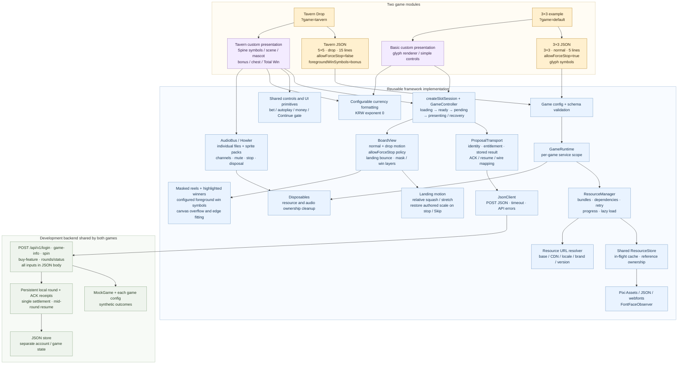

# Shared framework usage: Tavern + 3×3

This chart shows **both games on the same framework**. They use the same implementation of shared services, with separate game config, controller state, resources and synthetic wallet per game. The current app selects one game per page; this is not an assertion that two scenes can run and unload concurrently without further scene-lifecycle work.

View the [standalone SVG chart](framework-shared-chart.svg).

Editable diagram source: [framework-shared-chart.mmd](framework-shared-chart.mmd).

## What each game actually uses

| Capability | Shared implementation | Tavern | 3×3 |
| --- | --- | --- | --- |
| Config/schema | framework game-config and domain contracts | Board, timing, feature settings, resource manifest | Small board, timing, glyph definitions, empty resource bundle |
| Runtime/resources | app, resources, remote | Texture, atlas, skeletons, fonts, sound manifest | Same runtime; glyphs need no external textures; supports symbols.image |
| Controller/session | controller + createSlotSession | Paid spin and feature flow | Paid spin |
| Wire protocol | ProposalTransport + JsonClient | gameCode tavern-drop | gameCode reuse |
| Reel rendering | BoardView | Drop default; normal supported | Normal default; drop supported |
| Bounce | landing-motion and symbol carrier | Configured relative deformation | Same deformation implementation |
| Force stop | BoardView guard + game config | Disabled during reel motion | Enabled |
| Foreground winner layer | BoardView + foregroundWinSymbols | Scatter (bonus) escapes reel mask while winning | Available, no symbol configured by default |
| Money | shared formatter | KRW balance, bet, buy prices, wins | KRW balance and wins |
| Bet/autoplay controls | shared UI helpers | Used | Not present in the minimal UI |
| Continue readiness | waitForContinue readiness promise | Landing waits for native Spine intro | Available; this example has no landing scene |
| Audio | Howler AudioBus | Single-file cues and combined sprite pack | Not configured in this glyph-only example |
| Bonus/chest scenes | Tavern custom presentation | Used | Not part of this example |

## Handover assessment

**Deliverable as a reusable core and runnable demonstration, suitable for the technical core portion of Milestone 1.** The 3×3 example demonstrates a second configuration using the same controller, transport, runtime and board renderer, rather than copying Tavern's entire game.

This is **not yet a fully separated SDK/monorepo equivalent to Gen3**. Public entry points exist for slot-core and UI, but the internal implementations remain partly under presentation/domain. Tavern's large presentation module still needs scene-class decomposition. Full in-place scene switching/unloading, third-party game onboarding and production backend integration are not claimed by the current tests.

M1 acceptance is separate from the code being runnable. Before calling the whole milestone accepted, package the agreed source/build instructions for the client's GitLab, attach the reference/asset verification evidence, and reconcile any open checklist items with the client. The mock backend is synthetic; its JSON file is durable locally, while Railway currently needs a persistent volume to retain mock data through redeployment.

## Changes in this revision

- `presentation.allowForceStop` is a framework policy, true by default for compatibility. Tavern explicitly sets false. It blocks early reel stopping in both the UI and BoardView itself; stopping future autoplay rounds is a separate action.
- Landing Continue stays hidden and disabled until the native splash-intro track finishes. The readiness gate is shared UI code; Tavern supplies the Spine completion promise.
- `foregroundWinSymbols` selects symbol IDs allowed to draw outside the reel mask while winning. `winOverflowPaddingPx` reserves real canvas pixels, avoiding a second clip at the renderer's edge. Ordinary reels remain masked; clearing the highlight restores the normal render layer and edge fitting.

## Read/build/run

Start with `npm ci`, `npm run dev`; open `http://localhost:5173/?game=tarvern` or `?game=default`. Validate with `npm test` and `npm run build`. Build a standalone game using `npm run game:build -- tavern` or `npm run game:build -- reuse`.

Main implementation entry points: [GameRuntime](../src/framework/app/game-runtime.ts), [GameController](../src/framework/controller.ts), [BoardView](../src/framework/presentation/board.ts), [ProposalTransport](../src/framework/transport/proposal.ts), [ResourceManager](../src/framework/resources/resource-manager.ts), [Continue gate](../src/framework/presentation/scene.ts).
