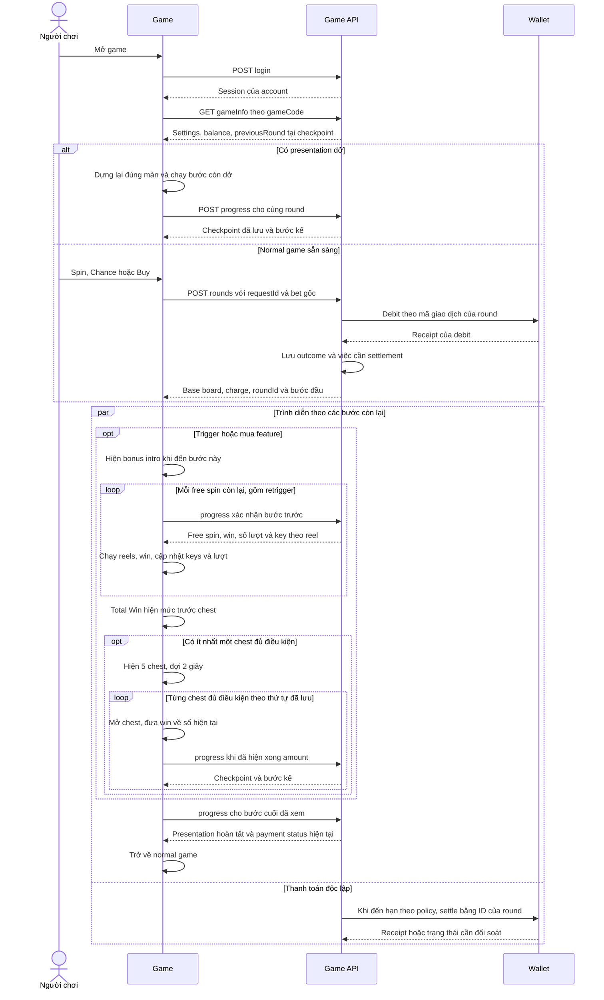
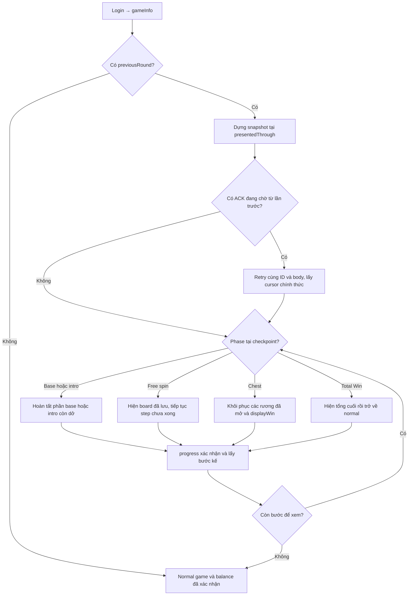
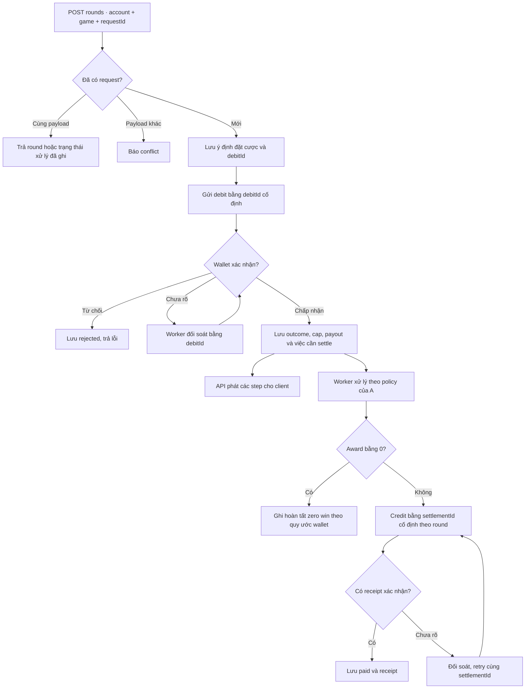

# Tavern Drop · Luồng game và API cho một paid round

**Bản đề xuất để Than, Yongtae và team A review · 18/11/2026.** Mình đề xuất giữ thứ tự **login → gameInfo → kiểm tra round trước đó**. Khi người chơi bấm Spin hoặc Buy, A nhận một lệnh đặt cược, lưu kết quả cả round và phát kết quả từng bước. Cùng lúc đó A chịu trách nhiệm hoàn tất thanh toán, kể cả khi người chơi đóng game. Phía game chỉ báo bước nào đã trình diễn xong.

**Quyết định cần Yongtae và A chốt trước tiên** là ranh giới của một free spin “đã hoàn thành” khi hình ảnh và checkpoint trên server cách nhau một lần truyền mạng. Mục 5 đưa ra cách xử lý cụ thể để hai bên thử với tình huống mất mạng thật.

## 1. Game flow và API đi cùng

Mở từng sơ đồ để phóng to hoặc chia sẻ trong buổi review. [Game và API](flow-game-api.svg) · [Resume](flow-resume.svg) · [BE và wallet](flow-wallet.svg)



Sơ đồ minh họa đường chạy thành công. Khi resume, game đi thẳng vào bước còn dở trong phần trình diễn. Nếu base spin không trigger thì chính base spin là bước cuối. Với bonus, ACK của free spin cuối được gửi trước khi bắt đầu phần chest. Trạng thái ví có thể chuyển sang đã trả ở bất kỳ bước trình diễn nào sau khi A chốt outcome. Với round thắng bằng 0, cách ghi nhận hoàn tất phía wallet do A quy định.

| Người chơi đang ở đâu | Game đọc hoặc gửi gì | Quyết định hiển thị |
| --- | --- | --- |
| Vừa login | `gameInfo.settings`, `wallet`, `lastReels`, `previousRound` | Khi `previousRound = null` thì hiện normal game với board gần nhất hoặc board mặc định. Khi có round thì đọc phase và checkpoint. |
| Normal game | Một `POST rounds` cho một thao tác trả tiền | Hiện board, line wins và base win do A trả. Spin thường không thắng kết thúc tại đây. Có trigger thì chuyển tới intro của cùng round. |
| Giữa freegame | `progress` xác nhận spin trước và lấy spin kế | Hiện board, win của spin, tổng tích lũy, keys và bộ đếm sau spin. Retrigger cập nhật tổng số lượt trong cùng round. |
| Spin cuối vừa xong | Step cuối có `chest` cùng kết quả cuối theo reel | Vào màn Total Win, hiện mức trước chest. Nếu có rương đủ điều kiện, hiện cả 5 và mở lần lượt sau 2 giây. Nếu cả 5 đều khóa, đi thẳng tới tổng cuối. |
| Đang mở chest thì thoát | Login lại rồi gọi `gameInfo` | Dựng lại các rương đã mở và số tiền sau rương gần nhất. Chỉ tiếp tục rương còn dở. Mục 4 có ví dụ số cụ thể. |
| Đã xem tổng cuối | `progress` cuối trả trạng thái thanh toán và balance mới nhất đã xác nhận | Về normal game. Nếu tiền còn pending, UI giữ balance đã xác nhận. Khả năng nhận cược mới trong lúc đó do A/operator chốt. |

## 2. Vì sao chọn cách này

| Phương án | Lợi ích | Điểm đánh đổi |
| --- | --- | --- |
| Mỗi free spin là một lệnh chơi như mock | Gần với code hiện tại | Nếu lệnh kế mới sinh outcome, A cần thêm cơ chế hoàn tất feature cho người đã thoát. Retry và khôi phục sau debit phức tạp hơn. |
| Một response trả toàn bộ feature như HAR mẫu | Một lần lấy toàn bộ board và multiplier | Vẫn cần lưu tiến độ đã xem. Response lớn hơn và client biết trước chuỗi kết quả. HAR chỉ ghi nhận balance ở `play` và `end-round`, không xác định được thời điểm ledger đổi. |
| **Đề xuất cho game đầu** · A lưu outcome cả round, release từng spin, gửi chest cùng spin cuối | A có đủ dữ liệu settle lúc client offline. Một request ở ranh giới spin vừa lưu checkpoint vừa lấy kết quả kế. Dễ xác định chính xác màn cần resume. | Cần A/math xác nhận khả năng chốt cả outcome từ đầu và latency cho round dài. Nếu chậm, A có thể trả trạng thái đang xử lý rồi hoàn tất bằng worker với cùng roundId. |

Yêu cầu của Yongtae là outcome bền vững, resume giữa chừng, một final payout và cap cả round. Việc chốt toàn bộ outcome sớm, tên endpoint và checkpoint mỗi rương là lựa chọn thiết kế để review. Ví dụ thực tế của hai game tham khảo cũng khác nhau. Log `n57058` cho thấy balance tăng theo free spin. HAR Tavern cho thấy một response chứa toàn bộ feature, với chênh lệch balance cuối bằng payout cả round. [Phân tích HAR Tavern](tavern-reference-har-analysis.md)

## 3. Contract gọn cho FE và BE

Đề xuất dùng prefix `/api/v1` và cùng một contract version do A trả trong `gameInfo`. Bản này thay thế **luồng khởi động** `session → resume` của draft trước bằng **login → gameInfo có snapshot**. Tất cả lời gọi dùng session đã xác thực. `code: 0` là thành công, mã lỗi khác do A cấp. Ví dụ sau là dữ liệu review, số tiền do BE có thẩm quyền xác nhận.

| API | Input | Output tối thiểu | Khi nào gọi |
| --- | --- | --- | --- |
| `POST /login` | Launch credential và `accountId` nếu có | Account đã xác thực và session/token theo cơ chế A | Khi mở phiên hoặc xác thực lại. Login thiếu accountId có thể chọn account trong pool demo đã cho phép. Production phải liên kết với đúng tài khoản operator. |
| `GET /game-info?gameCode=…` · **gameInfo** | Session và gameCode | `settings`, `wallet`, `lastReels`, `previousRound`. Khi có vấn đề tiền chưa xử lý, trả tham chiếu giao dịch đang chờ kể cả khi UI round cũ đã xong | Một lần khi vào game hoặc reconnect. Nếu session còn hiệu lực thì dùng lại. |
| `POST /rounds` · **spin/buy** | `requestId`, `gameCode`, `betMinor`, `mode`, `chance` nếu dùng | `roundId`, `originalBaseBetMinor`, `chargedMinor`, step đầu, checkpoint, `settlement`, `wallet`. Nếu debit đang được đối soát thì trả trạng thái xử lý với ID để tra cứu | Một lần cho mỗi paid round. Normal spin, Chance và bonus buy cùng đi qua cửa này. |
| `POST /rounds/{roundId}/progress` | `requestId`, `expectedPresentedThrough`, `presentedThrough` | Cursor đã lưu, bước kế hoặc batch đã được phép phát, payment status hiện tại. Có thể gửi hai cursor bằng nhau để lấy bước đã ghi | Sau mỗi checkpoint. A kiểm tra quyền sở hữu round, thứ tự và bước đã release. |
| `GET /rounds/{roundId}/status` | Session và roundId | Trạng thái settlement, receipt khi có, balance và walletVersion mới nhất | Chỉ khi cần refresh, theo `retryAfterMs` do A trả. Có thể dùng status đi kèm response khác. |
| `GET /requests/{requestId}` | Session và ID của request bị mất response | Trạng thái xử lý và roundId/receipt nếu đã nhận | Đường phục hồi tùy chọn nếu retry cùng ID hoặc gameInfo chưa đủ để xác định kết quả. |

**Đơn vị tiền.** `gameInfo` trả currency, exponent, mức bet hợp lệ, bet mặc định, số line và bảng giá Chance/Buy cho mức bet đang chọn hoặc tham chiếu config giá có version. A kiểm tra tất cả khi nhận cược. Ví dụ `currency = "KRW"`, `currencyExponent = 0`, `betMinor = 1000` hiển thị **₩1,000**. Áp dụng cùng formatter cho balance, bet, Chance, buy và tất cả win, kể cả số dài trên mobile. Hệ số rương `5` hiển thị **5×**. Nếu operator chỉ cho một game và line cố định trong session, FE có thể bỏ các tham số trùng như line, denomination, totalBet và freeSpin khỏi từng request.

### Format `reels` và `winLines`

Áp dụng cùng format cho normal spin, free spin, `gameInfo.lastReels` và `previousRound.snapshotAtPresented.reels`. BE và FE dùng config của game để biết `cols` (số reel), `rows` (số hàng), bảng symbol và bảng payline. `configId` được khóa theo paid round để khi resume vẫn giải mã đúng sau khi game cập nhật.

**Một mảng cho cả màn hình.** `reels` có đúng `cols × rows` số nguyên. Đọc hết hàng trên từ trái qua phải, rồi xuống hàng tiếp theo. **Vị trí trên wire bắt đầu từ 1**, giống cách đánh số trên ảnh. Với hàng và cột cũng tính từ 1, `pos = (row - 1) * cols + col`. FE đọc symbol tại `reels[pos - 1]`, suy ra `col = ((pos - 1) % cols) + 1` và `row = floor((pos - 1) / cols) + 1`.

| Kích thước (cột × hàng) | Số phần tử | Hàng trên | Hàng dưới cùng |
| --- | ---: | --- | --- |
| 3×3 | 9 | 1–3 | 7–9 |
| 5×3 | 15 | 1–5 | 11–15 |
| 5×5 | 25 | 1–5 | 21–25 |

**Mã symbol.** `1` luôn là Wild. ID cao nhất **trong danh mục symbol của game** luôn là Scatter, kể cả khi lượt quay không xuất hiện Scatter. Đề xuất ID cho Tavern theo thứ tự high → low hiện có. Mỗi game khác có thể có danh mục riêng.

| Symbol ID | 1 | 2 | 3 | 4 | 5 | 6 | 7 | 8 | 9 | 10 | 11 |
| --- | --- | --- | --- | --- | --- | --- | --- | --- | --- | --- | --- |
| Tavern | Wild | Feast | Roast | Potion | Ale | A | K | Q | J | 10 | Scatter |

**Line thắng.** `winLines` là một array. Mỗi object gồm `lineId` (ID từ 1 trong bảng payline), `winSym` (danh sách **vị trí ô** tham gia thắng theo thứ tự của line) và `winMinor` (tiền thắng của riêng line). FE lấy các symbol thực tế từ `reels`, kể cả Wild thay thế. Một ô có thể thuộc nhiều line. FE highlight riêng từng line, dùng amount của BE và hiển thị tổng spin từ `spinWinMinor`. Khi không có line thắng, gửi `"winLines":[]`. Nếu game có khoản thưởng ngoài payline, khoản đó vẫn có thể nằm trong tổng spin.

Ví dụ 5×5 sau dùng đúng bố cục của fixture `normalWin`. Ba ô đầu là A, nên line 1 highlight các vị trí 1, 2 và 3. Số ₩200 minh họa cho draft KRW.

```json
{
  "reels": [
    6, 6, 6, 7, 8,
    7, 10, 2, 10, 9,
    8, 4, 3, 4, 10,
    9, 5, 4, 9, 4,
    10, 9, 8, 5, 3
  ],
  "winLines": [{"lineId": 1, "winSym": [1, 2, 3], "winMinor": 200}],
  "spinWinMinor": 200
}
```

Ví dụ cách đọc một đường chéo trong config Tavern: line 14 đi qua `[1,7,13,19,25]`. Nếu chỉ ba ô đầu thắng, BE gửi `"winSym":[1,7,13]`. Khi mỗi lượt có hai đường thắng, gửi hai object kể cả khi chúng dùng chung vị trí 1.

**Mapping mock → wire.** Với mock dùng `board[reel][row]` và tọa độ từ 0, FE/adapter duyệt **row ngoài, reel trong**. Mỗi `wins[].positions` đổi thành `winSym` theo `row * cols + reel + 1`. `wins[].line + 1` ra `lineId`. Kiểm tra số ô, ID symbol theo config, lineId hợp lệ và các vị trí nằm trên payline tương ứng trước khi vẽ. Với chest, `reel` là số **cột** từ 1, nên rương cột 3 dùng `chest[2]`.

**Dữ liệu để vẽ game.** Step base/free spin mang `stepId`, loại step, `reels`, `spinWinMinor`, `winLines`, và duy nhất một mảng `chest` gồm 5 hệ số. Giá trị mặc định là `[1,1,1,1,1]`. Spin cuối thực tế, kể cả khi chạm cap sớm theo luật math, mang multiplier cuối. Trong freegame, trả tổng lượt, đã dùng, còn lại, win tích lũy và key mới. Snapshot resume trả board đầy đủ và tập key đã thu tại checkpoint. A cung cấp thứ tự các step mở rương đủ điều kiện, kể cả khi một rương mở có thể nhận ×1 theo luật được duyệt.

**Tần suất dự kiến.** Normal spin độc lập dùng 1 start + 1 ACK hoàn tất. Đề xuất cho bonus có `N` free spins thực tế và `K` rương mở là 1 start + `N + K + 3` lần progress, tương ứng base, bonus intro, N spins, K rương và total win. Ví dụ 10 spins, 2 rương là **1 start + 15 progress**, ngoài login/gameInfo và retry bất thường. Một progress gộp xác nhận bước trước với lấy bước kế. Không có request theo mỗi frame, line, key, đồng tiền bay hoặc để random lại chest. Gửi cả batch bước chest trong response cuối giảm số lần fetch riêng. Muốn giảm cả số ACK, cần thống nhất mức resume chi tiết có thể giữ được khi mất thiết bị.

## 4. Một round KRW xuyên suốt

Các JSON dưới đây là **trích đoạn field liên quan**. Payload thực tế dùng chung cấu trúc step ở mục 3 và bổ sung board, line, keys theo step. Có thể đối chiếu board và line đầy đủ trong [fixture mock hiện có](milestone-1-api-examples.json).

**Khởi động.** `POST /login` với credential của operator nhận session. `GET /game-info?gameCode=tavern-drop` trả kết quả sau cho một account mới.

```json
{"code":0,"contractVersion":"v1-review-3","settings":{"currency":"KRW","currencyExponent":0,"allowedBetMinor":[1000,2000],"defaultBetMinor":1000,"line":15,"cols":5,"rows":5,"configId":"tavern-grid-v1"},"wallet":{"confirmedBalanceMinor":100000,"walletVersion":40},"lastReels":null,"previousRound":null}
```

**Normal spin.** Người chơi gửi `POST /rounds`. Giả sử base win ₩400 và trigger 10 free spins. Giá trị ₩99,000 là balance sau debit. Base win đã hiện trong game nhưng còn nằm trong payout của round.

```json
{"requestId":"play-17","gameCode":"tavern-drop","betMinor":1000,"mode":"base","chance":"standard"}
```

```json
{"code":0,"roundId":"r17","originalBaseBetMinor":1000,"chargedMinor":1000,"presentedThrough":0,"releasedThrough":1,"steps":[{"stepId":1,"type":"base_spin","spinWinMinor":400,"chest":[1,1,1,1,1],"trigger":{"mode":"drop","freeSpins":10}}],"settlement":{"status":"pending"},"wallet":{"confirmedBalanceMinor":99000,"walletVersion":41}}
```

**Giữa freegame.** Step 2 là bonus intro. Đã trình diễn spin thứ tư thì FE gửi checkpoint 6. A lưu ACK và phát spin thứ năm, step 7. Nếu mất response, retry cùng body, cùng `requestId` sẽ lấy đúng step 7. Trong ví dụ này, win feature tăng từ ₩600 lên ₩900.

```json
{"requestId":"ack-r17-6","expectedPresentedThrough":5,"presentedThrough":6}
```

```json
{"code":0,"roundId":"r17","presentedThrough":6,"releasedThrough":7,"steps":[{"stepId":7,"type":"free_spin","spinWinMinor":300,"chest":[1,1,1,1,1],"featureAfter":{"total":10,"played":5,"remaining":5,"accumulatedMinor":900}}]}
```

Nếu người chơi reload khi spin thứ năm đang chạy, `gameInfo.previousRound` trả phase `free_spins`, cursor 6/7, board và keys ở cuối spin thứ tư, `played:4`, `remaining:6`, `accumulatedMinor:600` và cùng step 7 ở trên. FE dựng màn từ snapshot ₩600 rồi áp step 7 đúng một lần để đến ₩900. Khi đã ACK 7, snapshot kế tiếp phải chứa ₩900 và 5 lượt còn lại.

**Spin cuối và rương.** Giả sử win tích lũy trước rương là ₩1,200. FE bắt đầu màn Total Win từ ₩1,600 gồm ₩400 base + ₩1,200 feature. Rương chỉ nhân phần feature trong ví dụ này. A trả các mốc tiền để FE chạy animation chính xác kể cả khi math áp cap. Thứ tự sau đây dùng số cột từ 1.

```json
{"code":0,"roundId":"r17","presentedThrough":11,"releasedThrough":15,"steps":[
  {"stepId":12,"type":"free_spin","reels":[6,7,8,9,10,6,7,8,9,10,6,7,8,9,10,6,7,8,9,10,6,7,8,9,10],"winLines":[],"spinWinMinor":0,"chest":[5,1,10,1,1],"featureAfter":{"total":10,"played":10,"remaining":0,"accumulatedMinor":1200}},
  {"stepId":13,"type":"chest_reveal","reel":1,"displayWinAfterMinor":6400},
  {"stepId":14,"type":"chest_reveal","reel":3,"displayWinAfterMinor":60400},
  {"stepId":15,"type":"total_win","finalRoundAwardMinor":60400}
],"displayWinBeforeChestMinor":1600,"settlement":{"status":"pending"}}
```

**Thoát giữa rương thứ hai.** FE đã ACK 13 sau khi tiền rương đầu bay xong. Người chơi thoát khi step 14 đang chạy. Lần vào sau, `gameInfo.previousRound` trả snapshot 13 và **cùng payload step 14–15**. Số free spin còn lại bằng 0 nhưng phase vẫn là chest. Đích của animation còn lại là ₩60,400. Ví dụ A đã settle lúc người chơi vắng mặt.

```json
{"code":0,"previousRound":{"roundId":"r17","phase":"chest","presentedThrough":13,"releasedThrough":15,"snapshotAtPresented":{"reels":[6,7,8,9,10,6,7,8,9,10,6,7,8,9,10,6,7,8,9,10,6,7,8,9,10],"originalBaseBetMinor":1000,"baseWinMinor":400,"feature":{"total":10,"played":10,"remaining":0,"accumulatedMinor":1200},"chest":[5,1,10,1,1],"openedReels":[1],"displayWinMinor":6400},"steps":[{"stepId":14,"type":"chest_reveal","reel":3,"displayWinAfterMinor":60400},{"stepId":15,"type":"total_win","finalRoundAwardMinor":60400}],"settlement":{"status":"paid","settlementId":"award-r17","creditedMinor":60400}},"wallet":{"confirmedBalanceMinor":159400,"walletVersion":42}}
```

**Hoàn tất.** Sau step 15, FE gửi `progress` với `expectedPresentedThrough:14` và `presentedThrough:15`. Receipt `award-r17` vẫn có giá trị ₩60,400 dù FE đọc status nhiều lần. Nếu khi đó payment vẫn pending, A có thể trả `presentationStatus:"completed"` cùng `settlement.status:"pending"` rồi cập nhật qua status. Client lấy balance mới nhất theo `walletVersion`. Với ví dụ này, balance cuối là ₩100,000 − ₩1,000 + ₩60,400 = **₩159,400**.

**Cap và bonus buy.** Với base ₩1,000, kể cả mua bonus giá ₩100,000 thì cap cho toàn round vẫn là **₩10,000,000**. Nếu base win ₩400 và feature sau chest là ₩12,000,000, payout toàn round tối đa ₩10,000,000. A/math phải chốt rounding, giá buy/Chance, xử lý retrigger và mốc show win nếu chạm trần giữa các rương.

## 5. Resume ở đúng ranh giới



**Ba sự kiện khác nhau.** `releasedThrough` là bước cao nhất A đã cho phép truy cập, kể cả khi response bị mất. Client biết một bước đã chạy xong khi reels, win, key/retrigger hoặc chest và số tiền của bước đó đã hoàn tất. `presentedThrough` là bước liên tục cuối đã được A lưu sau ACK. Luôn có `0 ≤ presentedThrough ≤ releasedThrough`. Snapshot phải khớp với cursor đã lưu. Việc wallet trả tiền là trạng thái độc lập với cả hai cursor.

**Đề xuất xử lý khoảng mất ACK.** Sau khi animation chạm trạng thái nghỉ, FE ghi ticket ACK bền vững trên thiết bị theo account/game/round/step trước khi chuyển sang bước kế. FE gửi ACK và chỉ tiến sang bước kế khi A xác nhận. Mất response thì khi reconnect, FE đối chiếu ticket với `gameInfo`. Nếu server đã tiến cursor, bỏ ticket cũ. Nếu chưa, gửi lại ticket rồi dựng snapshot mới. Skip/Turbo đưa animation tới cùng trạng thái nghỉ và đi qua đúng logic ACK này.

**Giới hạn phải chốt với khách.** Nếu trình duyệt chết đúng sau frame cuối và trước lần ghi bền vững, hoặc người chơi chuyển thiết bị khi ACK chưa tới A, server không có bằng chứng màn cũ đã chiếu hết. Đề xuất thương lượng một ranh giới recover cụ thể cho free spin đã release nhưng còn mơ hồ: dựng board kết quả tĩnh, hiện win, keys và retrigger đã ghi, cho người chơi tiếp tục từ màn kết quả đó. Nhờ vậy FE không quay lại các reels của một spin có thể đã xem xong. Đổi lại người chơi có thể bỏ qua đuôi animation chưa xem. Nếu khách cần phát chính xác từng đoạn trên mọi thiết bị, phải thống nhất thêm checkpoint bên trong spin và ý nghĩa của “đã hoàn thành”. Đây là điểm nghiệm thu cần quyết định trước khi hứa hành vi production.

**Đa tab và reconnect.** A kiểm tra account/game/round, expected cursor và quyền của phiên đang trình diễn. Đề xuất một phiên được ghi progress tại một thời điểm. Khi chuyển thiết bị, A cấp lại quyền cho phiên mới và từ chối checkpoint muộn của tab cũ. Client nhận conflict thì tải snapshot chính thức. Outcome và cursor phải còn truy cập được sau khi session cũ hết hạn và cả khi round đã paid. A/operator cần chốt thời gian lưu, chính sách takeover và cách hiển thị round đã đóng nhưng presentation còn dở.

## 6. BE và wallet khi browser đóng hoặc mất response



- **Ranh giới giữa DB và ví ngoài.** A lưu intent và ID giao dịch bền vững trước debit. Nếu wallet debit thành công nhưng BE crash trước khi ghi outcome, worker tra giao dịch đó và tiếp tục đúng round. A cần giữ input/math version và kết quả RNG đã cam kết hoặc một cách khôi phục outcome duy nhất trước khi bất kỳ phần nào được release. Khi ghi outcome, lưu cả việc phải settle trong cùng transaction, chẳng hạn bằng outbox. Một job phục hồi có thể tìm mọi wager đã nhận mà chưa xử lý xong.
- **Một lần trả tiền dù gọi lại nhiều lần.** A và wallet cần thống nhất idempotency/lookup cho cả debit và credit. Nếu wallet đã credit nhưng mất response, A tra theo `settlementId` và chỉ retry với cùng ID theo bảo đảm dedupe của wallet. Khóa unique trong DB game một mình không giải quyết được mất response từ ví. Khi kết quả vẫn chưa rõ, giữ trạng thái cần đối soát và giao cho worker/operator. A chốt backoff, cảnh báo và quy trình xử lý lỗi dứt điểm.
- **Hợp đồng của progress.** Kiểm tra trùng `requestId` trước kiểm tra xung đột cursor. Duplicate cùng nội dung trả cùng kết quả bước và cursor đã commit. Cùng ID khác nội dung trả conflict. Bước quá xa, ACK vượt release hoặc phiên mất quyền ghi thì trả cursor chính thức. `progress` chỉ thay đổi checkpoint/phạm vi release. Nó không nhận bet mới, không chạy RNG và không gọi wallet credit.
- **Số dư và quyền chơi tiếp.** Chỉ cập nhật Balance từ wallet snapshot đã xác nhận. Nếu một response cũ về muộn, so version trước khi cập nhật. Người chơi có thể đã xem xong nhưng tiền còn pending, hoặc đã được credit dù đang ở rương đầu tiên. A quyết định thời điểm settlement và việc nhận round mới trong lúc debit/credit cũ còn chờ. Nếu nhiều round pending được phép, `gameInfo` phải liệt kê tham chiếu cho từng khoản đang đối soát.

## 7. Chênh lệch với code đang chạy và điều kiện nghiệm thu

| Đã kiểm tra trong project | Việc cần bổ sung khi tích hợp |
| --- | --- |
| `GET /api/session` trả snapshot trong RAM. `POST /api/command` chạy cho từng spin. FE lưu pending request nhưng xóa nó khi nhận outcome. | A cung cấp durable round theo account/game. FE thêm adapter login/gameInfo, journal ACK và dựng đúng presentation tại checkpoint. [Controller hiện tại](../src/framework/controller.ts) |
| Fixture `normalWin` có `spinWin:20`, `paidAward:20`. Fixture `finalFreeSpin` có tích lũy 420, rương 5×, credit 2100. Các số mock dùng scale 2. | Tách base/feature win để trình diễn khỏi final wallet credit. Chuyển formatter theo currency/exponent, kiểm tra ₩ và số dài trên mobile. [Các request/response mock gốc và field còn thiếu](backend-mock-examples-client-review.md) |
| Mock giữ receipt trong RAM, có thể credit base riêng và cấu hình cap 5.000×. | Team A kiểm chứng debit/credit idempotent qua restart, receipt thật và cap 10.000× base bet. [Mock](../server/mock-game.ts) · [Game config](../src/games/tavern/game.config.json) |

| Bài test chung giữa FE, A và wallet | Kết quả đạt |
| --- | --- |
| Mất response của paid spin, restart server rồi retry | Cùng round, cùng board, một debit. Nếu wallet còn chưa rõ thì trả trạng thái để đối soát. |
| Reload sau 4/10 spins, có retrigger, bấm turbo | Cùng board, keys, tổng lượt và win ở checkpoint. Không restart các free spin đã hoàn thành. |
| Thoát giữa hai rương, quay lại sau khi wallet đã credit | Ví dụ mục 4 dựng ₩6,400 và rương cột 1 đã mở, tiếp tục rương cột 3 đến ₩60,400. Receipt vẫn là `award-r17`. |
| Spin cuối không có chest đủ điều kiện | Bỏ qua hàng rương và phần đợi mở rương. Chuyển từ tổng trước chest tới tổng cuối theo A. |
| Đóng browser ngay sau debit và không quay lại | Worker hoàn tất round và xử lý khoản thắng. Mất response credit vẫn dẫn tới cùng một receipt. |
| Cùng lúc hai tab, request cũ tới sau takeover | Một phiên tiến cursor. UI thiết bị còn lại khôi phục từ snapshot. Số dư không lùi do response cũ. |
| Buy, cap, no-win và tiền pending | Cap dùng base bet gốc. Zero win có tính cuối cùng rõ ràng. Balance chỉ đổi theo wallet version mới. |

**Các quyết định dành cho buổi review.** Yongtae và A duyệt ranh giới resume khi mất ACK và mức chi tiết từng rương. A xác nhận thời điểm credit, cách xử lý round bị bỏ dở, khả năng đối soát của wallet và retention. A/math duyệt bet steps, rounding, cap và các amount trung gian. Sau đó hai phía cố định schema v1 và chạy cùng bộ tình huống ở bảng trên. Các ví dụ gốc đã có sẵn để Than đưa vào API thread hiện tại. [Mock có chú thích](backend-mock-examples-client-review.md) · [Bản phân tích yêu cầu và field chi tiết](backend-requirements-krw-resume-single-settlement.md)
