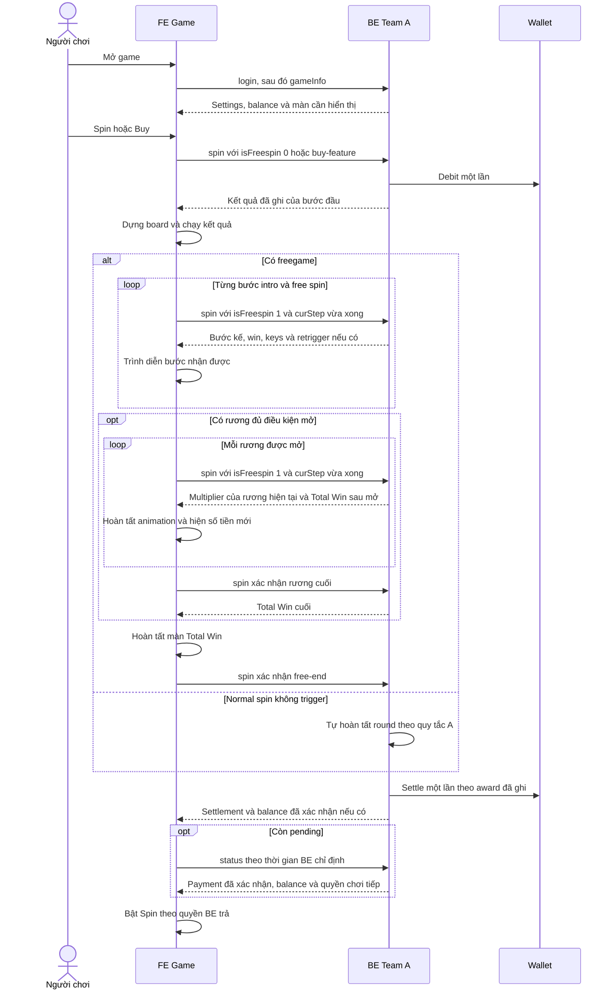
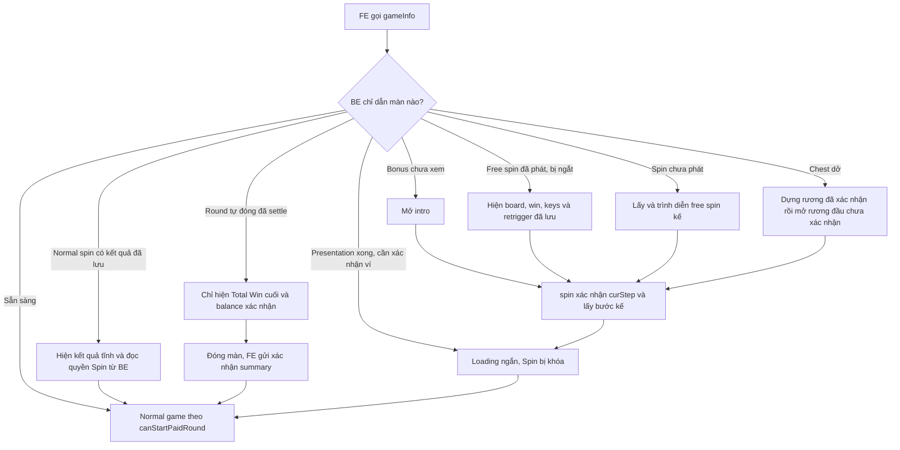
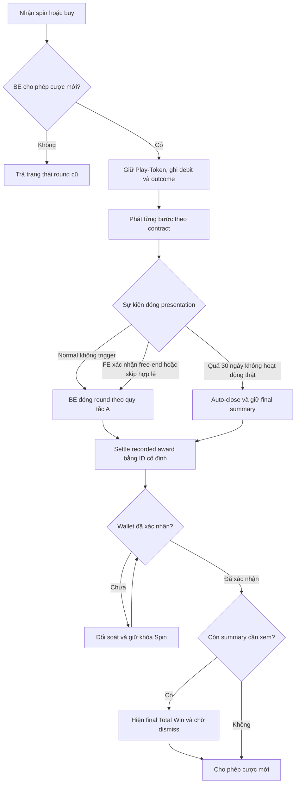

# Tavern Drop · BE/FE API và luồng game

**Quy tắc game đầu tiên đã được khách duyệt.** Các endpoint, field và enum dưới đây là đề xuất để Team A chốt contract. BE production chưa được xác nhận triển khai theo bản này.

Team A sở hữu outcome, số dư, settlement, trạng thái round, hạn 30 ngày và quyền nhận cược. FE dựng đúng màn từ response và gửi xác nhận khi bước trình diễn đã xong. Quy tắc tính hoạt động thật và cơ chế ghi deadline thuộc A.

## 1. Tổng hợp API

Prefix đề xuất là `/api/v1`. Sau login, FE dùng `sessionId` và `token` do BE cấp theo cơ chế xác thực A định nghĩa. Bảng này là bản đang review.

| API | Mục đích | FE gửi | BE trả | FE xử lý |
| --- | --- | --- | --- | --- |
| `POST /login` | Mở phiên cho đúng tài khoản | **Mock:** gửi `userId` đã được server xác thực trước đó để vào đúng tài khoản test, hoặc gửi body rỗng để BE chọn tài khoản demo ngẫu nhiên. **Server thật:** gửi `launchToken` do operator cấp | `sessionId`, `token`, và `userId` nếu BE trả kèm. Nên trả `userId` trong mock để dễ kiểm tra resume đúng tài khoản demo đã chọn | Dùng phiên vừa nhận để gọi `gameInfo`. Quyền truy cập tài khoản do BE xác thực. |
| `GET /game-info` · `gameInfo` | Lấy game settings và tiến độ hiện tại của user | `gameCode` và thông tin xác thực của phiên | `settings`, `lastReels`, `wallet`, `canStartPaidRound`, `playToken` khi được cược và `resume` nếu có | BE tìm tiến độ theo tài khoản đã xác thực và game. FE dùng response để vào normal game, resume spin/bonus/chest hoặc hiện Total Win của round tự đóng. |
| `POST /spin` · paid | Đặt cược và lấy kết quả normal spin | `isFreespin: 0`, `betMinor`, `chanceMode: normal / extra / super`. Header `Play-Token` do BE cấp | `chargedMinor`, `reels`, `winLines`, `spinWinMinor`, bước hiện tại và `freegame` nếu trigger | Hiện base spin rồi vào bonus nếu BE trả `intro`. Retry giữ nguyên token và payload. |
| `POST /buy-feature` | Mua và vào bonus trực tiếp | `betMinor`, `featureMode: tavern / drop`. Header `Play-Token` do BE cấp | `chargedMinor`, `freegame.curStep: intro`, số lượt và bước trình diễn đầu | Tiếp tục bằng `/spin` với `isFreespin: 1`. Retry giữ nguyên token và payload. |
| `POST /spin` · freegame | Xác nhận bước vừa hoàn tất và lấy bước kế | `isFreespin: 1`, `curStep` vừa trình diễn, `stepId` do BE cấp. Có thể thêm `kind: shown_as_result` khi resume bằng kết quả tĩnh | `freegame` đã cập nhật, `stepId` mới và dữ liệu ở bước kế. Với rương chỉ trả multiplier và Total Win của rương đến lượt | BE trả `freespin` thì quay reels. BE trả `show-chest`, `open-chest` hoặc `free-end` thì hiển thị đúng màn. Xác nhận một rương sau khi animation và số mới đều đã hiện. |
| `GET /rounds/status` | Kiểm tra payout khi còn chờ hoặc cần đối soát | `gameCode` nếu phiên chưa gắn game | `settlement.status`, receipt nếu có, `wallet`, `canStartPaidRound` và có thể có `retryAfterMs` | Cập nhật Balance từ số đã xác nhận. Bật Spin khi BE cho phép. Polling chạy nền không kéo dài mốc 30 ngày. |
| `POST /spin` · đóng tổng kết | Xác nhận đã đóng màn Total Win của round tự đóng sau 30 ngày | `isFreespin: 0`, `curStep: final-summary` và `summaryId` do BE cấp | `resume: null` nếu đã ghi nhận, `wallet` và `canStartPaidRound` | Khi nhận response, FE cập nhật quyền Spin. |

### Một endpoint Spin cho lượt cược và bước freegame

**Hai dạng request tại `/spin`.** BE chỉ nhận cược mới khi `isFreespin: 0` đi với `betMinor` và `Play-Token`, trước khi có `stepId`. Request xác nhận bước gửi `curStep` và `stepId` do BE cấp, riêng màn tổng kết dùng `summaryId`. Request xác nhận không mang cược mới. `isFreespin: 1` dùng suốt feature, kể cả khi `remainSpin` đã bằng 0 và đang ở chest hoặc Total Win.

**Ý nghĩa của `curStep`.** Trong request, đây là bước FE báo đã hiển thị xong. Trong response, đây là bước **BE cấp để FE thực hiện tiếp**. BE kiểm tra bước FE gửi dựa trên `stepId` đã phát và cập nhật tiến độ ở server. FE lấy `curStep` mới từ response thay vì tự tăng bước. Các rương dùng chung giá trị `open-chest`, mỗi rương có `stepId` riêng. Gửi lại cùng `stepId` phải trả lại cùng kết quả đã cấp cho lần xác nhận đó, hoặc báo tiến độ BE đã xác nhận, kể cả khi lần phản hồi trước bị mất.

### Trạng thái freegame

Response của Buy Feature hoặc Spin trúng freegame báo mode và tiến độ bonus ngay từ đầu. `gameInfo` dùng cùng cấu trúc khi khôi phục. Spin thường trả `freegame: null`. Ví dụ khi vừa trúng Drop với 10 lượt:

```json
{
  "freegame": {
    "featureMode": "drop",
    "totalSpins": 10,
    "curSpin": 0,
    "remainSpin": 10,
    "totalWinMinor": 0,
    "curStep": "intro"
  }
}
```

`totalSpins` là tổng số lượt đã cấp, gồm retrigger. Mình đề xuất dùng tên này thay cho `totalGains` để tách rõ số lượt với tiền. `curSpin` là số lượt đã tính trong trạng thái BE đang trả. `remainSpin = totalSpins - curSpin`. `totalWinMinor` là Total Win đang trình diễn do BE cung cấp, tách với Balance. Các giá trị này phải cùng thuộc một mốc. Ví dụ khi BE trả kết quả lượt 5 để resume, cả số lượt, win và keys đều là trạng thái sau lượt 5. BE vẫn theo dõi riêng bước đã phát và bước FE đã xác nhận.

| `curStep` | FE hiển thị | Khi chuyển bước |
| --- | --- | --- |
| `intro` | Màn giới thiệu Tavern hoặc Drop và số lượt được cấp | Sau Continue và intro hoàn tất, FE xác nhận để lấy free spin đầu. Nếu chưa xem intro thì lần sau mở lại màn này. |
| `freespin` | Reel, win, keys, retrigger và số lượt còn lại | FE xác nhận mỗi bước. Khi resume gặp lượt đã phát, hiện kết quả tĩnh rồi lấy lượt kế. |
| `show-chest` | Total Win trước mở; hiển thị 5 rương nếu có rương đủ điều kiện | Đến mốc mở, FE xác nhận để BE phát kết quả rương đầu tiên. Nếu không có rương đủ điều kiện, BE chuyển thẳng sang `free-end`. |
| `open-chest` | Animation rương đến lượt và Total Win sau khi mở do BE trả | FE xác nhận sau khi cả animation và số tiền đã hiện xong. BE cấp rương kế hoặc `free-end`. |
| `free-end` | Màn Total Win cuối | FE xác nhận sau khi trình diễn hoàn tất. BE xử lý payout và trả quyền cược tiếp. |

Nếu sản phẩm cần nút **Open All**, đề xuất dùng `open-all` làm thao tác chạy nhanh, vẫn đi qua các bước `open-chest` theo thứ tự BE cấp. A cần xác nhận thao tác này được phép và mốc checkpoint tương ứng. Khi round tự đóng sau 30 ngày, `gameInfo` chỉ dẫn mở màn tổng kết cuối theo nhánh riêng.

### Dữ liệu dùng chung

**Mã do BE cấp.** A trả một `playToken` khi người chơi được cược, gắn với tài khoản, game và một lần cược. FE lưu token cùng payload trước khi gửi. BE giữ token và liên kết với round một cách nguyên tử trước khi trừ tiền. Hai tab dùng cùng token chỉ tạo được một lần cược. Khi mất response, FE dùng lại token cũ cho đúng lệnh đó. Khi round đã hoàn tất và người chơi được cược tiếp, BE cấp token mới qua `gameInfo`, `spin` hoặc `status`. FE chỉ dùng token mới khi người chơi chủ động cược tiếp. Nếu token đã hết hạn hoặc không còn receipt, A trả trạng thái để đối soát, giữ nguyên số tiền đã ghi.

**Round và step.** Khi phiên đã gắn đúng game, FE gửi trực tiếp lệnh và mức cược. Nếu một phiên dùng cho nhiều game, A có thể đặt `gameCode` ở URL. BE quản lý `roundId` để lưu và đối soát. `stepId` trong response là mã duy nhất do BE cấp, khác với số thứ tự của step trong round. FE gửi lại mã này để xác nhận. `summaryId` làm nhiệm vụ tương tự với màn tổng kết. Nếu một xác nhận cũ đến muộn, BE đối chiếu đúng round cũ.

**Trạng thái.** `releasedThrough` là bước cuối BE đã cấp. `presentedThrough` là bước cuối BE đã lưu xác nhận. Đề xuất chỉ phát **một bước chưa xác nhận** tại một thời điểm, nhất là chest. Mất response vẫn lấy lại cùng bước đã cấp. `settlement.status` độc lập với hai cursor. `canStartPaidRound` do BE quyết định theo presentation, settlement và màn tổng kết còn chờ. BE kiểm tra quyền đó lại khi nhận lệnh cược, kể cả từ tab khác.

**Tiền.** KRW dùng `currencyExponent:0`. `betMinor:1000` là ₩1,000. FE dùng formatter theo currency và exponent của game. Đơn giá cược và số tiền thực trừ có thể khác khi dùng Chance/Buy. Giới hạn toàn round là 10.000× base bet gốc, kể cả mua bonus. BE trả tất cả amount dùng để hiển thị, gồm Total Win sau từng rương. Multiplier là hệ số.

### Format reels và winLines

#### ID symbol

`reels` chứa **ID của symbol** tại từng ô. ID `1` là Wild. ID cao nhất trong danh mục symbol của game là Scatter, kể cả ở lượt không xuất hiện Scatter. `gameInfo.settings.configId` xác định đúng bảng symbol và bảng đường thắng mà BE/FE dùng. Giữ nguyên config đó trong suốt round để kết quả resume vẫn giải mã đúng.

| ID Tavern đề xuất | 1 | 2 | 3 | 4 | 5 | 6 | 7 | 8 | 9 | 10 | 11 |
| --- | --- | --- | --- | --- | --- | --- | --- | --- | --- | --- | --- |
| Symbol | Wild | Feast | Roast | Potion | Ale | A | K | Q | J | 10 | Scatter |

#### Vị trí ô trên reels

`reels` là một mảng có đúng `cols × rows` phần tử, đọc từ trái sang phải rồi xuống hàng. Vị trí ô trên API bắt đầu từ **1**. Với `row` và `col` cũng bắt đầu từ 1, công thức là `pos = (row - 1) * cols + col`. FE lấy ID của symbol ở ô `pos` bằng `reels[pos - 1]`.

| Lưới (cột × hàng) | Độ dài `reels` | Vị trí theo từng hàng |
| --- | ---: | --- |
| 3×3 | 9 | 1–3 · 4–6 · 7–9 |
| 5×3 | 15 | 1–5 · 6–10 · 11–15 |
| 5×5 | 25 | 1–5 · 6–10 · 11–15 · 16–20 · 21–25 |

Ví dụ hàng đầu trên bảng 5×5 có `reels` bắt đầu bằng `[6,1,6,7,8,...]` thì **ô 2** chứa Wild, vì `reels[1] = 1`. Các dấu `...` chỉ rút gọn ví dụ, payload thật có đủ 25 số.

#### ID đường thắng và ô cần highlight

Mỗi object trong `winLines` tương ứng với một đường thắng. `lineId` là **ID payline từ 1** trong config, giữ nguyên cho mọi lượt. `winSym` là **các vị trí ô thực sự tham gia thắng** theo thứ tự trên payline. `winMinor` là số tiền BE trả cho đường đó. Một ô có thể xuất hiện trong nhiều đường thắng. Khi không có đường thắng, trả `"winLines":[]`.

Trong config Tavern 5×5, đường ngang trên cùng là line 1 và đường chéo từ góc trên trái là line 14.

| `lineId` | Đường đi đầy đủ | `winSym` nếu ba ô đầu thắng |
| ---: | --- | --- |
| 1 | `[1,2,3,4,5]` | `[1,2,3]` |
| 14 | `[1,7,13,19,25]` | `[1,7,13]` |
| 15 | `[21,17,13,9,5]` | `[21,17,13]` |

```json
{
  "winLines": [
    {"lineId": 1, "winSym": [1, 2, 3], "winMinor": 200},
    {"lineId": 14, "winSym": [1, 7, 13], "winMinor": 300}
  ],
  "spinWinMinor": 500
}
```

Mock dùng `board[reel][row]` và `wins[].line` từ 0. Khi chuyển sang đề xuất API, adapter duyệt row ngoài, reel trong, đổi vị trí thắng bằng `row * cols + reel + 1` và đổi line ID bằng `wins[].line + 1`. [Fixture mock hiện có](backend-mock-examples-client-review.md)

## 2. Luồng game và API

[Sơ đồ game và API](flow-game-api.svg) · [Sơ đồ resume](flow-resume.svg) · [Sơ đồ BE và wallet](flow-wallet.svg)



Sơ đồ trình bày đường chơi từ trạng thái sẵn sàng. Khi mở game mà `gameInfo` trả round dở hoặc có tổng kết cần xem, FE xử lý nhánh resume trước. A có thể trả `pending` rồi tiếp tục settlement ở server. Với freegame, một thao tác skip được phép đi qua cùng mốc xác nhận cuối. Với normal spin không trigger, A tự đóng round mà không đợi FE xác nhận animation.

## 3. Ví dụ request và response

Các JSON là ví dụ rút gọn theo từng tình huống. Những response `gameInfo` bên dưới chỉ trích các field liên quan đến nhánh đang bàn.

### 3.1 Login và mở game

```json
{"launchToken":"operator-issued-token"}
```

```json
{"code":0,"sessionId":"session-example","accountId":"player-17"}
```

FE gọi `GET /api/v1/game-info?gameCode=tavern-drop`.

```json
{"code":0,"contractVersion":"v1-review-6","settings":{"configId":"tavern-grid-v1","cols":5,"rows":5,"lineCount":15,"currency":"KRW","currencyExponent":0,"defaultBetMinor":1000,"allowedBetMinor":[1000,2000]},"lastReels":null,"resume":null,"wallet":{"confirmedBalanceMinor":100000,"walletVersion":40},"canStartPaidRound":true,"playToken":"play-be-17"}
```

### 3.2 Normal spin và settlement

`POST /api/v1/spin` với header `Play-Token: play-be-17`. Header mang token FE nhận từ `gameInfo`. Body gửi chế độ và mức cược. Mua Drop dùng `POST /api/v1/buy-feature` với `featureMode: "drop"` và cùng format bet.

```json
{"isFreespin":0,"betMinor":1000,"chanceMode":"normal"}
```

```json
{"code":0,"roundId":"r17","originalBaseBetMinor":1000,"chargedMinor":1000,"freegame":null,"step":{"type":"base_spin","reels":[6,6,6,7,8,7,10,2,10,9,8,4,3,4,10,9,5,4,9,4,10,9,8,5,3],"winLines":[{"lineId":1,"winSym":[1,2,3],"winMinor":200}],"spinWinMinor":200},"settlement":{"status":"pending"},"wallet":{"confirmedBalanceMinor":99000,"walletVersion":41},"canStartPaidRound":false}
```

Normal spin không trigger dùng một lệnh đặt cược. BE tự hoàn tất round và xử lý payout theo quy tắc của A. Nếu response còn báo `pending`, FE có thể đọc status để cập nhật Balance và quyền cược tiếp. Khi reload, `gameInfo` trả kết quả đã lưu để FE hiển thị trực tiếp.

`GET /api/v1/rounds/status` trả khi ví xác nhận:

```json
{"code":0,"roundId":"r17","presentationStatus":"completed","settlement":{"status":"paid","settlementId":"award-r17","creditedMinor":200},"wallet":{"confirmedBalanceMinor":99200,"walletVersion":42},"canStartPaidRound":true,"playToken":"play-be-next"}
```

Nếu mất response lệnh spin, retry cùng `Play-Token` và body. BE trả về cùng round và charge, kể cả khi outcome đã ghi trước khi FE nhận. Nếu round thắng 0, A cần một trạng thái xác nhận cuối như `no_payout` để FE biết điều kiện tài chính đã hoàn tất.

### 3.3 Resume giữa free spin

Người chơi đã xác nhận 4/10 lượt rồi thoát khi lượt 5 đang quay. Step 1 là base, step 2 là intro. Step 7 tương ứng lượt 5. BE đã phát step 7, nên `gameInfo` trả chỉ dẫn hiện kết quả tĩnh của ngay step này. Ví dụ lượt 5 thắng ₩300 và retrigger thêm 5 lượt:

```json
{"code":0,"resume":{"roundId":"r18","mode":"show_stored_result","releasedThrough":7,"presentedThrough":6,"step":{"stepId":"step-be-7","type":"free_spin","curStep":"freespin","reels":[6,6,6,11,8,7,11,2,10,9,8,4,3,4,11,9,5,11,9,4,10,9,8,5,3],"winLines":[{"lineId":1,"winSym":[1,2,3],"winMinor":300}],"spinWinMinor":300,"featureAfter":{"played":5,"total":15,"remaining":10,"accumulatedMinor":900,"keyPositions":[1,2,3,11],"retriggerSpins":5}}},"settlement":{"status":"pending"},"wallet":{"confirmedBalanceMinor":99000,"walletVersion":41},"canStartPaidRound":false}
```

FE hiện board, cumulative win, keys và số lượt sau retrigger. Sau đó gọi `/spin` để tiếp tục lượt 6.

```json
{"isFreespin":1,"curStep":"freespin","stepId":"step-be-7","kind":"shown_as_result"}
```

BE trả cursor 7 và step 8 nếu sẵn sàng. Nếu lượt 5 chưa được phát tại thời điểm reconnect, `gameInfo` chỉ dẫn chạy nó bình thường khi BE cấp kết quả. Nếu intro bonus chưa được xem, resume vào intro. Một ACK có thể vừa lưu bước hiện tại vừa lấy bước kế. Retry phải trả cùng dữ liệu của bước đã được cấp và FE đối chiếu cursor chính thức trước khi vẽ.

### 3.4 Free spin cuối, rương và thoát giữa rương

Free spin cuối chỉ cho biết có phần chest tiếp theo. FE hiện Total Win ban đầu, hiện cả 5 rương nếu có rương đủ điều kiện mở và dùng khoảng chờ 2 giây theo thiết kế game. Nếu cả 5 rương đều khóa, đi tới Total Win cuối và bỏ qua phần mở rương. Kết quả từng rương được release riêng, theo thứ tự do BE lưu.

```json
{"code":0,"roundId":"r19","releasedThrough":12,"presentedThrough":11,"step":{"stepId":"step-be-12","type":"free_spin","curStep":"freespin","reels":[6,7,8,9,10,6,7,8,9,10,6,7,8,9,10,6,7,8,9,10,6,7,8,9,10],"winLines":[],"spinWinMinor":0,"featureAfter":{"played":10,"total":10,"remaining":0,"accumulatedMinor":1200},"chestPhase":{"available":true,"displayWinBeforeMinor":1600}}}
```

Sau xác nhận step 12, BE cấp step 13 với `curStep: "show-chest"`. FE hiển thị hàng rương và Total Win trước mở, rồi gửi request sau để lấy rương đầu tiên:

```json
{"isFreespin":1,"curStep":"show-chest","stepId":"step-be-13"}
```

Cột tính từ 1. Số trước rương trong ví dụ là ₩400 base + ₩1,200 feature, và BE xác nhận ₩6,400 sau rương 5×.

```json
{"code":0,"roundId":"r19","releasedThrough":14,"presentedThrough":13,"step":{"stepId":"step-be-14","type":"chest_reveal","curStep":"open-chest","reel":1,"multiplier":5,"displayWinAfterMinor":6400}}
```

Sau khi **cả animation và số ₩6,400 đã hiện**, FE gửi:

```json
{"isFreespin":1,"curStep":"open-chest","stepId":"step-be-14"}
```

Giả sử BE đã phát rương thứ hai, FE thoát giữa animation trước khi ACK. `gameInfo` trả:

```json
{"code":0,"resume":{"roundId":"r19","mode":"play_step","releasedThrough":15,"presentedThrough":14,"snapshot":{"openedChests":[{"reel":1,"multiplier":5}],"displayWinMinor":6400},"step":{"stepId":"step-be-15","type":"chest_reveal","curStep":"open-chest","reel":3,"multiplier":10,"displayWinAfterMinor":60400}},"settlement":{"status":"pending"},"wallet":{"confirmedBalanceMinor":99000,"walletVersion":41},"canStartPaidRound":false}
```

Dựng rương cột 1 đã mở, giữ số ₩6,400 rồi chạy rương cột 3 đến ₩60,400. Nếu ACK của rương cuối đã ghi, lần reconnect đi tới Total Win. Nếu rương đã hiện xong nhưng ACK chưa ghi, resume từ rương đó. Replay chỉ trình diễn lại **cùng kết quả và amount**, tránh cộng lặp. Sau ACK rương cuối, BE phát step Total Win với số tiền cuối. Xác nhận step đó đóng presentation và làm round đủ điều kiện settle.

## 4. Resume và round tự đóng sau 30 ngày



`/spin` có thể trả bước tiếp theo thay vì trạng thái chờ ví. FE chỉ chuyển sang nhánh chờ settlement khi BE báo phần trình diễn cuối đã được ghi nhận.

A lưu deadline **30 ngày không có hoạt động thật**. Polling nền và các lần retry tự động không tự kéo dài deadline. A xác định hoạt động đủ điều kiện và quyết định kết quả khi người chơi quay lại sát hạn. Trước hạn dùng luồng resume bình thường. Sau hạn, A tự đóng phần trình diễn và settle số cuối đã lưu. Nếu ví vẫn đang đối soát, BE giữ khóa cược và FE dùng trạng thái chờ thông thường cho đến khi nhận xác nhận.

Ví dụ round `r19` đã tự đóng và settlement đã xác nhận. `gameInfo` chỉ dẫn hiển thị màn Total Win thông thường, sau khi đóng màn mới bật chơi tiếp.

```json
{"code":0,"resume":{"mode":"final_summary","roundId":"r19","summaryId":"r19-last-result","finalRoundAwardMinor":60400},"presentationStatus":"auto_closed","settlement":{"status":"paid","settlementId":"award-r19","creditedMinor":60400},"wallet":{"confirmedBalanceMinor":159400,"walletVersion":42},"canStartPaidRound":false}
```

Khi người chơi đóng tổng kết, FE xác nhận theo contract A. Ví dụ dùng cùng endpoint `/spin`.

```json
{"isFreespin":0,"curStep":"final-summary","summaryId":"r19-last-result"}
```

```json
{"code":0,"roundId":"r19","resume":null,"wallet":{"confirmedBalanceMinor":159400,"walletVersion":42},"canStartPaidRound":true,"playToken":"play-be-next"}
```

## 5. BE, wallet và lỗi mạng



- **Retry.** A đối chiếu token cược và receipt trước khi kiểm tra quyền cược mới. Retry cùng token và body phục hồi đúng round. Cùng token với nội dung khác trả lỗi xung đột. Với checkpoint, A dùng `stepId` hoặc `summaryId` do BE cấp để xác nhận đúng bước một lần, kể cả khi request tới muộn. A dùng một mã giao dịch ví ổn định cho mỗi debit và credit để đối soát khi mất response. ACK cuối và auto-close cạnh tranh trên cùng round và cùng mã settlement.
- **Khóa chơi.** Presentation xong **và** settlement xác nhận mới nhận cược cùng game. Khi có summary hết hạn, người chơi còn phải đóng màn đó. FE theo `canStartPaidRound`, BE enforce ở lệnh cược.
- **UI.** Balance lấy từ wallet snapshot đã xác nhận và giữ version mới nhất. Total Win chạy theo số BE trả sau từng step. Khi chờ, dùng loading trung tính hoặc nút Spin bị khóa. Với lỗi thật, dùng luồng reconnect/retry. Timeout giữ trạng thái chưa rõ kết quả.
- **Tần suất.** Normal spin không trigger dùng một request đặt cược và đọc status khi cần. Freegame gộp xác nhận/lấy bước kế. Chest xác nhận theo từng rương. Polling chỉ để đọc trạng thái, dùng nhịp A trả.

## 6. Điểm tích hợp A và FE cần làm rõ

1. **A cung cấp contract chốt.** Tên route, enum, mã lỗi, trạng thái terminal cho zero win, entitlement khóa cược, quyền xác nhận bước giữa nhiều tab, quy tắc hoạt động thật và retention của summary. FE thực hiện theo response.
2. **Mốc kết thúc thường và skip.** A định nghĩa khi nào BE tự đóng normal spin không trigger và cách nhận diện skip hợp lệ trong freegame. Đối với freegame, chốt lúc nào Total Win được xem là xong, gồm trường hợp đóng kết quả và auto-dismiss nếu thiết kế dùng.
3. **Dựng lại rương.** A trả board và keys cần cho cảnh, danh sách rương đã mở với multiplier đã phát, chỉ số rương sắp mở và số tiền tại checkpoint. Mẫu JSON rút gọn minh họa state riêng của rương. A cần chốt behavior animation khi một rương có hệ số ×1 hoặc chạm cap.
4. **Mock và runtime.** API hiện tại dùng session/command, board hai chiều và settlement demo. FE cần adapter cho bản A cung cấp, đồng thời test mất response, chuyển thiết bị, mất ACK, auto-close khi wallet timeout và chặn cược trong cùng game.
