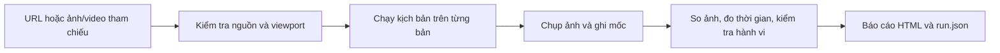

# Kế hoạch triển khai công cụ so sánh game

**Trạng thái:** Runner P0 đã có trong repo. P1 và P2 là phạm vi mở rộng.

## QA hành vi trên một bản game

Xem [tài liệu bàn giao QA cho Claude](qa-claude-handoff.md) để triển khai các test resume chest, mất phản hồi và HUD.

```powershell
npm run qa:behavior
```

Lệnh chạy các test Playwright có tag `@qa-behavior` trên một bản Vite local, cùng mock API riêng. Bộ test hiện kiểm tra mobile 390×844, thứ tự Scatter Land/Win, free spins và retrigger, chest có hoặc không mở, Total Win, và khôi phục intro/free spin. Các test kiểm tra trạng thái DOM, thứ tự animation và request. Ảnh chụp là bằng chứng để đọc lỗi.

Mỗi lượt lưu báo cáo HTML ở `.runtime/qa-behavior/<run-id>/html/index.html`, cùng `run.json`, ảnh khi lỗi và trace của lần chạy lại. Một test được xếp `failed` khi cùng assertion thất bại ở cả lượt đầu lẫn lượt chạy lại. Lỗi chập chờn hoặc lỗi chạy test lặp không đủ căn cứ được xếp `review`, còn test chưa chạy là `notObserved`. Các lỗi của cả suite được ghi ở `suiteErrors`. Dùng `CHROMIUM_PATH` cho Chrome ở vị trí khác, hoặc `npx playwright install chromium` để dùng browser của Playwright. Khi dùng `PLAYWRIGHT_BASE_URL`, trỏ vào Vite dev local vì một số test theo dõi animation qua module nguồn.

```powershell
npm run qa:trello -- --report .runtime/qa-behavior/<run-id>/run.json
npm run qa:trello -- --report .runtime/qa-behavior/<run-id>/run.json --publish
```

Lệnh đầu xem trước card. Lệnh thứ hai gửi lỗi `failed` vào **To-do**. Chọn thủ công `--review <id>` sau khi đã tái hiện một mục `review`. Chỉ ảnh PNG của mục được chọn được gửi kèm. Cả hai lệnh chạy trực tiếp bằng Node/Playwright và không gọi AI.

### Khám phá lỗi với dogfood

Trên Windows, có thể chuẩn bị CLI trong thư mục local của repo.

```powershell
npm install --prefix .runtime/dogfood-cli agent-browser
& .runtime/dogfood-cli/node_modules/.bin/agent-browser.cmd skills get dogfood
```

Chạy game bằng mock local (`npm run dev`) và mở `http://localhost:5173/?game=tarvern`. Dùng workflow `dogfood` của `agent-browser` để agent tự thao tác. Bắt đầu với desktop và portrait, thử Spin/Turbo, Buy Tavern/Drop và reload giữa bonus. Mock mặc định tắt kích hoạt Free Spins tự nhiên từ spin thường, nên dùng Buy Feature để vào bonus khi khám phá. Dùng các test `qa:behavior` cho trường hợp Scatter hoặc chest cần kết quả cố định. Mỗi lỗi cần bước tái hiện, trạng thái mong đợi, trạng thái thực tế và ảnh hoặc clip. Giữ kết quả khám phá trong `.runtime/dogfood/`. Phiên agent tự khám phá có dùng token AI. [Workflow dogfood](https://github.com/vercel-labs/agent-browser/blob/main/skill-data/dogfood/SKILL.md)

## Mục tiêu

Chạy một lệnh trên Windows để tự mở hai bản game, thực hiện cùng kịch bản và tạo báo cáo HTML cục bộ. Mỗi khác biệt cần truy về được viewport, thao tác, trạng thái game và thời điểm cụ thể. Tavern Drop là cấu hình đầu tiên. Runner dùng lại được cho game 3×3 hoặc game khác bằng cách thay kịch bản và bộ chọn.

## Công cụ và skill

| Công cụ | Vai trò |
| --- | --- |
| **Playwright Test trong repo** | Runner chính. Dùng lại `tests/browser`, mock response và fixture hiện có. Mỗi bản có browser context riêng. Dùng assertion để kiểm tra hành vi, screenshot baseline để giữ ổn định layout của bản nội bộ. [Visual comparisons](https://playwright.dev/docs/test-snapshots) |
| **`agent-browser`** | Skill ưu tiên cho khảo sát bản tham chiếu và chẩn đoán nhanh. Dùng để thử thao tác, chụp ảnh theo vùng, xem diff và quay clip ở các đoạn chuyển động. Khi cần quay 60 FPS, kiểm tra FFmpeg có trong PATH. [Skill trên skills.sh](https://www.skills.sh/vercel-labs/agent-browser/agent-browser) · [Hướng dẫn diff](https://agent-browser.dev/diffing) · [Lệnh quay](https://agent-browser.dev/commands) |
| **`playwright-cli`** | Skill bổ sung nếu cần khảo sát tương tác hay trace trình duyệt. Báo cáo tự động chạy từ runner chính kể cả khi máy chưa cài skill này. [Skill trên skills.sh](https://www.skills.sh/microsoft/playwright-cli/playwright-cli) |
| **`playwright-game-testing`** | Tài liệu tham khảo cho cách kiểm tra game Canvas/WebGL bằng khung hình và trạng thái HUD. [Skill trên skills.sh](https://www.skills.sh/shipshitgames/skills/playwright-game-testing) |

## Chạy trên máy local

Dùng Node.js 22.18+ và chạy `npm ci`. Cài Playwright Chromium bằng `npx playwright install chromium` hoặc đặt `CHROMIUM_PATH` vào executable Chrome/Chromium trên máy. Ví dụ PowerShell với Chrome mặc định là `$env:CHROMIUM_PATH = 'C:/Program Files/Google/Chrome/Application/chrome.exe'`.

```powershell
# Hai bản nội bộ, dùng cùng fixture
npm run test:compare -- --baseline "http://localhost:5174/?game=tarvern" --candidate "http://localhost:5173/?game=tarvern" --suite smoke

# Bản tham chiếu công khai và bản local
npm run test:compare -- --reference "https://paperclipgaming.com/ko/games/tavern-drop" --candidate "http://localhost:5173/?game=tarvern" --suite smoke
```

### Hai URL có session

Tạo `.runtime/game-compare.local.json`. Nhập URL đầy đủ để giữ query của session. Chạy bằng `--config` để tránh in URL session vào dòng lệnh npm.

```json
{
  "reference": { "url": "https://example.com/demo?session=REPLACE_ME" },
  "candidate": { "url": "http://localhost:5173/?game=tarvern" },
  "timeoutMs": 45000
}
```

```powershell
npm run test:compare -- --config .runtime/game-compare.local.json
```

Đổi `reference` thành `baseline` khi so hai bản nội bộ. Mỗi đầu vào cũng có thể là chuỗi URL. Nếu session cần cookie/local storage, thêm `"storageState": "state.json"` vào đầu vào tương ứng. Đường dẫn tính từ thư mục chứa config, dùng file Playwright storage state của phiên được phép kiểm thử. Dùng URL mới khi phiên hết hạn. Báo cáo chỉ ghi origin, còn config/session state luôn lưu cục bộ.

Dùng `--headed` để mở cửa sổ và `--video` để ghi clip Playwright. Nếu thiếu codec ghi hình, chạy `npx playwright install ffmpeg`. Bản tham chiếu kiểm thử bằng thao tác quan sát UI. Để thử Spin trên **demo**, thêm `"playDemo": true` vào `reference`; runner kiểm tra URL đích có `demo=true` trước khi bấm Spin. Các mốc Scatter ngẫu nhiên chỉ được ghi ở mức quan sát.

- **Hai bản nội bộ.** Runner cấp session sạch riêng cho mỗi bản và phát cùng kết quả spin từ fixture P0. Chế độ này cho kết quả pass/fail lặp lại được và có thể đưa vào CI sau khi ổn định. Đợt đầu hỗ trợ hai URL đang chạy, sau đó mới xem xét tự khởi động hai build từ commit.
- **Bản tham chiếu công khai.** Runner mở demo, theo iframe Tavern nếu có và nhận biết Continue, HUD và Bet Menu qua các vùng canvas. Nếu demo không tải, session hết hạn hoặc chưa quan sát được mốc tương ứng, báo `notObserved` kèm lý do. Profile P0 chỉ dùng Buy Bonus trong các bài mở rộng sau này.

## Đưa lỗi lên Trello

Lệnh `qa:trello` đọc `run.json` của một lượt QA. Mặc định lệnh in thử nội dung card cho các mốc `failed`. Dùng `--review <step-id>` để chọn thêm từng mốc `review`; xem ID trong `run.json`. Runner bỏ qua các mốc `passed` và `notObserved`.

```powershell
npm run qa:trello -- --report .runtime/game-compare/<run-id>/run.json
npm run qa:trello -- --report .runtime/game-compare/<run-id>/run.json --review <step-id>
npm run qa:trello -- --report .runtime/game-compare/<run-id>/run.json --publish
```

`--publish` yêu cầu `TRELLO_API_KEY` và `TRELLO_API_TOKEN` trong môi trường local. Token cần quyền đọc và ghi board. Đích mặc định là board `Tarvern` (`ncXK6YWm`), cột `To-do`. Khi cần đổi đích, đặt `TRELLO_BOARD_ID` và `TRELLO_LIST_NAME`. Tên cột được so khớp bỏ qua khoảng trắng, dấu gạch nối và chữ hoa/thường.

Các viewport gặp lỗi ở cùng một mốc được gộp vào một card. Nếu đã có card đang mở cho cùng profile, chế độ và mốc, lệnh cập nhật phần mô tả do tool quản lý. Ảnh baseline, candidate và diff có sẵn được đính kèm; chạy lại cùng báo cáo sẽ bỏ qua ảnh đã đính kèm. Lệnh in link card sau khi đăng. Các ảnh chụp sẽ hiển thị cho người có quyền xem card.

## Luồng chạy



Runner chung quản lý browser, thời gian chờ, ảnh và báo cáo. Profile Tavern định nghĩa viewport, thao tác, vùng chụp và dấu hiệu nhận biết từng mốc. Dùng sự kiện hoặc trạng thái UI để đồng bộ, rồi lấy thời gian tương đối từ mỗi mốc. Không dùng một khoảng chờ cố định cho cả luồng. Với screenshot regression, giữ cùng hệ điều hành, Chromium, DPR và chế độ render. Cố định fixture và chỉ che vùng động không thuộc nội dung cần kiểm tra, như đồng hồ. [Hướng dẫn về môi trường render của Playwright](https://playwright.dev/docs/test-snapshots#introduction)

## Kịch bản ưu tiên

| Ưu tiên | Kịch bản | Bằng chứng cần có |
| --- | --- | --- |
| P0 | Brand → Landing → game | Mốc Continue sẵn sàng và ảnh trước/sau click. Ghi mascot, độ mờ và thời điểm HUD xuất hiện. |
| P0 | Drop thường và Turbo | Frame trước khi symbol đến mép reel, frame vào reel, frame đáp. Dùng fixture có Scatter ở reel muộn để bắt quầng vàng xuất hiện sớm. Kiểm tra ở cả hai tốc độ. |
| P0 | HUD và Bet Menu trên desktop/portrait | Ảnh theo vùng và tọa độ các nút. Kiểm tra clipping, khoảng cách và trạng thái sau thao tác. Viewport khởi đầu là 1280×720 và 390×844, DPR 1. |
| P1 | Buy Tavern và Drop | Kiểm tra 3/4 Scatter tương ứng, Scatter Win xong trước intro, HUD ẩn trong intro và hiện trước auto spin. |
| P1 | Resume giữa free spin hoặc chest | Reload đúng checkpoint. Ghi counter, key, win tích lũy và số chest đã mở. Kiểm tra free spin đã hoàn thành chỉ được tính một lần. |
| P1 | Chest → Big Win → Total Win | So thứ tự mở rương và mốc tăng amount. Kiểm tra số tiền dài trên portrait, thanh cuộn và click toàn màn hình để tiếp tục. |
| P2 | Autoplay và Near Scatter | Kiểm tra chọn lượt chỉ chuẩn bị autoplay, Spin mới bắt đầu, nút +10 cập nhật số lượt. So highlight và thứ tự rơi khi gần Scatter ở tốc độ thường. |

## Báo cáo và nghiệm thu bản đầu

- Lưu mỗi lần chạy dưới `.runtime/game-compare/<run-id>/`. `index.html` hiển thị hai ảnh cạnh nhau, ảnh diff khi so được, và mốc thời gian hoặc clip nếu có. `run.json` ghi nguồn, build nếu xác định được, viewport, fixture, trạng thái từng bước và đường dẫn bằng chứng.
- Báo cáo phân biệt được lỗi assertion, khác biệt thị giác cần xem và trạng thái chưa quan sát được. Mã thoát khác 0 cho lỗi assertion, HUD dịch quá 2 CSS px ở hai bản nội bộ, hoặc lỗi chạy tool. Ảnh animation dùng để review vì thời điểm yêu cầu screenshot có thể trễ hơn mốc renderer. JSON ghi hai mốc riêng. Ở chế độ tham chiếu công khai, chênh lệch pixel chỉ để xem xét.
- Hoàn thành bản đầu khi một lệnh chạy hết P0 cho hai URL nội bộ, tạo báo cáo mở được trên máy và đạt cùng kết luận trong hai lần chạy liên tiếp. Dùng một sai lệch chủ động trong bản chạy thử, chẳng hạn dịch vị trí nút Bet hoặc bật lại glow trước khi vào reel, để chứng minh báo cáo phát hiện được lỗi. Chạy thêm một lần với URL tham chiếu và ghi trạng thái quan sát được.

## Mở rộng kịch bản

Runner chung trong `src/framework/testing/`. Profile và fixture P0 của Tavern nằm trong `src/games/tavern/testing/`. Hai bản nội bộ nhận cùng fixture gồm ba Scatter, trong đó Scatter muộn ở reel 5 hàng 3. Bộ test theo dõi trạng thái render tại các mốc chờ, vào reel và đáp. Mở rộng P1 theo thứ tự Buy Bonus, Resume và Total Win. Thử CI sau khi quy trình ảnh và độ lặp lại đã ổn định.

Để thử sai lệch bố cục nội bộ, dùng cấu hình candidate với `"testStyle": "#bet-picker { translate: 16px 0px !important; }"` và URL loopback. Tool cần báo sai lệch 16 px và trả exit code 1. Style thử chỉ tồn tại trong browser context của lần chạy.

## Kết quả xác minh

- Hai lượt nội bộ liên tiếp trên desktop và portrait có cùng kết quả. Cả 22 mốc đều được ghi, với 0 lỗi assertion và 16 mốc ảnh cần xem. Board, win và mốc hiện của fixture Scatter ở reel 5 được kiểm tra ở cả hai tốc độ. Lượt đối chiếu Vite preview với Vite dev cũng cho cùng kết quả.
- Lỗi thử dịch nút Bet 16 px được phát hiện ở HUD và Bet Menu trên cả hai viewport. Lượt chạy lỗi thử trả exit code 1.
- Demo gốc bằng URL session hiển thị Landing, chuyển cảnh, game, HUD và Bet Menu trên cả hai viewport. Normal và Turbo đều có ảnh trong và sau lượt spin quan sát được. 12 mốc Drop được ghi `notObserved` khi đối chiếu với fixture vì demo trả board ngẫu nhiên và thiếu telemetry ở đúng thời điểm Scatter muộn.

Phạm vi buổi đầu là công cụ cục bộ trên repo chính. Baseline ban đầu lấy từ bản nội bộ được duyệt. Giữ ảnh, video và trace của lần chạy trong thư mục cục bộ.
