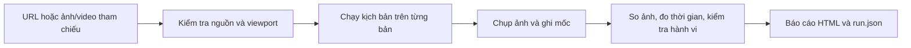

# Kế hoạch triển khai công cụ so sánh game

**Trạng thái:** Kế hoạch cho buổi làm việc sáng mai. Các lệnh dưới đây là giao diện dự kiến.

## Mục tiêu

Chạy một lệnh trên Windows để tự mở hai bản game, thực hiện cùng kịch bản và tạo báo cáo HTML cục bộ. Mỗi khác biệt cần truy về được viewport, thao tác, trạng thái game và thời điểm cụ thể. Tavern Drop là cấu hình đầu tiên. Runner dùng lại được cho game 3×3 hoặc game khác bằng cách thay kịch bản và bộ chọn.

## Công cụ và skill

| Công cụ | Vai trò |
| --- | --- |
| **Playwright Test trong repo** | Runner chính. Dùng lại `tests/browser`, mock response và fixture hiện có. Mỗi bản có browser context riêng. Dùng assertion để kiểm tra hành vi, screenshot baseline để giữ ổn định layout của bản nội bộ. [Visual comparisons](https://playwright.dev/docs/test-snapshots) |
| **`agent-browser`** | Skill ưu tiên cho khảo sát bản tham chiếu và chẩn đoán nhanh. Dùng để thử thao tác, chụp ảnh theo vùng, xem diff và quay clip ở các đoạn chuyển động. Khi cần quay 60 FPS, kiểm tra FFmpeg có trong PATH. [Skill trên skills.sh](https://www.skills.sh/vercel-labs/agent-browser/agent-browser) · [Hướng dẫn diff](https://agent-browser.dev/diffing) · [Lệnh quay](https://agent-browser.dev/commands) |
| **`playwright-cli`** | Skill bổ sung nếu cần khảo sát tương tác hay trace trình duyệt. Báo cáo tự động chạy từ runner chính kể cả khi máy chưa cài skill này. [Skill trên skills.sh](https://www.skills.sh/microsoft/playwright-cli/playwright-cli) |
| **`playwright-game-testing`** | Tài liệu tham khảo cho cách kiểm tra game Canvas/WebGL bằng khung hình và trạng thái HUD. [Skill trên skills.sh](https://www.skills.sh/shipshitgames/skills/playwright-game-testing) |

## Giao diện dự kiến

```powershell
# Hai bản nội bộ, dùng cùng fixture
npm run test:compare -- --baseline "http://localhost:5174/?game=tarvern" --candidate "http://localhost:5173/?game=tarvern" --suite smoke

# Bản tham chiếu công khai và bản local
npm run test:compare -- --reference "https://paperclipgaming.com/ko/games/tavern-drop" --candidate "http://localhost:5173/?game=tarvern" --suite smoke
```

- **Hai bản nội bộ.** Runner cấp session sạch riêng cho mỗi bản và phát cùng board, win, trigger, chest và checkpoint đã ghi. Chế độ này cho kết quả pass/fail lặp lại được và có thể đưa vào CI sau khi ổn định. Đợt đầu hỗ trợ hai URL đang chạy, sau đó mới xem xét tự khởi động hai build từ commit.
- **Bản tham chiếu công khai.** Runner thử mở demo, phát hiện iframe nếu có và ghi lại các trạng thái quan sát được. Khi board ngẫu nhiên, chỉ đo vùng và mốc thực sự tương ứng. Nếu demo không tải hoặc chưa quan sát được trạng thái hiếm trong thời gian chạy, báo `not observed` và đính kèm lý do. Chỉ thao tác Buy Bonus khi phiên đang dùng demo credit. Có thể dùng ảnh/video đã ghi làm bằng chứng cho trạng thái chưa gặp lại.

## Luồng chạy



Runner chung quản lý browser, thời gian chờ, ảnh và báo cáo. Profile Tavern định nghĩa viewport, thao tác, vùng chụp và dấu hiệu nhận biết từng mốc. Dùng sự kiện hoặc trạng thái UI để đồng bộ, rồi lấy thời gian tương đối từ mỗi mốc. Không dùng một khoảng chờ cố định cho cả luồng. Với screenshot regression, giữ cùng hệ điều hành, Chromium, DPR và chế độ render. Cố định fixture và chỉ che vùng động không thuộc nội dung cần kiểm tra, như đồng hồ. [Hướng dẫn về môi trường render của Playwright](https://playwright.dev/docs/test-snapshots#introduction)

## Kịch bản ưu tiên

| Ưu tiên | Kịch bản | Bằng chứng cần có |
| --- | --- | --- |
| P0 | Brand → Landing → game | Mốc Continue sẵn sàng và ảnh trước/sau click. Ghi mascot, độ mờ và thời điểm HUD xuất hiện. |
| P0 | Drop thường và Turbo | Frame trước khi symbol đến mép reel, frame vào reel, frame đáp. Dùng fixture có Scatter ở reel muộn để bắt quầng vàng xuất hiện sớm. Kiểm tra ở cả hai tốc độ. |
| P0 | HUD và Bet Menu trên desktop/portrait | Ảnh theo vùng và tọa độ các nút. Kiểm tra clipping, khoảng cách và trạng thái sau thao tác. Viewport khởi đầu là 1280×720 và 390×844, DPR 1. |
| P1 | Buy Tavern và Drop | Kiểm tra 3/4 Scatter tương ứng, Scatter Win xong trước intro, HUD ẩn trong intro và hiện trước auto spin. |
| P1 | Resume giữa free spin hoặc chest | Reload đúng checkpoint. Ghi counter, key, win tích lũy và số chest đã mở. Kiểm tra free spin đã hoàn thành chỉ được tính một lần. |
| P1 | Chest → Big Win → Total Win | So thứ tự mở rương và mốc tăng amount. Kiểm tra số tiền dài trên portrait, thanh cuộn và click toàn màn hình để tiếp tục. |
| P2 | Autoplay và Near Scatter | Kiểm tra chọn lượt chỉ chuẩn bị autoplay, Spin mới bắt đầu, nút +10 cập nhật số lượt. So highlight và thứ tự rơi khi gần Scatter ở tốc độ thường. |

## Báo cáo và nghiệm thu bản đầu

- Lưu mỗi lần chạy dưới `.runtime/game-compare/<run-id>/`. `index.html` hiển thị hai ảnh cạnh nhau, ảnh diff khi so được, và mốc thời gian hoặc clip nếu có. `run.json` ghi nguồn, build nếu xác định được, viewport, fixture, trạng thái từng bước và đường dẫn bằng chứng.
- Báo cáo phân biệt được lỗi assertion, khác biệt thị giác cần xem và trạng thái chưa quan sát được. Mã thoát khác 0 cho lỗi assertion hoặc lỗi chạy tool. Ở chế độ tham chiếu công khai, chênh lệch pixel chỉ để xem xét. Hiệu chỉnh ngưỡng diff theo từng vùng sau khi chạy lặp trên cùng build.
- Hoàn thành bản đầu khi một lệnh chạy hết P0 cho hai URL nội bộ, tạo báo cáo mở được trên máy và đạt cùng kết luận trong hai lần chạy liên tiếp. Dùng một sai lệch chủ động trong bản chạy thử, chẳng hạn dịch vị trí nút Bet hoặc bật lại glow trước khi vào reel, để chứng minh báo cáo phát hiện được lỗi. Chạy thêm một lần với URL tham chiếu và ghi trạng thái quan sát được.

## Thứ tự triển khai sáng mai

1. Kiểm tra Node, Chromium và chạy lại các test `landing`, `tavern-policies`, `startup-feature` đang có. Xác nhận demo tham chiếu mở được với hai viewport dự kiến và chọn bộ chọn ổn định.
2. Tạo command và runner dùng Playwright hiện tại. Làm trước một kịch bản Landing → game và một cặp ảnh HUD để hoàn chỉnh luồng từ đầu vào đến báo cáo.
3. Thêm fixture Drop có Scatter ở reel muộn, đo mốc như bảng P0 và chạy ở cả hai tốc độ. Hoàn thành Bet Menu, chạy lặp hai lần và thử sai lệch chủ động.
4. Chạy chế độ tham chiếu, ghi phạm vi quan sát được rồi mở rộng P1 theo thứ tự Buy Bonus, Resume và Total Win. CI để sau khi ảnh baseline và độ lặp lại đã ổn định.

Phạm vi buổi đầu là công cụ cục bộ trên repo chính. Baseline ban đầu lấy từ bản nội bộ được duyệt. Giữ ảnh, video và trace của lần chạy trong thư mục cục bộ.
