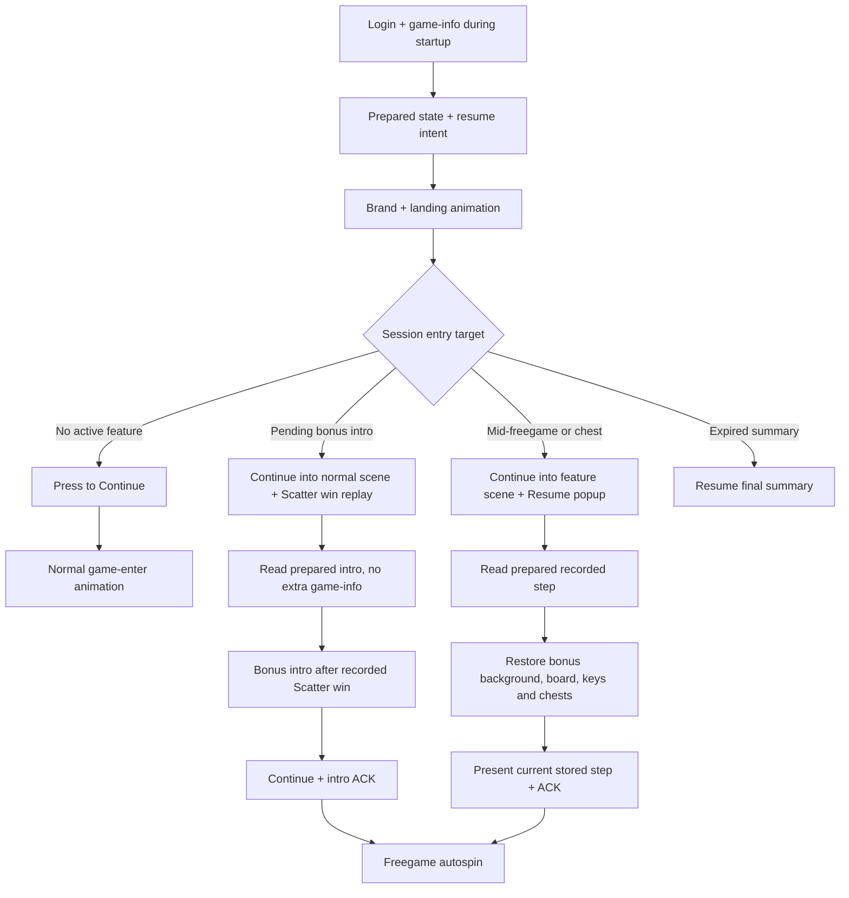

# Landing uses the prepared session to select the game scene

Login and `POST /api/v1/game-info` finish during startup, before the landing can be continued. The same prepared snapshot boots the controller. A shared `resolveSessionEntry` helper reads resume intent before considering the visible board snapshot.

This distinction matters at `intro`: the last acknowledged snapshot is still a base-game board, but the released step is already Tavern/Drop bonus intro. This checkpoint intentionally enters the normal scene first to play the bonus intro; later feature checkpoints enter freegame directly.

The normalized snapshot now retains `resume.curStep`, `resume.featureMode` and `resume.kind`. They are presentation routing metadata, not client-side outcome decisions. Both the metadata and the displayed snapshot come from the same game-info response.

For active features the landing still waits for its native animation, then shows Press to Continue. No Resume popup appears on the landing. For `curStep=intro`, Continue enters the normal scene, automatically replays the recorded Scatter win and plays the bonus intro without a Resume popup. For later checkpoints, Continue restores the feature scene directly and shows Resume over that scene, without the normal reveal/game-enter path. The feature stays paused until Resume is clicked. An unshown bonus intro resumes at its popup; a released free spin restores that spin's after-state and remaining count; chest progression resumes at the current chest boundary.

`GameController.recover(false)` can consume the prepared resume once, without another game-info request or another wager. If presentation/recovery later encounters a network error, a fresh recovery still reconciles with the backend. A pending local wager is cleared only after the backend's recorded resume result has been obtained. Outcomes and payment receipts remain server-owned.

For checkpoints after intro, Tavern's native renderer restores the bonus idle pose directly rather than playing base exit/game-enter animations. An intro checkpoint enters normal first, replays only the recorded Scatter win, then plays the authored base-exit/bonus-intro flow. This does not create a spin, change its outcome, or ACK intro before the bonus Continue. New paid bonus triggers retain their normal Scatter/entry presentation.

Checks cover both Tavern and Drop at intro and mid-freegame, request counts, no second wager, preserved remaining-spin counts, normal startup, and full feature completion after a resumed intro.
