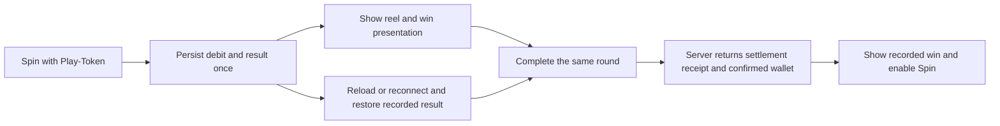

# Tavern Drop M2 re-review — status and revision plan

> **Superseded by the [second re-review revision](rereview-2-delivery.md)** and its [reference timing](rereview-2-reference-timing.md). This page records the earlier candidate.

**Review baseline:** GitLab MR !2, commit `807f914`. The checks below distinguish the client-observed results from the original revision plan. See the [revision candidate notes](rereview-delivery.md) for the implementation and repeatable checks.

## Already verified

| Evidence | Result |
| --- | --- |
| Client review of `807f914` | All 15 paylines matched. Both Bonus Buy previews left the mock wallet unchanged. Repeated input and retry after a lost response produced one round and one debit in the scenarios tested. |
| Development browser checks | The opening-bet and charged-amount checks now follow the configured base stake. The sound-pack listener is registered before opening the game. The opening-bet check passed in the local regression run, and the sound-pack check passed when rerun on its own. These are local test changes. The audio check still needs to verify playback. |
| Historical M2 smoke and build | The earlier build, viewport and runtime checks are recorded in the [M2 verification record](verification.md). The re-review build will have its own commit, hashes, test report and capture links. |

## Step-by-step revision plan

| Order | Item and current finding | Change and acceptance check |
| --- | --- | --- |
| 1 | **Approved KRW stakes.** MR !2 offers 22 values. Normal, Extra, Super, Tavern Buy and Drop Buy already have the agreed price factors. | Replace the shared game configuration with the ordered 25-value list below. Drive the Bet Menu, HUD arrows, Feature panel arrows, mock game-info and spin validation from that list. Add an exact ordered-list test with an independent expected array. Check the first and last steps, mock rejection of a removed stake, and the original base stake in the spin payload for all Chance modes. Verify the cap uses base stake across all five modes, including both Bonus Buy quotes. |
| 2 | **Ordinary spin completion and reload.** The mock settles base-only rounds in the paid response and releases the next Play-Token while the reels can still be moving. Reload can restore the reels while losing the last win. | Persist the debit, board and win as a pending round. Block new paid play until the same round receives an idempotent completion ACK and the server confirms wallet and unlock. Apply the same boundary to zero-win rounds. On reconnect or reload, finish the stored round and show its result and confirmed balance without replaying reels or win animations. Cover lost paid and completion responses, same-token retry and repeated ACK. See the acceptance cases below. |
| 3 | **Chance HUD.** The active mode and charge currently replace the main BET amount. | Keep the original base stake prominent. Show mode and actual cost per spin beside it at desktop and at 390 px portrait, including long KRW amounts. At a ₩20,000 base, show **Extra Chance · Bet ₩20,000 · Cost ₩60,000** and **Super Chance · Bet ₩20,000 · Cost ₩120,000**. Verify changing the base bet updates both amounts and turning Chance off restores the normal HUD. |
| 4 | **Win pacing.** The build already has distinct Normal/Turbo timings. The client observed an effect that starts early and disappears quickly. | Capture the reference first. Compare final reel land, first win frame, symbol/payline and amount hold, fade, HUD count, and tier screen exit. Use equivalent single-line, multi-line and 100× scenarios. Tune the measured differences in Tavern configuration and use cancellable presentation timing shared with Skip. Compare Normal and Turbo separately. |
| 5 | **Skip and Space.** Tavern currently blocks force-stop while reels are moving, and the client saw a disabled control labelled Skip on a 100× win. The current hold timer is 400 ms. Reference behavior still needs live verification for both interactions. | Measure a second Space tap during moving reels and separately during the amount count. Then measure a hold from key-down through release, including initial action, temporary speed, and the post-release state, with the same Turbo setting on both builds. Implement a shared input/presentation policy with Tavern timing in config. Show an enabled Skip only during a confirmed skippable stage. On network and settlement waits, keep the input locked. Ignore native key repeat, cancel hold on lost focus, restore the selected Turbo setting on release, and assert repeated key/click input creates only one wager. |
| 6 | **Disabled Bonus copy and click sounds.** The M2 notice deliberately blocks Bonus Buy and prevents charging. Its wording and some click cues differ from the reference. | Review wording and cue mappings by action. Where the reference has no M2-equivalent lock, agree concise player-facing copy that communicates the lock and no charge. Keep both previews and confirmations free of a debit. Verify audible output for intended UI actions in a real browser, including mute/volume behavior, by checking active audio output or advancing playback after a trusted gesture. Keep the single-pack network assertion as a separate check. |
| 7 | **Provisional paytable.** Current synthetic five-of-a-kind payouts are **2.5× for Ale** and **7.5× for Wild**. The client observed **4×** and **20×** on the reference. | Mark all currently unapproved symbol payouts in the re-review guide and in the Info/paytable UI once the change lands. Keep the current synthetic values until Iman’s approved math package arrives. Import approved payouts into Tavern’s versioned symbol mapping under `symbols[].pays` in `src/games/tavern/game.config.json`. Use the same version for the Info table, mock payout calculation and fixed fixtures. Record the config ID with each fixture and verify the two reported entries against the approved package. |

### Approved base stakes

All values are whole KRW, in this order:

```text
200, 300, 400, 500, 600, 800, 1000, 1500, 2000, 3000,
4000, 5000, 6000, 8000, 10000, 15000, 20000, 30000, 40000,
50000, 60000, 80000, 100000, 150000, 200000
```

Retain Normal ×1, Extra ×3, Super ×6, Tavern Buy ×125 and Drop Buy ×300. The round cap is always **10,000 × original base stake**. Example at ₩20,000: the cap is ₩200,000,000 in every mode. The checks below use synthetic KRW. The live RGS connection remains in M4.

## Ordinary round acceptance cases



| Case | Repeatable evidence |
| --- | --- |
| Normal win | Fixed synthetic ₩79,000 win on a ₩20,000 stake (or a documented equivalent). With initial wallet ₩10,000,000, expect ₩9,980,000 after debit and ₩10,059,000 after confirmed settlement. Spin stays locked until confirmation. |
| Zero win | Same starting wallet and stake, final wallet ₩9,980,000. Completion returns a terminal no-payout receipt and unlocks Spin. |
| Reload or lost paid response | Interrupt after the server records the debit. Reload using the same player identity. Recover the same round and show its fixed win and confirmed balance without reel/count replay. If retrying the wager, send the original Play-Token and payload. Assert the same round and one debit. |
| Lost completion response or repeated completion | Drop the ACK response after server commit, then retry the same ACK from the original tab or a second tab. Compare round ID, settlement ID, authoritative amount and wallet version. No second settlement or extra round. |

Use the existing synthetic API sequences in the development source as a starting point and align the examples with the implemented mock. After debit, expose the released base result with `canStartPaidRound: false` and no new Play-Token. Advance the presentation cursor and return the next entitlement only after confirmed settlement. Keep the fallback settlement policy for abandoned rounds so player return is unnecessary. A fixture verifies recovery independently from random outcomes. Run the win and input cases in both Normal and Turbo.

## Re-review evidence and delivery

- Record two desktop comparisons with visible Space key-down and key-up. The first shows the second tap during reel motion and during a separate win count. The second shows hold and release, including the measured hold threshold and when speed returns to the selected setting. Use the same Turbo setting in each original/build pair and label the viewport and build.
- Record one short mobile capture at 390 px showing Extra and Super at a ₩20,000 base, then the fixed-win refresh case. Include enough of the outcome and wallet for reviewers to verify the amounts.
- Run a clean export, `npm ci`, `npm test`, `npm run build` and the selected Playwright checks. Start the mock with `npm start` from the review app directory. Provide exact fixture commands and URLs, the test matrix and results, browser/OS/Node versions and the mock environment.
- For the re-review reply, include the new SHA on MR !2, app build and export-manifest SHA-256 values, run instructions and the evidence links. These fields will be filled from the tested revision. Delivery date to be confirmed after reference timing checks and the repeatable recovery case have been validated.
