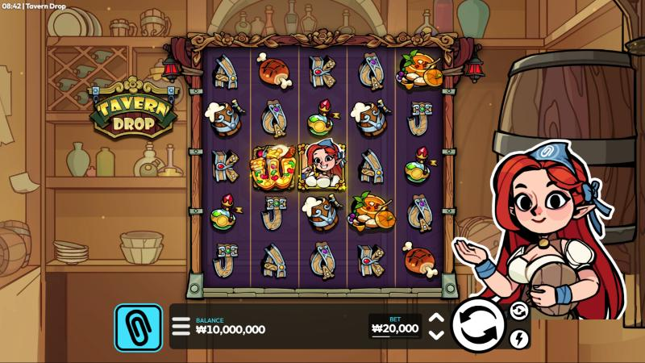
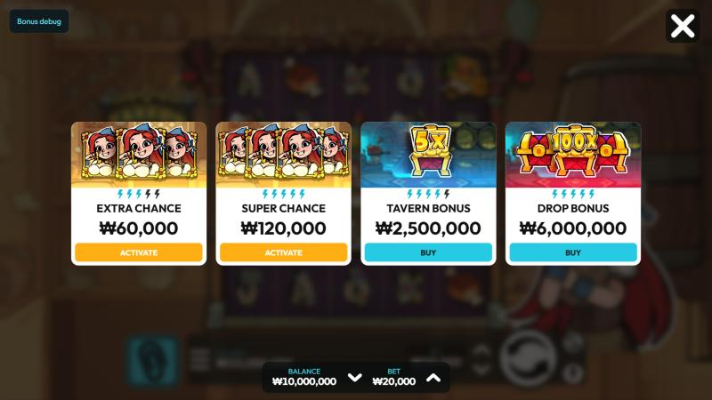
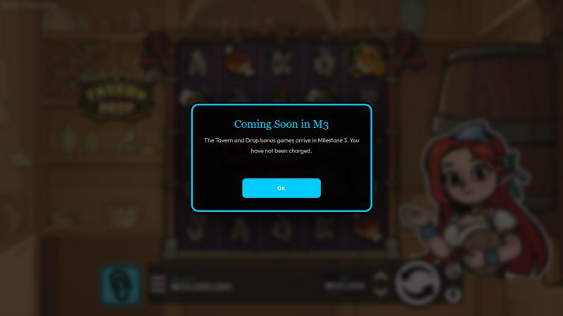
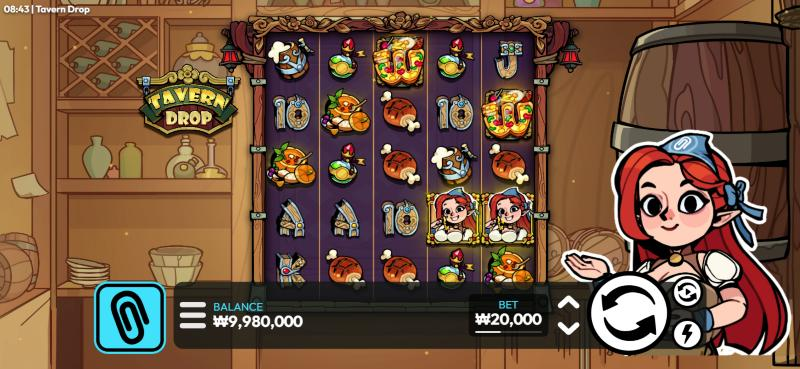

# Tavern Drop — Milestone 2 features and test guide

> Current review status: [second re-review revision](milestone-2-evidence/rereview-2-delivery.md) and [reference input and win timing](milestone-2-evidence/rereview-2-reference-timing.md).

Milestone 2 covers the Tavern Drop **base game** on the reusable `fw-pixi` TypeScript/PixiJS framework. The baseline uses Tavern Drop v13 art, Spine animations, fonts and sounds. The Tavern and Drop bonus games are Milestone 3. In M2 the Bonus Buy is locked: confirming it shows **Bonus not available** and no bet is placed.

This guide describes the build reviewed at `807f914`. See the [M2 re-review plan](milestone-2-evidence/re-review-plan.md) for findings, the approved stake list and acceptance cases for the next build. Results use the mock API with demo credits.

## 1. Test setup

| Item | Value |
| --- | --- |
| Game URL | `https://<your-host>/` or `https://<your-host>/?game=tavern` |
| Local URL | `http://localhost:4000/` after `npm run build` and `npm start` |
| Second layout example | `/?game=reuse` opens a 3×3 game on the same framework |
| Asset viewer | `/?game=viewer` plays each Spine clip, image and sound cue |
| Demo wallet | ₩10,000,000 per new session (synthetic KRW) |
| Asset quality | Automatic. Add `?quality=hd` or `?quality=sd` to force a tier |
| Review tools | Designated mock review sessions can open **Feature buy → Bonus debug** for the error-state switches in section 9 |

Test on at least one desktop browser (Chrome, Edge, Safari or Firefox), one Android phone and one iPhone, in portrait and landscape. A new browser profile or private window starts a new demo session.

## 2. Loading, Continue and resume

**Delivered**

- The Paperclip Gaming intro animation plays for 2.7 s without stutter, then the static loader shows the studio logo, the game logo and the loading percentage.
- Phones load the SD texture set and desktops the HD set, as in the original. The canvas renders at up to 2× pixel density.
- The landing screen shows the tavern and **Press to continue**. The press starts the game music and ambience.
- The client can retry a lost paid response. Ordinary-spin completion and reload recovery are scheduled for the re-review.

**How to test**

1. Open the game. Expected: the intro, then the loader with a rising percentage, then the landing screen. No blank frame or flash of unstyled text.
2. Press **Press to continue**. Expected: the reels appear, the HUD becomes active and music fades in.
3. For the re-review, use the [ordinary round acceptance cases](milestone-2-evidence/re-review-plan.md#ordinary-round-acceptance-cases) for mid-spin reload. The baseline can restore the board and wallet while losing the displayed last win.
4. On a phone, add `?quality=hd` and compare with `?quality=sd`. Expected: both load. HD is sharper and uses more memory.

## 3. 5×5 base game, reel motion, skip and 15 paylines

**Delivered**

- A 5×5 board with 15 fixed paylines paying left to right, 3 or more of a kind. Wild substitutes for all symbols except Bonus.
- The original drop motion: outgoing symbols fall out over 340 ms, new symbols drop in reel by reel, land with a squash and settle. Turbo uses the original shorter values.
- Anticipation from two Bonus symbols: remaining reels slow, the camera zooms slightly and an anticipation sound plays.
- Win presentation (original timing): a 500 ms pause after the reels (300 ms in Turbo or after a skip), then the lines light up one after another and stay lit; each line shows its payline art and amount (green below 20× bet, red from 20×). After the last line and any win screen, the **Win** amount counts up over 500 ms while Spin is already available.
- **Skip**: pressing Spin, a second Space tap or a tap on the play area during a round shortens it. During the drop the symbols still fall and land visibly, just faster. During the lines every line is still shown, with shorter gaps. A skip never places a wager. The [timing reference](milestone-2-evidence/rereview-2-reference-timing.md) lists the original values.

**How to test**

1. Spin 20 times at the default bet. Expected: no symbol pops or flashes when the old symbols fall out; each reel lands in order.
2. Find a spin with several winning lines. Expected: lines are shown one by one, earlier lines stay lit, each line amount appears next to its line, and the total counts up in **Win**.
3. Tap the reels while they drop. Expected: the symbols finish falling quickly but visibly, then the winning lines and amounts are shown. In another round, tap during the lines. Expected: the remaining lines show faster; the recorded amount is unchanged.
4. Tap the play area while no round is running. Expected: nothing happens; no wager is placed.
4. Land two Bonus symbols. Expected: anticipation on the remaining reels.
5. Open **Menu → Game Rules → Paytable** and compare 3 of the 15 paylines with a winning spin. Expected: the lit symbols follow the drawn line.

## 4. HUD, bet controls, Turbo and Autoplay (desktop and mobile)

**Delivered**

- HUD layouts for desktop, landscape phones and portrait phones, centered like the original and inside the safe area.
- **Bet ladder (KRW).** The review baseline contains 22 steps, with a default of ₩20,000. The [25 approved base stakes](milestone-2-evidence/re-review-plan.md#approved-base-stakes) will replace that ladder in the re-review build.
- **Turbo** can be toggled in the HUD. Holding Space for 0.4 s turns Turbo on until release; release restores the player's own setting.
- **Autoplay**: 10, 25, 50, 100, 250, 500, 1,000 or unlimited rounds. The Spin button shows the remaining count; pressing it stops autoplay. **+10** adds rounds while autoplay runs. Autoplay stops on a bonus trigger, a Max Win, insufficient balance or any error.
- **Space**: a press acts like Spin (spin when idle, skip during a round). **Holding Space** keeps playing, as in the original: a new wager starts each time the previous round has been presented and the server allows the next one, one wager at a time, until the key is released or the window loses focus. Keyboard auto-repeat never adds a wager.

**How to test**

1. For the re-review, verify all 25 approved stakes in the Bet Menu and through the bet arrows on the HUD and Feature panel. The first and last steps are ₩200 and ₩200,000.
2. Turn Turbo on and spin. Expected: faster drops and win lines.
3. Start Autoplay with 10 rounds. Expected: the counter on Spin goes down by one per round and stops at 0. Start again and press Spin after two rounds. Expected: autoplay stops.
4. Desktop: hold Space for a few seconds. Expected: Turbo turns on after 0.4 s and rounds follow one after another, each fully shown. Release. Expected: no further wager, and Turbo returns to its previous setting.
5. Check the HUD on desktop (1280×720 and 1920×1080), a landscape phone and a portrait phone, including a tall phone such as a Samsung S23 Ultra. Expected: nothing is cut off at the bottom and no page scrollbar appears.

## 5. Menu, rules, paytable and audio settings

**Delivered**

- **Menu** with Game Rules and separate **sound effects** and **music** volume sliders, each with a mute icon.
- **Game Rules** with the paytable (live values from the game configuration), the 15 paylines, features, Extra/Super Chance prices, the max win (10,000× bet) and general rules.
- Sound starts at volume 0.5 for effects and music, as in the original.

**How to test**

1. Open **Menu → Game Rules**. Expected: paytable, paylines and feature text are readable on phone and desktop and scroll inside the panel.
2. Move the music slider to 0. Expected: music stops, effects continue. Restore it. Expected: music resumes.
3. Tap the effects icon. Expected: effects mute and the icon changes.

The RTP line stays hidden until the client supplies the approved RTP figure. The symbol payouts shown in the baseline Info screen are provisional synthetic values. See the [re-review plan](milestone-2-evidence/re-review-plan.md#step-by-step-revision-plan) for the reported Ale and Wild entries and where approved values will be loaded.

## 6. Extra Chance, Super Chance and Bonus Buy

**Delivered**

- **Feature buy** opens a panel with four cards: **Extra Chance** (3× bet per spin), **Super Chance** (6× bet per spin, a triggered bonus is always the Drop Bonus), **Tavern Bonus** (125× bet) and **Drop Bonus** (300× bet). Prices are shown in KRW at the current bet and change with the panel's own bet −/+.
- Each card opens a confirmation with its description and price. **Confirm** applies it; closing the confirmation (×) returns to the panel without changes.
- With a Chance mode active, the HUD keeps the base bet prominent and shows the mode and the cost per spin below it (for example **Bet ₩20,000 · Super Chance · Cost ₩120,000**). On portrait phones the mode and cost stack on two lines so the balance and bet arrows keep their space.
- Cards that cost more than the balance are disabled (dimmed, as in the original).
- **Tavern/Drop Bonus Buy** shows a confirmation with the price. In M2, **Confirm** shows **Bonus not available**: "Bonus Buy is currently unavailable. Your balance has not changed."

**How to test**

1. Open **Feature buy** at ₩20,000. Expected: ₩60,000, ₩120,000, ₩2,500,000 and ₩6,000,000 on the four cards.
2. Choose **Extra Chance → Activate → Confirm** and spin. Expected: the bet label shows the chance mode and the balance goes down by ₩60,000. Press **Feature buy** again. Expected: the chance mode switches off and spins cost ₩20,000 again.
3. Open Tavern Bonus and close the confirmation with ×. Expected: back in the panel, nothing changes. Open it again and press **Confirm**. Expected: the **Bonus not available** message; the balance is unchanged.
4. Set the bet to ₩200,000 with a balance below ₩60,000,000. Expected: Drop Bonus is disabled.

## 7. Win animations, sounds, Scatter anticipation and mascot

**Delivered**

- **Win screens** on the original thresholds per spin: from 10× bet the win screen plays, rising through **Big (20×)**, **Super (50×)**, **Mega (75×)** and **Epic (100×)**; **Max Win** at the 10,000× cap. Wins from 5× and below 10× only count up on the HUD. The amount counts continuously across tiers. Pressing Spin, Space or the play area jumps to the next tier; on the last tier it completes the amount.
- **Sounds**: all 66 cues of the original sound sprite are listed in the asset checklist. Button cue parity and real playback verification are part of the re-review. Existing cue groups include reel stops, line wins rising in pitch, round-end coins, win-screen tier stings, Scatter lands, anticipation, ambience and three music layers that build with wins.
- **Mascot**: the barmaid cheers from a 50× win (below Max Win) and with Bonus triggers. Her giggle and mug sounds come from the animation itself.

**How to test**

1. Play until a 10× or larger win, or use the cases in **Bonus debug** if enabled. Expected: the win screen with the correct tier name and sound, then the HUD win.
2. Count the reel stop sounds on a normal spin. Expected: five stops, quieter in Turbo.
3. Watch for a 50× win. Expected: the mascot cheers once.
4. Win on several lines. Expected: each line plays a win sound slightly higher than the one before, and background music gains a layer that fades out about 8 s after the last win.

## 8. KRW formatting and long amounts

**Delivered**

- All balances, bets, prices and wins use the Korean won with no decimals and thousands separators, for example ₩10,000,000.
- On narrow phones, a long balance, win or bet shrinks to fit the space next to the bet arrows instead of overlapping them. Tested up to ₩2,000,000,000 (the Max Win at ₩200,000).

**How to test**

1. Check the balance, bet, win, Feature buy prices and win screens. Expected: ₩ with commas and no decimals everywhere.
2. On a 360 px-wide portrait phone, check the starting balance ₩10,000,000. Expected: it does not touch the bet − arrow.
3. Set the bet to ₩200,000 and open Feature buy. Expected: ₩60,000,000 fits inside its card.

## 9. Insufficient balance, connection loss, reconnect and retry

All four popups use the same style as **Resume Active Game?**.

| State | When it appears | Player options | Money rule |
| --- | --- | --- | --- |
| **Insufficient Balance** | The spin, chance price or buy price is above the balance | OK | No request is sent; autoplay stops |
| **Connection Lost** | A spin request failed or its reply was lost | Retry | Retry resends the same round; the bet is charged once |
| **Reconnecting…** | The browser is offline | Retry is disabled until online | Closes when the browser is back online; never places a new bet by itself |
| **Please Try Again** | The server declined the request | OK | The balance is unchanged |
| **Game Updated** | Spin was pressed in a window whose view is out of date (the game was played or a round is open in another window) | OK | Nothing is bet or shown from the other window; the balance is refreshed. While a round is open elsewhere, Spin stays locked ("Round open in another window") until that round ends |

**How to test with Bonus debug** (Feature buy → Bonus debug → Error states)

1. **Set balance to ₩200**, close the menus, spin at ₩20,000. Expected: Insufficient Balance. **Restore balance** afterwards.
2. **Lose the next spin's reply**, then Spin. Expected: Connection Lost. Press Retry. Expected: the round is shown and the balance changes by exactly one bet plus the win.
3. **Fail the next spin request**, then Spin and Retry. Expected: the same as step 2.
4. **Go offline for 8 seconds**. Expected: Reconnecting…, closing by itself after 8 s.

**How to test without Bonus debug**

- Insufficient balance: raise the bet or a chance mode above the remaining balance.
- Offline: turn on airplane mode (phone) or set **Offline** in the browser's developer tools Network panel, then press Spin. Turn the network back on. Expected: Reconnecting…, then the popup closes; no spin is placed.
- Lost reply: start a spin and switch off the network while the reels move. Expected: Connection Lost; Retry after reconnecting presents the round once.
- Interrupted win: reload while a winning round is on screen. Expected: after Continue the recorded board and win are shown first, with Spin locked, and the confirmed balance follows.
- Two windows: open the game in two tabs of the same browser. Spin in tab A. Then press Spin in tab B. Expected: **Game Updated** in B, B's balance shows A's result, and B does not show A's win. While a round is running in one tab, Spin in the other is locked until that round ends.

Screenshots of each state are in `docs/milestone-2-evidence/error-states/`.

## 10. Automated checks

```sh
npm ci
npm test              # 63 unit tests: rules, backend, transport, timing, layout, resources
npm run build         # type check and production build
npm run test:browser  # Playwright browser tests (needs Chromium)
```

## 11. Evidence

The verification record is in `docs/milestone-2-evidence/verification.md`. Screens from a clean production build are in `docs/milestone-2-evidence/screens/`; error states are in `docs/milestone-2-evidence/error-states/`.

| Desktop | Feature buy |
| --- | --- |
|  |  |
| **Bonus Buy lock (earlier M2 wording)** | **Landscape phone** |
|  |  |

## 12. Known limits in M2

- The bonus games (free spins, keys, chests, Total Win) are Milestone 3. They can still appear after a natural Bonus trigger in the demo and are not part of the M2 review.
- Results, balances and Max Win come from the included mock API with demo credits. The real backend adapter and approved math are separate integration work.
- The RTP figure and final rules wording await the client's approved values.
- Assets are the original Tavern Drop v13 runtime files. Their use in the client's release depends on the client's rights to them.
