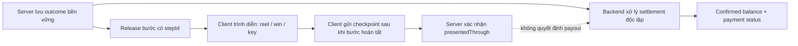
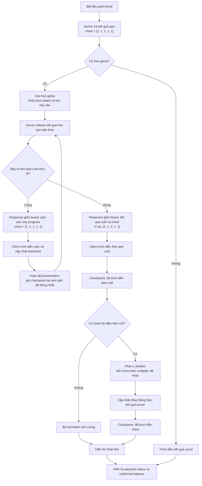
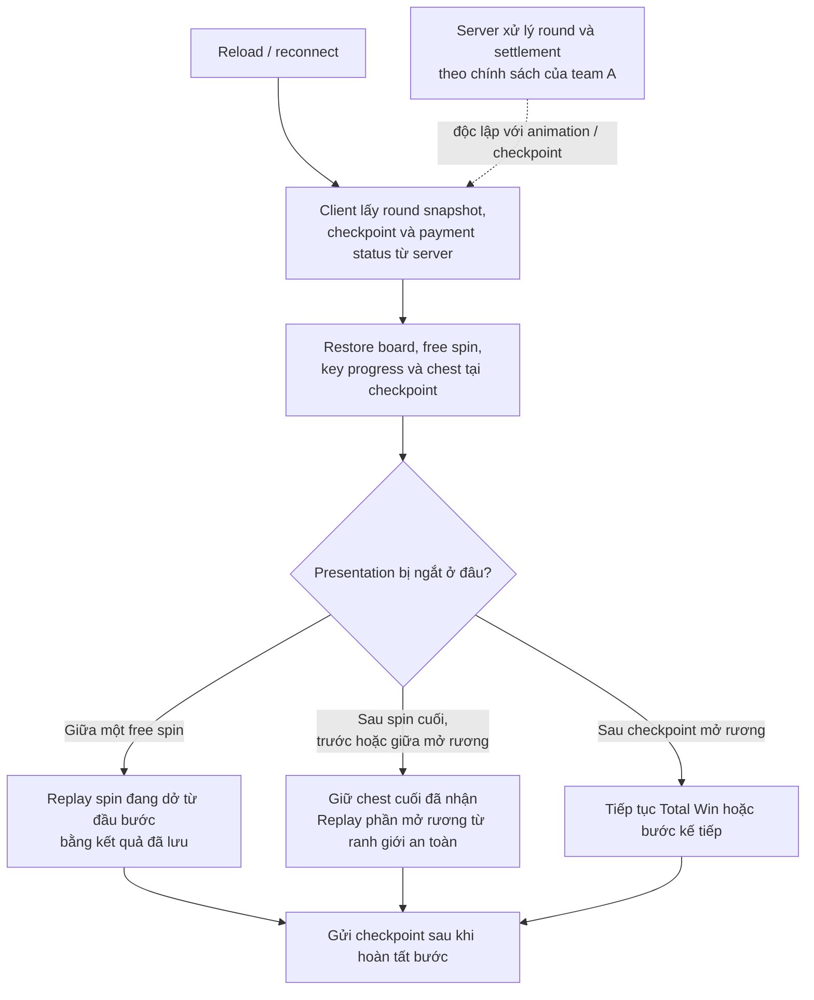
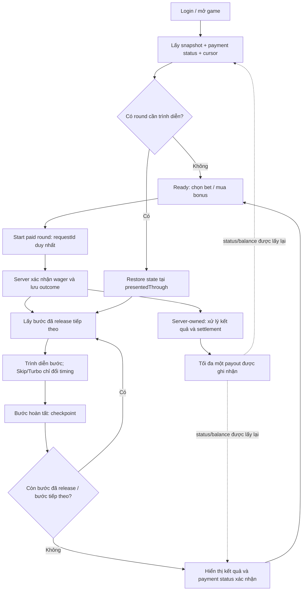

# Đề xuất luồng client: resume round và một lần settlement

Yêu cầu KRW/exponent 0 và draft cập nhật ngày 18/11/2026 nằm trong [BE requirements và API proposal mới](backend-requirements-krw-resume-single-settlement.md). Ví dụ USD/scale 2 bên dưới giữ làm lịch sử thiết kế.

**Trạng thái: đề xuất để review với team A/Yongtae; chưa triển khai và chưa phải API contract đã thống nhất.** Tài liệu tập trung vào client, checkpoint và cách trình diễn. Team A chịu trách nhiệm outcome, wallet, lưu bền vững và xử lý round khi client vắng mặt. Ví dụ dưới đây là dữ liệu giả lập; endpoint, tên trường, enum, số line, symbol mapping và ngữ nghĩa chính xác phải được hai bên xác nhận.

## 1. Quyết định đã thống nhất

1. Reload/reconnect tiếp tục **cùng round và tiến độ đã đạt**, gồm free spin, tổng thắng tích lũy và key/chest. Không chạy lại toàn bộ feature từ scatter trigger; chỉ bước trình diễn chưa hoàn tất có thể chạy lại từ checkpoint an toàn.
2. Có **một lần payout cuối cho toàn bộ paid round**, gồm base win và feature win sau chest/retrigger. Đây là quyết định về số lần settlement, không tự xác định thời điểm credit wallet.
3. Cap là **10.000 × base bet gốc** cho toàn round, kể cả bonus buy; không nhân với giá mua bonus. Backend xác nhận kết quả, số tiền, trạng thái payment và cap.
4. Outcome không thay đổi vì reconnect, skip, turbo, duplicate request hoặc mất response. Request tiến độ không tạo bet/payout mới. Việc bảo toàn payout không được phụ thuộc duy nhất vào việc người chơi quay lại hoặc gửi tín hiệu animation hoàn tất.
5. Hiển thị **thắng đang trình diễn/chưa thanh toán** tách biệt với **confirmed wallet balance**. Nếu backend đã settle trước khi animation kết thúc, client vẫn không được ghi đè confirmed balance bằng số đang đếm trên màn hình.

## 2. Tham khảo và giới hạn

| Nguồn | Dùng để tham khảo | Không nên suy diễn |
| --- | --- | --- |
| [Mock request/response hiện có](milestone-1-api-examples.json), [giải thích](milestone-1-api.md) | `requestId`, snapshot, board, wins, free spins, chest và final feature | Đây là mock in-memory, chưa có checkpoint trình diễn hoặc payment status bền vững. Base win hiện có thể được credit trước feature; không đáp ứng chính sách một payout mới. |
| Log game `n57058` do người dùng cung cấp | Tách `successBet`, `totalWin`, balance, `freeGame` và ticket; free spin tiếp tục dùng bet gốc | Game này quan sát được credit từng free spin. Không áp dụng cách credit đó cho quyết định của Yongtae. Symbol và line của game này cũng không mặc định giống Tavern. |
| [HAR Tavern Drop](tavern-reference-har-analysis.md) | Một `play` trả danh sách event của cả round, rồi có `end-round`; `finalBoardWin` có base feature win và multiplier theo reel | Một mẫu không chứng minh recovery hay retry. Không giả định `end-round` của bản gốc là cơ chế settlement phù hợp với yêu cầu mới. |
| [Compact API đề xuất trước đây](proposed-compact-api.md) | Tham khảo trường dữ liệu nhỏ gọn và minh họa JSON | Phần nói base win được credit riêng là **giả định cũ, không còn phù hợp** với quyết định một payout. Contract trong tài liệu này thay thế giả định đó về mặt đề xuất. |

Mock Tavern hiện tại có 15 line, board 5 × 5, symbol ID dạng chuỗi và cap cấu hình 5.000×. Việc cập nhật client/mock sang 10.000× và đổi logic payout là công việc triển khai riêng, chưa được thực hiện trong tài liệu này.

### Gợi ý mapping từ response tham khảo

| Trường tham khảo | Gợi ý trong contract mới | Ghi chú |
| --- | --- | --- |
| `code` | `code` | `0` thành công; catalog mã lỗi do A chốt. |
| `tnum`, `roundId` | `ticketId`, `roundId` | Phân biệt ID spin và ID paid round xuyên suốt feature. Trong log tham khảo, `roundId` thay đổi qua từng spin; không tự giả định nó là ID của cả feature. |
| `successBet` | `chargedAmount` | Giá trị debit được server xác nhận; free spin không tạo wager mới. Base bet gốc được giữ riêng. |
| `totalWin`, `featureResults.accmWin` | `spinWin`, `accumulatedWin`, `roundAward` | Tách thắng từng bước, tổng feature đang tích lũy và kết quả cuối cả round để tránh hiểu nhầm thành số đã credit. |
| `balance` | `wallet.confirmedBalance` | Chỉ là balance ví đã xác nhận; không cộng số đếm animation vào trường này. |
| `symbol`, `lineWins`, `wildWins` | `board`, `lineWins[].positions` | Đủ thông tin để highlight symbol; phải chốt mapping và indexing. Với log tham khảo, ID 1 có dấu hiệu là Wild và ID 12 là Scatter; không mặc định áp dụng cho Tavern. |
| `freeGame.spins`, `currSpin`, `fgTotalGain`, `fgRemainGame` | `freeGame.total`, `played`, `remaining` | Một biểu diễn nhất quán, có thêm key/chest và cursor presentation để resume. |
| `featureResults.multiplierList` / HAR `finalBoardWin.multipliers` | `chest`, `featureWinBeforeMultipliers`, `featureAward` | `chest` là một mảng multiplier theo reel, mặc định `[1, 1, 1, 1, 1]`. Các cấu trúc tham khảo thuộc hai game khác nhau và không phải cùng một schema. |

Trong log tham khảo, `unit`, `credit` và `domination` cùng xuất hiện; mẫu chỉ có một giá trị `credit`, nên chưa đủ dữ liệu kết luận công thức denomination. Login bằng account ID và token/session như đề xuất trước vẫn cần team A chốt; không nên xem tên endpoint hoặc trường auth trong tài liệu này là quyết định cuối.

## 3. Hai tiến độ khác nhau

- **Outcome/release progress (`releasedThrough`)**: server đã lưu kết quả và cho client truy cập tới bước nào. Không chứng minh animation đã chạy hoặc người chơi đã thấy bước đó.
- **Presentation checkpoint (`presentedThrough`)**: bước cuối mà client đã trình diễn xong **và server đã xác nhận checkpoint**. Checkpoint là cursor logic trên chuỗi bước, không phải frame hay thời gian animation.
- **Settlement state**: trạng thái wallet do backend xác nhận; có thể tiến triển độc lập với presentation. Trình tự credit và trạng thái cuối do team A định nghĩa.

Các cursor dưới đây là **minh họa**. Mỗi round cần một thứ tự đơn điệu và ID bước ổn định. Server có thể đã settle trước khi client xem xong hoặc đã đóng; vẫn phải có đủ dữ liệu để resume presentation. Mỗi snapshot dùng cho resume phải tương ứng với `presentedThrough`, không được mặc định lấy state sau `releasedThrough` nếu giữa hai cursor có bước chưa trình diễn.



### Ranh giới đề xuất

| Bước an toàn | Đánh dấu hoàn tất khi | Snapshot khôi phục cần có |
| --- | --- | --- |
| Base spin / trigger | Board dừng, line/scatter và transition entry đã xử lý đến ranh giới thống nhất | Board, base win, mode, base bet và round ID |
| Một free spin | Board, line win, cập nhật key/chest và retrigger của spin đó đã được trình diễn | `played`, `remaining`, tổng feature trước nhân, từng key theo reel/row, board |
| Chest result | Các multiplier và tổng cuối đã được trình diễn tới ranh giới được chốt | Trạng thái 5 chest, multiplier từng reel, tổng feature trước/sau multiplier, cap |
| Total Win | Màn kết quả kết thúc/được tiếp tục | Round ID, final award và payment status gần nhất |

Nên giữ một free spin là đơn vị checkpoint mặc định. Không checkpoint từng line, từng key hay từng frame. Nếu bị ngắt giữa các animation trong một free spin, replay **spin đang dở đó** từ ranh giới đầu spin, với kết quả đã ghi. Nếu đã trình diễn xong nhưng ACK checkpoint bị mất, chỉ được coi là đã checkpoint sau khi server xác nhận hoặc trả lại trạng thái khi retry/reconnect; ranh giới này phải được khách hàng chấp nhận vì client/server không thể biết chắc người dùng đã nhìn thấy những frame nào.

## 4. Flowchart: `chest` qua từng spin và resume

Sơ đồ này minh họa phương án **một mảng multiplier `chest` trong từng kết quả spin**. Kết quả vẫn do server quyết định; checkpoint và thời điểm release multiplier là phần cần thống nhất với team A.



`chest` luôn có 5 phần tử, theo thứ tự reel. Trước spin cuối dùng giá trị mặc định; ở **spin kết thúc thực tế** (kể cả kết thúc sớm do cap), server trả multiplier cuối cho chest đủ điều kiện. Giá trị `1` không cho biết key nào đã được thu, vì vậy ví dụ vẫn đề xuất `keyMasks` riêng cho resume. `chest` là dữ liệu kết quả, không phải lệnh credit vào wallet.



Ví dụ trên tách checkpoint `last_spin_presented` và `chest_presented` để không phải chạy lại spin cuối khi người chơi đã xem xong spin nhưng chưa xem xong rương. Nếu mất ACK đúng lúc client đã xem xong, resume theo checkpoint cuối **được server xác nhận**; phase/cursor cụ thể phải chốt với A.

## 5. Luồng tổng thể đề xuất



Mũi tên tới settlement là **trách nhiệm server**, không có nghĩa payout chỉ được xử lý sau bước `presentedThrough`. Nếu backend không quyết định toàn bộ outcome ngay từ đầu mà release dần, team A cần xác định cơ chế xử lý phần outcome chưa release khi người chơi rời đi, theo math và chính sách round của họ. Không được coi việc client gửi checkpoint là điều kiện duy nhất bảo toàn payout.

### Trình tự request dự kiến

```mermaid
sequenceDiagram
    participant C as Client
    participant G as Game API (Team A)
    participant W as Wallet / settlement (Team A)
    C->>G: Start round (requestId, game, bet)
    G->>G: Xác nhận wager, lưu round / outcome
    G-->>C: Round ID, bước đã release, snapshot, payment status
    G->>W: Xử lý settlement theo chính sách server
    Note over G,W: Có thể xảy ra trong khi client trình diễn hoặc sau mất kết nối; thời điểm credit cần thống nhất.
    C->>C: Trình diễn bước 1
    C->>G: Checkpoint 1 + xin bước kế (nếu cần)
    G-->>C: ACK checkpoint + dữ liệu bước kế / trạng thái
    C->>C: Trình diễn bước 2
    Note over C,G: Nếu mất kết nối ở bước 2, server vẫn giữ ACK bước 1.
    C->>G: Resume round
    G-->>C: Snapshot tại checkpoint 1 + bước 2 đã lưu + payment status
    C->>C: Trình diễn lại bước 2 từ ranh giới an toàn
    C->>G: Checkpoint 2 + xin bước kế (nếu cần)
    G-->>C: ACK + dữ liệu đã release
```

## 6. Ví dụ đề xuất cho API review

Các ví dụ dùng số nguyên minor unit, giả định scale 2: `100` tương ứng `1.00`; currency/scale do server xác nhận. `baseBet: 100` cho cap `1_000_000` minor unit, tương ứng `10.000,00`. `chargedAmount` có thể lớn hơn base bet khi buy, nhưng không thay đổi cap. Đây là JSON **minh họa thiết kế**, không phải response của mock hiện tại hoặc contract đã duyệt.

### 6.1 Normal spin / bắt đầu round

Mock gốc: [`normalWin` trong milestone-1-api-examples.json](milestone-1-api-examples.json). Mock hiện có `requestId`, `expectedVersion`, `action`, `bet`, `chance`, `state`, `wins` và `spinWin`; **chưa có** versioned event cursor hay payment status.

```json
{
  "requestId": "req-start-001",
  "gameCode": "tavern-drop",
  "action": "spin",
  "baseBet": 100,
  "chance": "standard"
}
```

```json
{
  "code": 0,
  "contractVersion": "draft-1",
  "roundId": "round-001",
  "baseBet": 100,
  "chargedAmount": 100,
  "currency": "USD",
  "amountScale": 2,
  "releasedThrough": 1,
  "presentedThrough": 0,
  "steps": [
    {
      "stepId": 1,
      "type": "base_spin",
      "board": [["A", "K", "Q", "J", "10"], ["A", "K", "Q", "J", "10"], ["A", "K", "Q", "J", "10"], ["K", "Q", "J", "10", "A"], ["Q", "J", "10", "A", "K"]],
      "lineWins": [{ "line": 0, "symbol": "A", "positions": [[0, 0], [1, 0], [2, 0]], "win": 10 }],
      "spinWin": 10,
      "chest": [1, 1, 1, 1, 1]
    }
  ],
  "wallet": { "confirmedBalance": 99900, "paymentStatus": "pending" }
}
```

`line` và vị trí trong ví dụ dùng index từ 0; `board[reel][row]`. Các ID cần theo game config cuối. Balance 99900 là balance **sau trừ wager**, chưa cộng 10. Status `pending` chỉ là nhãn đề xuất; cần team A định nghĩa enum, finality và trường hợp không có payout. Không dùng `releasedThrough: 1` để kết luận client đã trình diễn xong step 1.

### 6.2 Bonus progression và checkpoint

Mock gốc: [`dropEntry`, `resumeBeforeFinalSpin`, `finalFreeSpin`](milestone-1-api-examples.json). Mock đã có `remaining`, `played`, `accumulated`, `chests[].rows`, `collected`, nhưng chưa phân biệt release/presentation và chưa có ACK checkpoint.

Ví dụ client đã trình diễn xong step 18 và muốn xác nhận trước khi lấy bước kế tiếp:

```json
{
  "requestId": "req-progress-019",
  "roundId": "round-002",
  "presentedThrough": 18
}
```

```json
{
  "code": 0,
  "roundId": "round-002",
  "presentedThrough": 18,
  "releasedThrough": 19,
  "steps": [
    {
      "stepId": 19,
      "type": "free_spin",
      "board": [["A", "K", "Q", "J", "10"], ["A", "K", "Q", "J", "10"], ["A", "K", "Q", "J", "10"], ["K", "Q", "J", "10", "A"], ["Q", "J", "10", "A", "K"]],
      "lineWins": [{ "line": 0, "symbol": "A", "positions": [[0, 0], [1, 0], [2, 0]], "win": 10 }],
      "spinWin": 10,
      "chest": [1, 1, 1, 1, 1],
      "freeGameAfter": {
        "total": 10, "played": 5, "remaining": 5, "accumulatedWin": 250,
        "keyMasks": [5, 1, 3, 0, 0], "retrigger": 0
      }
    }
  ],
  "wallet": { "confirmedBalance": 99900, "paymentStatus": "pending" }
}
```

`presentedThrough: 18` trong response là ACK của server. Step 19 đã được server release, **chưa** được xác nhận là trình diễn xong. Mỗi kết quả spin có một mảng `chest` gồm 5 multiplier theo thứ tự reel; ở các spin trước lượt cuối, giá trị hiển thị mặc định là `[1, 1, 1, 1, 1]`. Đến **kết quả free spin cuối**, backend trả multiplier của các chest đủ điều kiện trong cùng mảng này, trước khi client chạy animation mở rương. Snapshot resume cũng cần mảng `chest` tương ứng với bước đã xác nhận; các response chỉ ACK/status không nhất thiết lặp lại board hay chest. Trường `keyMasks` là đề xuất riêng để lưu vị trí key khi resume, không phải một mảng chest thứ hai: mỗi số là bitmask 5 hàng, bit 0 ứng với hàng trên cùng. Ví dụ `5` (`00101`) là đã thu key ở hàng 0 và 2; `31` là đủ 5 key. Client có thể so với snapshot trước để xác định key mới. Vì multiplier `1` không cho biết vị trí key, vẫn cần dữ liệu key hoặc một cơ chế resume tương đương do A xác nhận. Nếu server cho phép các bước không liên tiếp, cần thay cursor số nguyên bằng cấu trúc khác đã thống nhất. Outcome có thể được phát theo batch thay vì một bước mỗi response.

### 6.3 Resume khi ngắt giữa free spin

Ví dụ step 19 đã release nhưng client chưa có ACK presentation cho step đó. `snapshotAtPresented` là state sau step 18, không phải state sau step 19. Client restore snapshot, rồi replay đúng step 19 từ đầu bước; sau đó mới ACK.

```json
{
  "code": 0,
  "contractVersion": "draft-1",
  "roundId": "round-002",
  "releasedThrough": 19,
  "presentedThrough": 18,
  "snapshotAtPresented": {
    "board": [["A", "K", "Q", "J", "10"], ["K", "Q", "J", "10", "A"], ["Q", "J", "10", "A", "K"], ["J", "10", "A", "K", "Q"], ["10", "A", "K", "Q", "J"]],
    "baseBet": 100,
    "chest": [1, 1, 1, 1, 1],
    "freeGame": {
      "mode": "drop", "total": 10, "played": 4, "remaining": 6,
      "accumulatedWin": 240, "keyMasks": [5, 1, 2, 0, 0]
    }
  },
  "steps": [
    {
      "stepId": 19, "type": "free_spin", "spinWin": 10,
      "board": [["A", "K", "Q", "J", "10"], ["A", "K", "Q", "J", "10"], ["A", "K", "Q", "J", "10"], ["K", "Q", "J", "10", "A"], ["Q", "J", "10", "A", "K"]],
      "lineWins": [{ "line": 0, "symbol": "A", "positions": [[0, 0], [1, 0], [2, 0]], "win": 10 }],
      "chest": [1, 1, 1, 1, 1],
      "freeGameAfter": {
        "total": 10, "played": 5, "remaining": 5, "accumulatedWin": 250,
        "keyMasks": [5, 1, 3, 0, 0], "retrigger": 0
      }
    }
  ],
  "wallet": { "confirmedBalance": 99900, "paymentStatus": "pending" }
}
```

Nếu server đã settle trong lúc client offline, response này cần trả `wallet` hiện tại theo dữ liệu xác nhận, dù presentation vẫn ở step 18. Snapshot không được làm lộ kết quả tương lai nếu team A không cho phép; dữ liệu của bước chưa ACK vẫn phải ổn định khi được cấp lại.

### 6.4 Free spin cuối, chest và kết quả

```json
{
  "stepId": 30,
  "type": "free_spin",
  "board": [["A", "K", "Q", "J", "10"], ["K", "Q", "J", "10", "A"], ["Q", "J", "10", "A", "K"], ["J", "10", "A", "K", "Q"], ["10", "A", "K", "Q", "J"]],
  "spinWin": 0,
  "chest": [2, 1, 3, 1, 1],
  "freeGameAfter": {
    "total": 10, "played": 10, "remaining": 0,
    "accumulatedWin": 600, "keyMasks": [31, 5, 31, 0, 0], "retrigger": 0
  },
  "featureWinBeforeMultipliers": 600,
  "featureAward": 3600,
  "baseWin": 10,
  "roundAward": 3610,
  "cap": 1000000,
  "capped": false
}
```

Ví dụ không cap: `600 × 2 × 3 = 3600`; cộng base win `10` thành round award `3610` (`36.10`). `chest` chính là danh sách multiplier trong response của free spin cuối, không cần thêm mảng multiplier trùng lặp. Client trình diễn spin cuối trước, sau đó dùng mảng đã nhận để chạy `4_finalwin`, mở các rương đủ điều kiện và đếm tiền. Trạng thái key/mở khóa được xác định từ `keyMasks` hoặc cơ chế tương đương do team A thống nhất. Giá trị mặc định `1` ở các spin trước không khẳng định multiplier cuối; kết quả phải được server lưu ổn định và chỉ release cho client theo checkpoint đã thống nhất. Nếu free game kết thúc sớm do cap, **spin kết thúc thực tế** được xem là spin cuối. Khi không có rương đủ điều kiện, `chest` vẫn là `[1, 1, 1, 1, 1]` và client bỏ animation mở rương. Đối với cap, server cần cung cấp amount thực tế và quy tắc hiển thị trung gian được thống nhất.

Kết quả chest đến cùng free spin cuối không có nghĩa hai animation bắt buộc dùng chung checkpoint. Để resume sau khi đã xem xong spin cuối nhưng chưa xem xong mở rương, đề xuất bổ sung phase/cursor presentation riêng cho ranh giới `last_spin_presented` → `chest_presented`; snapshot cần giữ mảng `chest` cuối cho tới khi phần trình diễn liên quan hoàn tất. Kiểu cursor và cách biểu diễn phase này cần chốt với A.

### 6.5 Completion và payment status

Ví dụ response dưới đây chỉ đề xuất cách phân biệt outcome và tiền thật sự credit; **thời điểm chuyển từ pending sang paid và semantics của `roundStatus` phải do team A chốt**.

```json
{
  "code": 0,
  "roundId": "round-002",
  "roundStatus": "completed",
  "presentedThrough": 30,
  "result": { "roundAward": 3610, "capped": false },
  "wallet": {
    "confirmedBalance": 103510,
    "paymentStatus": "paid",
    "creditedAmount": 3610,
    "settlementId": "settlement-002"
  }
}
```

Với balance sau wager `99900`, sau khi server xác nhận credit `3610` thì balance là `103510`. `pending` không cho phép UI suy ra tiền đã được credit; `paid` chỉ hiển thị khi backend xác nhận. Trường hợp thất bại, retrying, zero win và trạng thái không xác định cần team A định nghĩa rõ. Request lấy status/checkpoint không được tự tạo thêm một payout.

## 7. Tần suất request và retry

Đề xuất ưu tiên giảm round trip **mà không đánh đổi recoverability**:

| Tình huống | Tần suất đề xuất | Ghi chú |
| --- | --- | --- |
| Mở game / reconnect | Một lần lấy snapshot, cursors, các bước cần replay và payment status | Có thể phân trang/batch event nếu round lớn; không replay toàn bộ feature. |
| Bắt đầu paid round | Một request với `requestId` ổn định | Chỉ thao tác này mới có thể tạo wager, tùy contract A. |
| Trình diễn free spins | Nếu A release từng bước: tối đa một request ở ranh giới free spin, **gộp ACK bước trước + lấy bước sau** | Nếu A đã release batch/cả round, có thể checkpoint theo batch được đồng ý; không gọi từng frame/line/key. |
| Chest / total | Checkpoint tại ranh giới đã thống nhất, có thể gộp với request kế tiếp | Không gọi để thực hiện payout; completion UI và payment là hai trạng thái khác nhau. |
| Payment status | Lấy cùng response hiện có hoặc refresh khi cần xác nhận | Poll/push, khoảng cách và timeout do team A thống nhất; không ngầm polling mỗi frame. |

Request ID stable cần được giữ qua timeout và retry; cùng ID + cùng payload trả cùng kết quả, cùng ID + payload khác bị từ chối. Checkpoint phải monotonic, an toàn khi gửi trùng, và không vượt quá bước đã release. Nếu mất ACK checkpoint, reconnect/retry lấy ACK server; nếu server chưa ghi nhận thì replay từ ranh giới đã xác nhận. Đa tab/thiết bị và xung đột version cần contract A quy định; không tự động tạo wager mới khi reconciliation chưa xong.

## 8. Mapping hiện tại và công việc chưa làm

| Thành phần | Hiện tại | Cần cho hướng mới |
| --- | --- | --- |
| Client transport | `GET /api/session`, `POST /api/command` | Adapter cho contract version, round lookup, step release, checkpoint, status và lỗi của team A. |
| Pending request | Lưu request vào local storage trước khi gửi; retry cùng ID trong session còn sống | Nhận diện round và checkpoint sau reload; xử lý kết quả server đã commit nhưng response/ACK bị mất. Local storage không phải nguồn sự thật duy nhất. |
| Presentation | Có `presenting` phase, skip/turbo và free spin từ mock | Phân biệt bước server release với bước trình diễn xong; snapshot ở cursor trình diễn và quy tắc replay an toàn. |
| Wallet | Mock credit base win và feature award riêng | Một settlement toàn round, cap 10.000× base bet; payment status/balance xác nhận từ A. Không sửa wallet client-side. |
| Lưu trữ | Mock session và receipt trong RAM | Team A chịu trách nhiệm durable result, recovery và settlement độc lập với client. |

## 9. Cần thống nhất với team A

1. **Outcome/release:** outcome được xác định toàn bộ từ đầu, hay server release dần? Nếu release dần và client rời đi, server hoàn tất/xử lý round thế nào mà vẫn bảo toàn payout?
2. **Checkpoint:** danh sách ranh giới, dạng cursor, ACK gộp với fetch tiếp theo, cách xử lý mất ACK, retention, nhiều thiết bị/tab, và ai có quyền tiến cursor.
3. **Settlement:** enum và finality của payment status, một payout bao gồm base + feature, zero-win, thất bại/retry và cách truy vấn receipt; trigger credit và thời điểm balance hiển thị.
4. **Amounts/math:** currency/scale, tính cap trên base bet, làm tròn, retrigger và intermediate display khi cap, cũng như các amount thực tế đã debit/credit.
5. **Event contract:** game code, version, mapping symbol, định dạng board/payline, biểu diễn chest và khả năng replay; giới hạn payload, batch, sequencing và giữ kết quả khi session/token hết hạn.
6. **Tần suất/API:** start, resume, checkpoint/next, status; API có trả toàn bộ outcome sớm hay chỉ phần đã release; nếu toàn bộ outcome đã được lưu sẵn thì xác định quyền truy cập các phần chưa trình diễn.

## 10. Tiêu chí xác nhận chung

- Reload giữa free spin khôi phục checkpoint trước bước đó và replay cùng kết quả; các spin đã ACK không chạy lại.
- Mất response cho wager, checkpoint hoặc status; retry cùng ID không tạo wager/payout thứ hai và không đổi outcome.
- Đóng client trước khi xem xong vẫn không làm mất outcome/winnings; server xử lý round theo chính sách team A mà không cần animation-complete.
- So sánh số thắng đang hiển thị với balance đã xác nhận trước, trong và sau settlement; không trình bày pending win như tiền đã credit.
- Test no-win, normal win, trigger, retrigger, nhiều chest, không chest, cap theo base bet, buy bonus, skip/turbo, reconnect và nhiều tab/thiết bị theo contract được duyệt.
