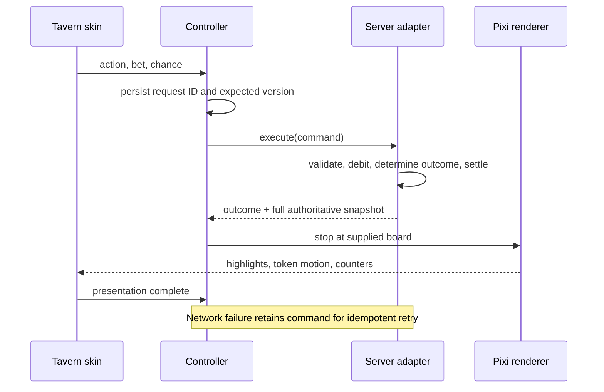

# Template architecture

See the [framework flowchart and v1 game config](framework-flow.md).

## Ownership

- `src/framework/domain/contracts.ts`: shared snapshots, commands and outcomes. Boards are `[reel][row]`; money uses integer minor units.
- `src/framework/domain/rules.ts`: reusable payline evaluator, unique-row chest collection and capped feature settlement. Imported by the fake server; not by the client view.
- `src/framework/controller.ts`: loading, ready, pending, presenting and recovery phases. Saves the pending command before sending; retries preserve its request ID and expected version.
- `src/framework/transport/http.ts`: HTTP adapter implementing `GameTransport`. A real provider adapter can implement the same interface.
- `src/framework/presentation/board.ts`: Pixi reel motion, masks, highlights and collection particles. `board.start(turbo)` uses the configured motion, dimensions and timing. Skins can also pass an explicit motion.
- `src/framework/session.ts`: composes a controller and Pixi board for a game definition, transport, symbol factory, and storage.
- `src/framework/presentation/assets.ts`: resolves public URLs and loads textures through the shared Pixi asset cache.
- `src/framework/presentation/audio.ts`: plays configured audio clips with one mute control and cached decoding.
- `src/framework/game-config.ts`: checks the v1 JSON configuration before boot.
- `src/games/catalog.ts`: shares registered configurations between the browser and the mock server.
- `src/games/tavern/game.config.json`: board, symbols, paylines, reel timing and provisional math.
- `src/games/tavern/skin.ts`: maps mock symbol IDs to the reference art. The IDs remain stable for existing outcome fixtures, even where the reference art depicts a different object.
- `src/games/tavern/mascot.ts`: plays the Spine 4.2 idle and win animations. It loads on desktop without delaying the reel board.
- `src/games/reuse/game.config.json`: a 3 × 3 example using the shared Basic skin, renderer, session and mock backend with a separate cookie.
- `src/games/tavern/app.ts`: Tavern-specific scene composition, HUD, bonus modals and controls.
- `server/mock-game.ts`: fake game backend. Owns wallet debit/credit, generated outcomes, free spins, retriggers, chest awards and round cap. In-memory only.
- `server.js`: same-origin HTTP API, cookie-based demo sessions and production static assets.

## Outcome flow

The client never decides the payout or modifies server balance. A feature remains attached to one paid round. Its bet is locked. Base winnings are credited once; only the capped feature difference is credited at completion. Chest identity multipliers are 1 for locked reels; unlocked multipliers multiply, not add.

## Create another game

1. Copy the [3 × 3 configuration](../src/games/reuse/game.config.json). Give the game a unique ID, query and API path.
2. Register the validated config in `src/games/catalog.ts`. The Basic skin handles the board and payline UI, and the mock server registers the API route.
3. For custom art, supply a `SymbolFactory` and game skin. For different mechanics, supply a server adapter and feature presentation.

Reel dimensions are configuration-driven; the Tavern HTML/CSS skin is intentionally laid out for five reels. A different layout needs its own CSS grid and chest layout. This is a reusable project foundation, not a finished generic SDK for arbitrary game mechanics.

## Tavern asset replacement

Keep the Spine binary, atlas and relative texture pages together. The mascot expects `idle` and `win`. The symbol mapping and transparent margins are recorded in `skin.ts`. The chest artwork in `theme.css` uses atlas coordinates. Update those references together when changing atlases.

The five cue clips were cut from `td_sounds.ogg` using offsets in `td_sounds.json`. The cue keys are `pc_shared_reel_start`, `pc_shared_reel_stop_4`, `pc_shared_win_line_1`, `td_fs_intro_start`, and `td_mult_win_chest_open_0` in start, stop, win, entry, and chest order. The game loads each short clip as needed.

## Run and deploy

Node >=22.18 required for native TypeScript stripping in the fake API. `npm ci`, `npm run dev`; Vite proxies `/api` to port 4000. `npm run build && npm start` serves the bundled client plus fake API on `$PORT` (default 4000).

Railway uses its normal dependency-install phase, `npm run build`, then `npm start`. Do not add another `npm ci` to the Railway build command: it previously conflicted with the builder's mounted dependency directory.

A static-only GitHub Pages deployment cannot run the mock API. Use Railway or another Node host for this version. Demo sessions and receipts are memory-resident and reset on process restart; multi-instance/durable recovery is not implemented. Use a durable session/ledger service for production.
