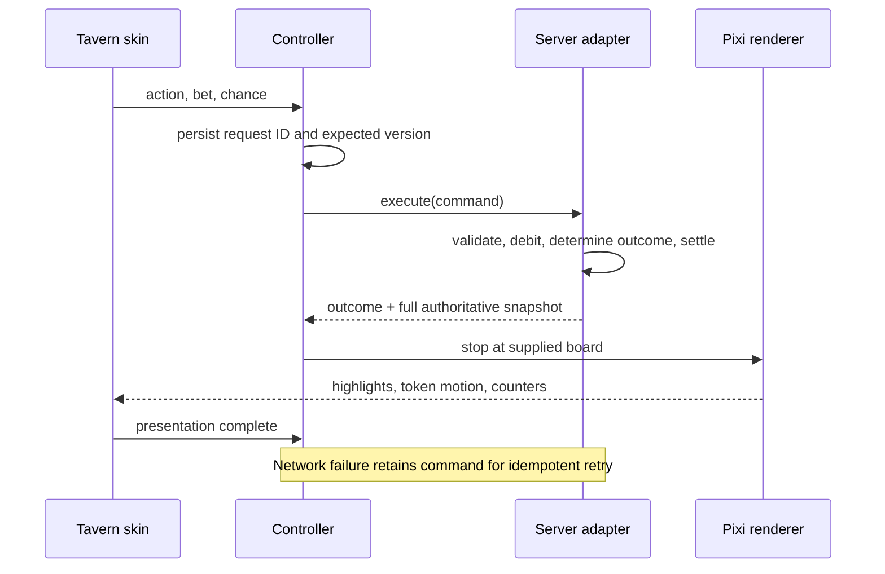

# Template architecture

## Ownership

- `src/framework/domain/contracts.ts`: shared snapshots, commands and outcomes. Boards are `[reel][row]`; money uses integer minor units.
- `src/framework/domain/rules.ts`: reusable payline evaluator, unique-row chest collection and capped feature settlement. Imported by the fake server; not by the client view.
- `src/framework/controller.ts`: loading, ready, pending, presenting and recovery phases. Saves the pending command before sending; retries preserve its request ID and expected version.
- `src/framework/transport/http.ts`: HTTP adapter implementing `GameTransport`. A real provider adapter can implement the same interface.
- `src/framework/presentation/board.ts`: Pixi reel strips, masks, stop timing, highlight paths and collection particles. Symbol factory injection keeps artwork out of the board renderer.
- `src/framework/presentation/audio.ts`: replaceable audio adapter with procedural placeholder cues.
- `src/games/tavern/definition.ts`: board, symbols, paylines and explicitly provisional math values.
- `src/games/tavern/skin.ts`: original code-drawn symbol art. Replace the symbol factory with sprites or Spine containers without changing reel motion.
- `src/games/tavern/app.ts`: Tavern-specific scene composition, HUD, bonus modals and controls.
- `server/mock-game.ts`: fake game backend. Owns wallet debit/credit, generated outcomes, free spins, retriggers, chest awards and round cap. In-memory only.
- `server.js`: same-origin HTTP API, cookie-based demo sessions and production static assets.

## Outcome flow

The client never decides the payout or modifies server balance. A feature remains attached to one paid round. Its bet is locked. Base winnings are credited once; only the capped feature difference is credited at completion. Chest identity multipliers are 1 for locked reels; unlocked multipliers multiply, not add.

## Create another game

1. Copy `src/games/tavern` to a new skin directory. Provide a definition with unique symbol IDs, valid line paths, initial board and a supported bet list.
2. Implement a `SymbolFactory` that returns a persistent Pixi container and a `set(id)` function. Load licensed sprites/Spine assets here. The board handles movement, masking and supplied outcomes.
3. Compose the game's HUD and feature presentations in its app module; wire `GameController` and a `GameTransport` adapter. Update `src/main.ts` to select the app.
4. Supply the server adapter or provisional mock configuration. Keep certified math and actual settlement on your game server. The current Tavern/Drop command contract is a first-game feature module, not a universal protocol for every future slot mechanic.
5. Add fixture-driven tests for each win and feature state. Confirm real server contracts, approved rules and final artwork separately.

Reel dimensions are configuration-driven; the Tavern HTML/CSS skin is intentionally laid out for five reels. A different layout needs its own CSS grid and chest layout. This is a reusable project foundation, not a finished generic SDK for arbitrary game mechanics.

## Run and deploy

Node >=22.18 required for native TypeScript stripping in the fake API. `npm ci`, `npm run dev`; Vite proxies `/api` to port 4000. `npm run build && npm start` serves the bundled client plus fake API on `$PORT` (default 4000).

Railway uses its normal dependency-install phase, `npm run build`, then `npm start`. Do not add another `npm ci` to the Railway build command: it previously conflicted with the builder's mounted dependency directory.

A static-only GitHub Pages deployment cannot run the mock API. Use Railway or another Node host for this version. Demo sessions and receipts are memory-resident and reset on process restart; multi-instance/durable recovery is not implemented. Use a durable session/ledger service for production.
