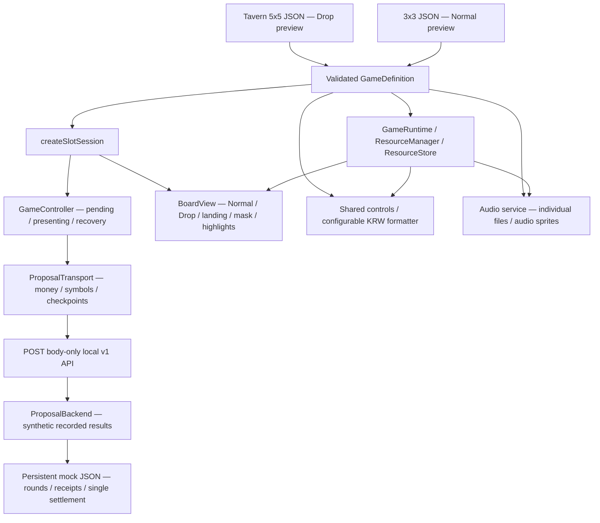

# M1 shared architecture

Both examples below run the same TypeScript/PixiJS core. Tavern's full custom scenes, original reference assets and animation viewer are deliberately outside this public M1 runtime. Bonus/recovery mechanics are exercised by the synthetic API examples and tests, not by a second complete game.

| Area | Exported module | Demonstration/evidence |
| --- | --- | --- |
| Configuration | `src/framework/game-config.ts`, schema, game JSON | Different board dimensions, symbols, paylines, speeds and spin types |
| Resources | `resources`, `remote`, `app/game-runtime.ts` | Bundle ordering, deduplication, progress, ownership and retry tests; placeholder preview has no remote asset dependency |
| Slot/session | `slot-core`, `controller.ts`, `session.ts`, `domain` | Both previews use the same session/board; synthetic rules are isolated from presentation |
| Network/recovery | `network`, `transport/proposal.ts` | Lost-response, duplicate, restart, checkpoint and final-settlement tests |
| Audio/UI | `audio`, `ui`, `presentation/audio.ts` | Reusable file/sprite cue support and controls/formatting; preview is intentionally silent |
| Presentation | `presentation/board.ts` and helpers | Drop 5x5 and Normal 3x3; configurable landing and force-stop policies |

fw-pixi follows shared app/resource/network/core boundaries; it is not a packaged monorepo SDK. In-place game switching/disposal, arbitrary third-party game onboarding and production wallet integration are not M1 acceptance claims.

See [acceptance checklist](milestone-1.md), [API field guide](milestone-1-api.md) and [asset verification](milestone-1-asset-spec.md).

## Add another configuration

Run `npm run game:new -- coral-slot "Coral Slot"`. Edit `src/games/coral-slot/game.config.json`: reels/rows, symbols, lines, bets, currency and Normal/Drop timings. The scaffold registers a basic skin in the catalog. Use `npm run game:build -- coral-slot` and `npm run game:start -- coral-slot` for a standalone mock build. Custom presentation is an adapter above the shared controller/board/resource services; do not put a game's symbols or payout logic into the shared renderer. Synthetic rules must be replaced by recorded server results for production.
